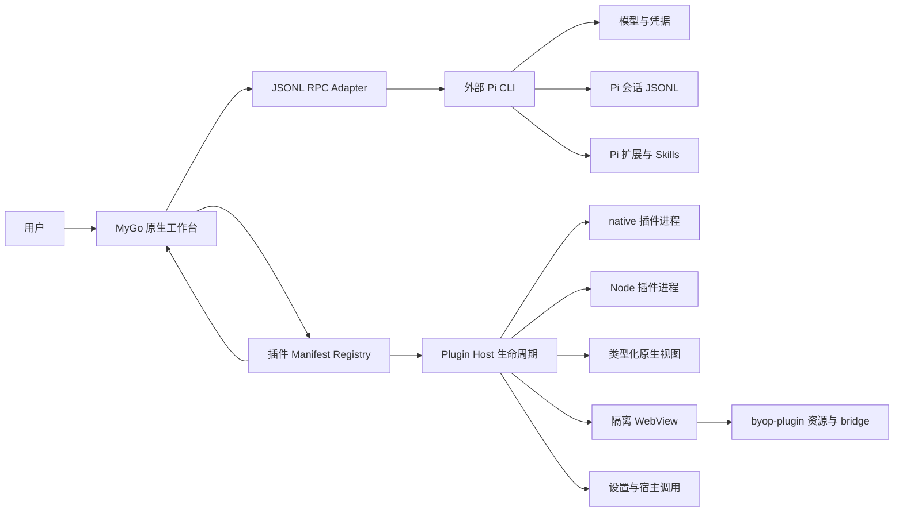

# BYOP

**Build You Own Pi**（BYOP）是一个基于 [MyGo](https://github.com/egoist/mygo) 原生 UI 的多插件工作台外壳，通过 JSONL RPC 调用单独安装的 [Pi CLI](https://github.com/earendil-works/pi)。

当前版本 0.15.0：新增可安装的轻量表格插件，支持本地记录编辑、筛选、固定上下文发送到 Agent 和历史撤销；Pi 会话自动加载插件扩展，使用插件独立 SQLite 数据目录。见 [P15b 验证记录](docs/P15b-validation.md) 和 [插件说明](plugins/lightweight-table/README.md)。P14 已完成统一深色材质层级，壁纸作为根背景，导航玻璃继续直接采样壁纸；阅读区保持不透明深底，Composer、卡片、任务栏和浮层使用分层表面与一致的玻璃边缘。见 [P14 验证记录](docs/P14-validation.md)。P13b 的窗口拖动、侧栏调宽和列表间距继续保留，见 [P13b 验证记录](docs/P13b-validation.md)。P13 深色液态玻璃主题已加入壁纸、导航透明度、模糊和边缘折射可调，高对比与减少透明度回退规则保持不变；具体证据和限制见 [P13 验证记录](docs/P13-validation.md)。P12 完整界面、BYOP Radix 产品 token、分组设置与模型渠道流程继续保留。产品字号只使用 12/14/18 px，正文与代码为 14 px；可见边框为 0.5 px，必要过渡为 250 ms ease-out。Liquid Glass 只用于 chrome、导航和必要浮层，阅读区与 Composer 背景不透明。主题、语言、会话整理、发送方式、导航、任务栏、工作区、最近 Pi 会话关联、草稿与迁移偏好保存在 `<BYOP_CONFIG_DIR 或 ~/.byop>/preferences.json`。轻量表格已按明确授权进入实施；其他功能插件继续暂停。BYOP 不内置 Pi SDK、不直接改写 Pi 会话 JSONL，也不复制模型凭据。


## 当前能力

- MyGo 原生窗口与按插件视图懒创建的隔离 WebView；
- BYOP Radix 产品 token 提供语义色、材质角色、间距与圆角；深色阅读区、Composer、抬升卡片和玻璃浮层分别消费同一组产品 token；字号仅 12/14/18 px，正文和代码 14 px，标题 18 px；可见边框 0.5 px；
- Chat、Plugins、Automations、Settings 导航；
- Settings 顶部提供跟随系统、English 与简体中文；切换后原生界面、窗口标题、插件清单显示文字和现有 WebView 立即刷新，无需重启；
- 宿主界面文字来自 `locales/<tag>.json`，新增语言只需复制源语言文件、翻译、重新生成访问器并构建；
- Light、Dark、System 三种主题；
- 对比度可跟随系统、固定标准或增强；增强主题使用单独的高对比度 palette，并同步到插件 WebView；
- 动效可跟随系统、固定标准或减少；减少动效时状态文字保持静态，不启动持续重绘；
- 必要界面过渡统一为 250 ms ease-out；跟随系统减少动态或固定减少动效时为 0 ms；
- 默认收起的右侧任务栏；
- 顶栏将导航栏与任务栏开关合并为单个分组，支持 `⌘B` / `Ctrl+B` 与 `⌘⌥B` / `Ctrl+Alt+B`；
- 偏好持久化到 `<config>/preferences.json`，环境变量 `BYOP_THEME`、`BYOP_TASKS`、`BYOP_NAV`、`BYOP_WORKSPACE` 优先于文件；
- Settings Migration 只读扫描旧桌面版本、localStorage 与 Pi scheduled-task 计数；旧主题、工作区、最近会话关联、草稿和兼容偏好经预览后显式导入；
- 旧 Pi 会话按 header 的 ID 和 canonical workspace 关联；不复制会话正文、凭据或模型配置；
- 旧字号、sidebar scale、宽度等值保存在 `legacy` 区，不改变 BYOP 的 14 px 正文和默认任务栏状态；
- 外部 `pi --mode rpc` 进程适配器，默认持久化会话；`BYOP_PI_EPHEMERAL=1` 时使用 `--no-session`；
- `get_state` 握手、`prompt` 发送、流式 `message_update`、最终 `message_end`；
- 只读扫描 Pi 当前工作区 session 目录，显示最近 50 条中的前 8 条；展开后最多显示 16 条并可滚动；
- Chat 导航支持新建会话和切换会话；运行或压缩中拒绝切换；切换后重建 user、assistant 和 tool 时间线；
- 会话区按 Pinned、Sessions、Later、Archived 分区；支持置顶顺序拖拽、右键整理、归档与恢复，以及 8 秒内撤销；
- Later 到期后回到 Sessions 并显示 accent 圆点；打开会话后清除 BYOP 侧整理状态，Pi 会话文件始终不变；
- 连接、创建或切换会话后加载可用模型和 thinking levels；模型 Picker 按渠道分组，同一渠道内的同名模型聚合为容量 family，行内使用 DeepSeek、Claude、Qwen 或中性品牌图标，并始终显示当前变体的 Model ID；
- composer 模型控件按内容展开，显示完整模型名、渠道与已知容量；同一 family 有至少两个已知容量时提供独立上下文 Picker，思考强度使用 BYOP 的 native 控件；模型、上下文、思考和快速模式按当前会话在进程内保存；
- 按 `toolCallId` 关联 `tool_execution_start/update/end`；
- 原生会话时间线按“文字 → 工具 → 文字”的真实顺序保留内容块；
- `tool_execution_start/update/end` 按 `toolCallId` 原位更新，不改变工具卡位置；
- Chat 使用 Onevra transcript primitives 渲染时间线，并由 BYOP token wrapper 统一产品视觉；Composer 背景不透明，Glass 只用于 chrome、导航和必要浮层；
- 正常完成的轮次会以独立、无会话、无工具的 Pi one-shot 进程生成一条后续消息建议；默认显示为 ghost text，也可在 Settings 切换为输入框上方的卡片；
- 建议只提供 `Tab` / `Use` 采纳和 `Esc` / dismiss 关闭，不会自动发送；采纳后清空输入框会重新显示，发送、新一轮、会话切换和关闭都会取消或移除旧建议；
- 连续工具合并为可折叠的活动组，运行中显示最新动作，完成后显示“Ran N tools”；
- 运行中显示“Working · 耗时”，结束后折叠为“Worked for 耗时”，保留最终回复可见；
- 工具详情使用等宽文本，展示长参数、结果或实时输出和状态耗时；
- 运行中工具自动展开，完成、失败、取消或中断后自动折叠；
- Running、Completed、Failed、Cancelled、Interrupted 五种工具状态；
- 多个工具保留各自时间线位置，右侧任务栏显示最新运行或最近活动的工具；
- Stop、进程退出和重连分别把未完成工具标记为 Cancelled 或 Interrupted；
- 以 `agent_settled` 作为真实运行完成信号；
- Stop 使用 `clear_queue → abort`，并用 `agent_settled(aborted:true)` 确认结果；
- 运行中可继续编辑并发送；默认排队或插话可由 Settings 选择，`Enter` 使用默认方式，`⌘Enter` / `Ctrl+Enter` 使用相反方式；
- 运行中发送沿用当前 `activeRequest` 和 `runID`，不创建新的本地轮次；队列条最多显示 3 条并提供清空队列；
- 重试等待中的 Stop 先发送 `abort_retry`，再清空队列并中止当前运行；
- 订阅 `queue_update`，在任务栏显示 steering 与 follow-up 队列数量；
- 订阅 `compaction_start/end`，显示 manual、threshold、overflow 压缩状态及压缩前后 token 估算；
- 订阅 `auto_retry_start/end`，显示重试次数、上限、倒计时和最终错误；
- 区分 `agent_end(willRetry)` 与 `agent_settled`，前者不会提前关闭当前轮次；
- provider 错误和失败重试保留在临时运行诊断，不进入永久助手消息块；
- `extension_error` 与 JSONL 协议错误分开显示，并记录扩展文件、事件和错误摘要；
- 进程退出、协议错误、请求超时、重连隔离和窗口关闭清理；
- 固定 20 px 导航图标槽位，展开与收起状态保持左边缘对齐；
- 扫描 `~/.byop/plugins` 与 `<cwd>/.byop/plugins`，也可通过 `BYOP_PLUGINS_DIR` 指定一个或多个目录；
- 严格解析 schema 1 `plugin.json`，拒绝未知字段、尾随 JSON、超过 1 MiB 的清单和不安全 entry 路径；
- 检查宿主版本 `0.9.0` 与 Plugin API `1` 兼容性；
- 插件可通过可选 `l10n` 目录把 manifest 和插件视图里的 `%key%` 解析为当前语言；先查当前语言，再回退英文，最后保留原字符串；
- 标记插件 ID、跨插件贡献 ID 和同插件内重复贡献 ID；
- Plugins 页面支持搜索、空状态、问题提示、重新扫描，以及 navigation、command、view、task panel、setting 和 WebView 元数据预览；
- native 与 Node 插件按声明的 `onCommand:<id>`、`onView:<id>` 或 `lazy: true` 懒启动；两者都拒绝越出插件目录的 entry（含符号链接），native 还要求可执行文件，Node 只接受 `.js`、`.mjs`、`.cjs`；
- Node runtime 使用 `--permission`，按 `files`、`network` 和 `process` 能力增加文件系统、网络与子进程许可；路径先解析为真实绝对路径；
- 插件 `initialize` 收到合并后的设置与完整 capabilities；活动中的插件保存设置后收到 `settingsChanged`；
- 插件可以向宿主请求主题、设置、工作区与文件读写，显示通知、更新任务卡和刷新当前视图；宿主按清单与 capabilities 拒绝越权请求；
- 设置页按插件声明生成 string、number、boolean、select 字段，保存到 `~/.byop/plugin-settings/<pluginId>.json`，目录权限 `0700`、文件权限 `0600`；
- 主视图使用类型化 block 模型渲染 heading、text、notice、keyValue、list、code 和 button；未知 block 显示为 Unsupported block，未声明命令的按钮禁用；
- 带 navigation 的 native view 或 WebView 进入侧栏 `PLUGINS` 区域；插件页面支持打开任意主视图，secondary 视图只在卡片中列出；
- 插件卡片以身份、生命周期状态、简短说明和主操作为主；runtime、权限、宿主调用、完整契约和运行结果放在详情中，并提供 Open view 与 Deactivate；
- 视图在 UI goroutine 外渲染，支持 Refresh、Retry、自动刷新、错误态和重新扫描后的失效回退；
- 每个 WebView 视图最多复用一个 MyGo `ui.WebView` 实例；通过 `byop-plugin://<pluginId>/<relative-path>` 读取插件根目录内的静态文件，只允许同插件导航，并拒绝 `window.open` 与所有浏览器权限；
- WebView 响应使用 5 MiB 文件上限、`nosniff`、`no-store` 和严格 CSP；只有 `network: true` 时把 `connect-src` 放宽为 `https:`；
- WebView bridge 通过 `mygo.CallerPage(ctx)` 反查唯一的插件视图，不信任页面传入的插件 ID；每次调用都重新检查当前 URL、插件注册状态、视图声明以及清单/根目录指纹；
- `host.*` 与 Node/native 插件共用同一套能力检查；`plugin.postMessage` 限制 64 KiB，并按插件限制并发；
- WebView 提供 Light/Dark CSS 变量、运行时主题事件和 12/14/18 px 字号，正文与代码为 14 px；主题包含 `onAccent`、`dangerText`、`warningText`、`successText` 和 `focus`，高对比或减少透明度时使用不透明 Radix 实色；页面可调用 `host.getLocale`，读取 `window.byop.locale`，并用 `window.byop.onLocale` 订阅运行时语言变化；加载或渲染进程失败时显示原生错误卡，可 Reload 或返回 Plugins；
- 重新扫描、停用、进程停止和关闭窗口时销毁相关 WebView；离开页面只隐藏实例；
- 重新扫描和关闭窗口前会停用全部插件进程；插件意外退出时标记为 failed 并保留 stderr 尾部摘要。
- 插件可声明 manual、once、scheduledLoop 和 sessionLoop 自动化；自动化命令必须同时是插件已声明的 command，并出现在 `activation.events` 的精确 `onCommand:<command>` 项中；
- Automations 页面显示注册项、kind 与规则、READY / PAUSED / AUTO-PAUSED / RUNNING 状态、连续失败数和最近 5 次运行；
- Run now 只允许已启用且未在运行的自动化；调用超时按 `timeLimit` 记录，其他插件错误按 `pluginError` 记录；
- 每次运行先向 `runs/<pluginID>/<automationID>.jsonl` 追加 `running`，完成后原子重写 active 文件为最终记录；每项最多保留 200 条，较早记录追加到 `archive/<pluginID>/<automationID>.jsonl`，`state.json` 使用原子重写；启动时把未完成运行标记为 `aborted/interrupted`；
- JSONL 按行解析，坏行产生可见 warning 后跳过；整个 run 文件都无法解析时先转为 `.corrupt-<UTC timestamp>.jsonl`，损坏的 `state.json` 也先转为 `.corrupt-<UTC timestamp>.json`，再写新文件；
- 连续 5 次失败自动暂停；用户可暂停和恢复，恢复会清除失败计数；sessionLoop 在应用重启后自动暂停并显示 `App restarted`；
- 插件因重扫、停用或窗口关闭而主动停止时，待处理运行记录为 `aborted/stopped`，不计入连续失败数；
- P7 没有定时 scheduler、ticker 或运行计时刷新，P12 也不新增 Loop 调度器或解析 `/loop`；所有运行都由 Run now 手动触发，`trigger` 固定为 `manual`。既有登记、运行历史、暂停/恢复和失败自动暂停行为保留。

插件安装与附件仍属于后续阶段。模型、上下文与 Thinking chip 在运行、压缩或会话操作期间切为只读；模型元数据未加载时，模型 chip 仍为只读。Pi 1.4.0 未开放快速模式 RPC，因此不渲染闪电开关。P6a 已提供会话历史与切换。

**Plugin development hold：** P5 后插件平台功能已就绪，但在 Lex 明确要求前不开发功能插件。Library 与 Document 是冻结候选，不属于当前页面或导航入口；当前入口为 Chat、Plugins、Automations、Settings。`examples/` 只放契约 fixture。

## 架构



职责边界：

| 对象 | 所有者 |
|---|---|
| 窗口、导航、主题、任务栏 | BYOP |
| Settings | BYOP；分类导航、统一搜索与分类控件在页面主体，About 位于底部 |
| 插件清单、目录扫描、贡献点和冲突状态 | BYOP |
| 模型、provider、OAuth、凭据 | Pi |
| 会话 JSONL、扩展、Skills、工具执行 | Pi；BYOP 只读扫描列表，所有会话变更走 RPC |
| 模型目录、thinking levels、provider 凭据 | Pi；BYOP 只保存当前选择的可显示元数据 |
| native / Node 插件生命周期、命令和视图 | BYOP Plugin Host（P5） |
| 插件设置、宿主调用和能力检查 | BYOP Plugin Host（P5） |
| WebView 静态资源、导航隔离、bridge 与生命周期 | BYOP Plugin Host（P5） |

计划中的插件契约和迁移边界见 [Architecture](docs/architecture.md)。

## 运行

要求：

- Go 1.27.1 或更高版本；
- Node.js 25 或更高版本（只有使用 Node 插件时需要，可用 `BYOP_NODE` 指定路径）；
- 单独安装并可执行的 Pi CLI；
- Pi 的模型登录和 provider 配置已完成。

```sh
go run .
```

默认从 `PATH` 解析 `pi`。使用其他位置：

```sh
BYOP_PI_PATH=/absolute/path/to/pi go run .
```

P15b 将 `plugins/lightweight-table` 发布文件安装到 `~/.byop/plugins/local.lightweight-table` 后，普通启动会自动显示“表格”入口并加载会话 MCP，无需配置环境变量。数据独立保存在 `~/.byop/plugin-data/local.lightweight-table/tables.sqlite`；设置 `BYOP_CONFIG_DIR` 时则使用该目录下的 `plugin-data/`。它不连接原扶摇数据库。

开发和 P15a 独立链路验证仍可显式指定扩展与数据库：

```sh
BYOP_PI_EXTENSIONS="$PWD/plugins/lightweight-table/pi-extension.mjs" \
BYOP_LIGHTWEIGHT_TABLE_DB=/path/under/AgentScratch/tables.sqlite \
go run .
```

`BYOP_PI_EXTENSIONS` 使用当前系统的路径列表分隔符，每个路径追加为 Pi `--extension`。表格桥只注册当前会话的本地 stdio MCP，不修改全局 Pi `mcp.json`。五个 MCP 工具、数据目录、初始化和操作说明见 [Lightweight Table](plugins/lightweight-table/README.md)。

macOS 上查找登录 shell PATH 使用非交互的 `/bin/zsh -lc`，不会读取 `.zshrc`。若 Pi 仅由 `.zshrc` 中的 nvm 配置提供，请设置 `BYOP_PI_PATH`，或把 Pi 安装到 `/opt/homebrew/bin`、`/usr/local/bin`、`~/.local/bin`、`~/.npm-global/bin` 等常见目录。

只启动原生外壳、不连接 Pi：

```sh
BYOP_PI_CONNECT=0 go run .
```

使用临时会话（不写入 Pi session 目录，并隐藏侧栏会话列表）：

```sh
BYOP_PI_EPHEMERAL=1 go run .
```

设置 `PI_CODING_AGENT_SESSION_DIR` 时，Pi 直接把会话 JSONL 存放在该目录下，
不再按工作区创建 `--<cwd>--` 子目录。BYOP 同样扫描这个平铺目录，并只显示
session header 的 `cwd` 与当前工作区（解析符号链接后）一致的条目；路径开头的
`~` 会被展开。未设置时，会话根目录为
`($PI_CODING_AGENT_DIR 或 ~/.pi/agent)/sessions`，当前工作区则使用
`--<cwd>--` 子目录。若只在 Pi settings 中设置 `sessionDir`，请在启动 BYOP 时
同步设置 `PI_CODING_AGENT_SESSION_DIR`，确保列表读取同一位置。

默认扫描：

- `~/.byop/plugins`
- `<当前工作目录>/.byop/plugins`

使用隔离目录或指定多个目录：

```sh
BYOP_PLUGINS_DIR=/path/to/plugins go run .
BYOP_PLUGINS_DIR=/path/one:/path/two go run .
```

`BYOP_PLUGINS_DIR` 使用当前操作系统的路径列表分隔符；macOS/Linux 为 `:`，Windows 为 `;`。设置该变量后，BYOP 只扫描显式目录。目录不存在时，默认目录会被忽略，显式目录会在 Plugins 页面显示扫描问题。每个插件是根目录下的一项，清单文件名为 `plugin.json`。

最小原生插件示例（`bin/` 不入库，需要先构建）：

```sh
(cd examples/hello-native && go build -o bin/hello-native .)
BYOP_PLUGINS_DIR="$PWD/examples" BYOP_PAGE=plugins BYOP_PI_CONNECT=0 go run .
```

点击卡片上的 **Say hello** 会启动插件并显示结果；点击 **Deactivate** 会停用插件并结束进程。

P4.2 与 P5 契约 fixture 使用无依赖的 Node 文件和本地静态资源：

```sh
BYOP_PLUGINS_DIR="$PWD/examples" \
BYOP_PAGE=plugins \
BYOP_PI_CONNECT=0 \
go run .
```

从侧栏打开 **Hello Node** 可检查类型化视图、设置、任务更新、通知、README 宿主读取和 `settingsChanged → refreshView` 流程。打开 **Hello WebView** 可检查隔离页面、主题变量、能力拒绝、插件回传和被拦截的外部链接。两个目录都只是契约 fixture，不是功能插件。

`en` 是源语言，`locales/en.json` 使用 ARB 风格保留每个键的 `@key` 描述与占位符类型。添加语言：

```sh
cp locales/en.json locales/ja.json
# 翻译 ja.json 的消息值，并把 @@locale 改为 ja
go run github.com/egoist/mygo/cmd/mygo@v0.5.5 generate .
go build -o byop .
```

Settings 自动列出 `locales/Catalog.Languages()` 中的标签。测试可用 MyGo 已有的 `MYGO_LOCALE=en` 或 `MYGO_LOCALE=zh-Hans` 覆盖当前进程语言。

插件清单的 `%key%` 按当前界面语言从 `<plugin>/<l10n>/<tag>.json` 读取，再尝试 `en.json`，最后显示原始字符串。语言目录必须留在插件根目录内，每个语言文件上限 256 KiB；重新扫描会丢弃缓存。

截图和本地走查参数：

```sh
BYOP_THEME=dark BYOP_PAGE=plugins BYOP_TASKS=1 go run .
```

`BYOP_THEME` 支持 `system`、`light`、`dark`；`BYOP_TASKS=1` 默认展开任务栏；`BYOP_NAV=collapsed` 默认收起导航；`BYOP_WORKSPACE=/absolute/path` 覆盖已保存工作区；`BYOP_PAGE` 支持 `chat`、`plugins`、`automations`、`settings`；`BYOP_DEMO_TOOLS=1` 载入不连接 Pi 的隔离演示时间线。

迁移扫描源可由以下环境变量指向测试副本：`BYOP_LEGACY_APP_DIR`、`BYOP_LEGACY_LOCALSTORAGE`、`BYOP_LEGACY_PI_AGENT_DIR`。迁移前不会自动运行；扫描不会删除或改写旧数据。

## Build & install

在 macOS Apple Silicon 上构建未公证的 BYOP 应用：

```sh
go run github.com/egoist/mygo/cmd/mygo build -skip-notarize
```

MyGo v0.5.5 的产物位于 `dist/darwin-arm64/BYOP.app`。安装到系统应用程序目录：

```sh
ditto dist/darwin-arm64/BYOP.app /Applications/BYOP.app
open /Applications/BYOP.app
```

替换已有版本前，必须先退出 `BYOP.app`，并把旧 `/Applications/BYOP.app` 移到“废纸篓”，再执行 `ditto` 安装。若 `/Applications` 不可写，可将目标改为 `~/Applications/BYOP.app`。本地构建没有公证，复制到其他 Mac 后可能被 Gatekeeper 拦截。

## 验证

```sh
gofmt -l .
go build -o byop .
go vet ./...
go test ./... -count=1
git diff --check
node --check examples/hello-webview/plugin.mjs
node --check examples/hello-webview/web/app.js
node --check examples/hello-node/plugin.mjs
python3 -m json.tool examples/hello-webview/plugin.json
jq empty design-system/onevra/tokens.json
jq empty design-system/pi-workbench/tokens.extensions.json
```

真实 Pi CLI 联调：

```sh
BYOP_PI_INTEGRATION=1 go test \
  -run 'TestPiRPCIntegration(MinimalLoop|Stop|Tool|Timeline|Compact)$' \
  -v -count=1 -timeout=8m
```

该测试会向已登录的 Pi 发送短提示，启动、停止一次较长回复，要求 Pi 连续执行两次安全的 `bash` 命令，并调用一次手动压缩 RPC。时间线测试验证两个工具各自关联正确，且 `BETWEEN_TOOLS` 文字位于两者之间、最终文字位于第二个工具之后。若未设置 `BYOP_PI_INTEGRATION=1`，集成测试会跳过。

验证记录见 [P11-validation.md](docs/P11-validation.md)、[P9c-validation.md](docs/P9c-validation.md)、[P9b-validation.md](docs/P9b-validation.md)、[P9a-validation.md](docs/P9a-validation.md)、[P8-validation.md](docs/P8-validation.md)、[P7-validation.md](docs/P7-validation.md)、[P6b-validation.md](docs/P6b-validation.md)、[P6-validation.md](docs/P6-validation.md)、[P5-validation.md](docs/P5-validation.md)、[P4.2-validation.md](docs/P4.2-validation.md)、[P4.1-validation.md](docs/P4.1-validation.md)、[P4-validation.md](docs/P4-validation.md) 和 [P3-validation.md](docs/P3-validation.md)，P2 最小 RPC 闭环见 [P2-validation.md](docs/P2-validation.md)，P1 原生外壳走查见 [P1-validation.md](docs/P1-validation.md)。

## 设计系统

权威设计与 token 位于项目根 `design-system/pi-workbench/`；仓库发布副本如下：

- [BYOP Radix 产品 token](design-system/pi-workbench/tokens.json)：运行时颜色与基础尺寸的权威发布副本
- [BYOP 扩展 token](design-system/pi-workbench/tokens.extensions.json)：兼容、迁移和非冲突组件几何
- [Onevra 原始 token](design-system/onevra/tokens.json)：只读上游参考，不代表当前产品数值

根与仓库的 `tokens.json`、`tokens.extensions.json` 必须逐字一致。字号仅 12/14/18 px，正文与代码 14 px；可见边框 0.5 px，输入圆角 8 px，浮层 12 px，chip 6 px。设计版本只保留当前 0.3.0 与上一版 0.2.1；Git、研究、验证历史继续保留。

## 参考

- MyGo `v0.5.5`：`4d8673cd2658a2c6e86b26c44751e57bf8174f91`
- Onevra `source v0.2026.13`：`ece5cd99c334703f7878209f77cc24af14a49b79`，Chat 组件作为 Go 依赖使用
- Pi 图标来自 Onevra 固定提交中的 Lucide `Pi` 图标

第三方许可见 [THIRD_PARTY_NOTICES.md](THIRD_PARTY_NOTICES.md)。

## 许可

BYOP 使用 MIT License，见 [LICENSE](LICENSE)。
