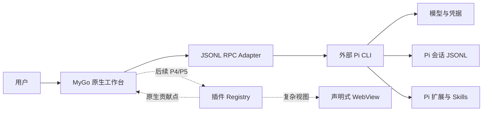

# BYOP

**Build You Own Pi**（BYOP）是一个基于 [MyGo](https://github.com/egoist/mygo) 原生 UI 的多插件工作台外壳，通过 JSONL RPC 调用单独安装的 [Pi CLI](https://github.com/earendil-works/pi)。

当前版本完成 P3.2a Onevra Chat 复刻：Chat 的阅读区、时间线、工具行和输入框直接使用 Onevra 原生 Chat 组件，同时保留 P3.2 的外部 Pi 连接、有序文字与工具活动、`agent_settled` 完成判定、停止和重连状态。BYOP 不内置 Pi SDK，不直接改写 Pi 会话 JSONL，也不复制模型凭据。


## 当前能力

- MyGo 原生窗口，无 React、Next.js 或内置 WebView；
- Onevra 语义色、间距、圆角和 14 px 默认正文；Chat 输入框也调整为 14 px；
- Chat、Plugins、Library、Document、Automations、Settings 导航骨架；
- Light、Dark、System 三种主题；
- 默认收起的右侧任务栏；
- 外部 `pi --mode rpc --no-session` 进程适配器；
- `get_state` 握手、`prompt` 发送、流式 `message_update`、最终 `message_end`；
- 按 `toolCallId` 关联 `tool_execution_start/update/end`；
- 原生会话时间线按“文字 → 工具 → 文字”的真实顺序保留内容块；
- `tool_execution_start/update/end` 按 `toolCallId` 原位更新，不改变工具卡位置；
- Chat 使用 Onevra `FloatingConversation`、`Turn`、`ActivityGroup`、`Activity` 和 `GlassComposer`；
- 连续工具合并为可折叠的活动组，运行中显示最新动作，完成后显示“Ran N tools”；
- 运行中显示“Working · 耗时”，结束后折叠为“Worked for 耗时”，保留最终回复可见；
- 工具详情使用等宽文本，展示长参数、结果或实时输出和状态耗时；
- 运行中工具自动展开，完成、失败、取消或中断后自动折叠；
- Running、Completed、Failed、Cancelled、Interrupted 五种工具状态；
- 多个工具保留各自时间线位置，右侧任务栏显示最新运行或最近活动的工具；
- Stop、进程退出和重连分别把未完成工具标记为 Cancelled 或 Interrupted；
- 以 `agent_settled` 作为真实运行完成信号；
- Stop 使用 `clear_queue → abort`，并用 `agent_settled(aborted:true)` 确认结果；
- 进程退出、协议错误、请求超时、重连隔离和窗口关闭清理；
- 固定 20 px 导航图标槽位，展开与收起状态保持左边缘对齐。

Plugins、Library、Document 和 Automations 目前是可运行的原生视觉骨架。插件安装、插件 SDK、WebView 视图、附件、模型选择、会话历史与切换仍属于后续阶段；输入框中的附件按钮和模型标签目前只做展示。

## 架构



职责边界：

| 对象 | 所有者 |
|---|---|
| 窗口、导航、主题、任务栏 | BYOP |
| 插件清单、贡献点、工作台视图状态 | BYOP |
| 模型、provider、OAuth、凭据 | Pi |
| 会话 JSONL、扩展、Skills、工具执行 | Pi |
| 复杂插件界面 | 插件提供，BYOP 托管 WebView |

计划中的插件契约和迁移边界见 [Architecture](docs/architecture.md)。

## 运行

要求：

- Go 1.27.1 或更高版本；
- 单独安装并可执行的 Pi CLI；
- Pi 的模型登录和 provider 配置已完成。

```sh
go run .
```

默认从 `PATH` 解析 `pi`。使用其他位置：

```sh
BYOP_PI_PATH=/absolute/path/to/pi go run .
```

只启动原生外壳、不连接 Pi：

```sh
BYOP_PI_CONNECT=0 go run .
```

截图和本地走查参数：

```sh
BYOP_THEME=dark BYOP_PAGE=plugins BYOP_TASKS=1 go run .
```

`BYOP_THEME` 支持 `system`、`light`、`dark`；`BYOP_PAGE` 支持 `chat`、`plugins`、`library`、`document`、`automations`、`settings`；`BYOP_TASKS=1` 默认展开任务栏；`BYOP_DEMO_TOOLS=1` 载入不连接 Pi 的隔离演示时间线。

## 验证

```sh
gofmt -w *.go
go build -o byop .
go vet ./...
go test ./...
jq empty design-system/onevra/tokens.json
jq empty design-system/pi-workbench/tokens.extensions.json
```

真实 Pi CLI 联调：

```sh
BYOP_PI_INTEGRATION=1 go test \
  -run 'TestPiRPCIntegration(MinimalLoop|Stop|Tool|Timeline)$' \
  -v -count=1 -timeout=8m
```

该测试会向已登录的 Pi 发送短提示，启动、停止一次较长回复，并要求 Pi 连续执行两次安全的 `bash` 命令。时间线测试验证两个工具各自关联正确，且 `BETWEEN_TOOLS` 文字位于两者之间、最终文字位于第二个工具之后。若未设置 `BYOP_PI_INTEGRATION=1`，集成测试会跳过。

验证记录见 [P3-validation.md](docs/P3-validation.md)，P2 最小 RPC 闭环见 [P2-validation.md](docs/P2-validation.md)，P1 原生外壳走查见 [P1-validation.md](docs/P1-validation.md)。

## 设计系统

仓库内自带两份可复用 token，公开构建不依赖仓库外的本地路径：

- [Onevra 基础 token](design-system/onevra/tokens.json)
- [BYOP 扩展 token](design-system/pi-workbench/tokens.extensions.json)

正文 token 为 14 px，完整层级为 10 / 11 / 12 / 14 / 15 / 16 / 18 / 30 / 32 px。颜色、间距、圆角、动效、Loop 和工作台扩展语义均保留在 JSON 中；Go 源码通过 `theme.go` 固定当前原生主题子集。

## 参考

- MyGo `v0.5.5`：`4d8673cd2658a2c6e86b26c44751e57bf8174f91`
- Onevra `source v0.2026.13`：`ece5cd99c334703f7878209f77cc24af14a49b79`，Chat 组件作为 Go 依赖使用
- Pi 图标来自 Onevra 固定提交中的 Lucide `Pi` 图标

第三方许可见 [THIRD_PARTY_NOTICES.md](THIRD_PARTY_NOTICES.md)。

## 许可

BYOP 使用 MIT License，见 [LICENSE](LICENSE)。
