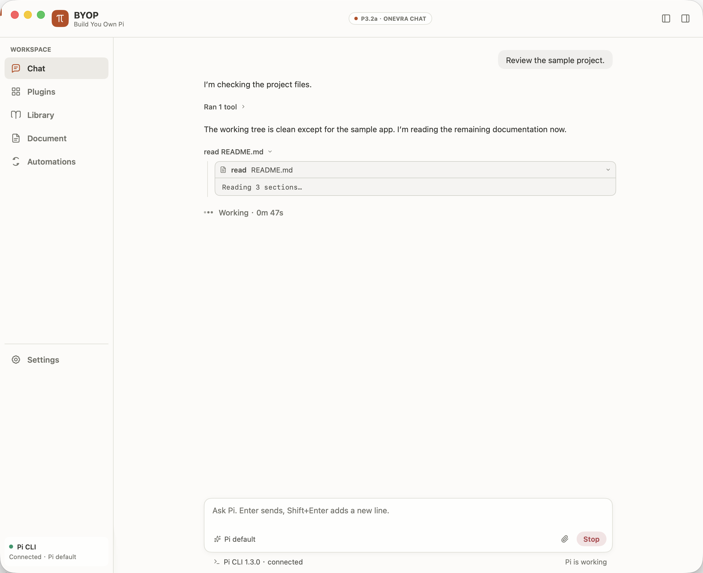
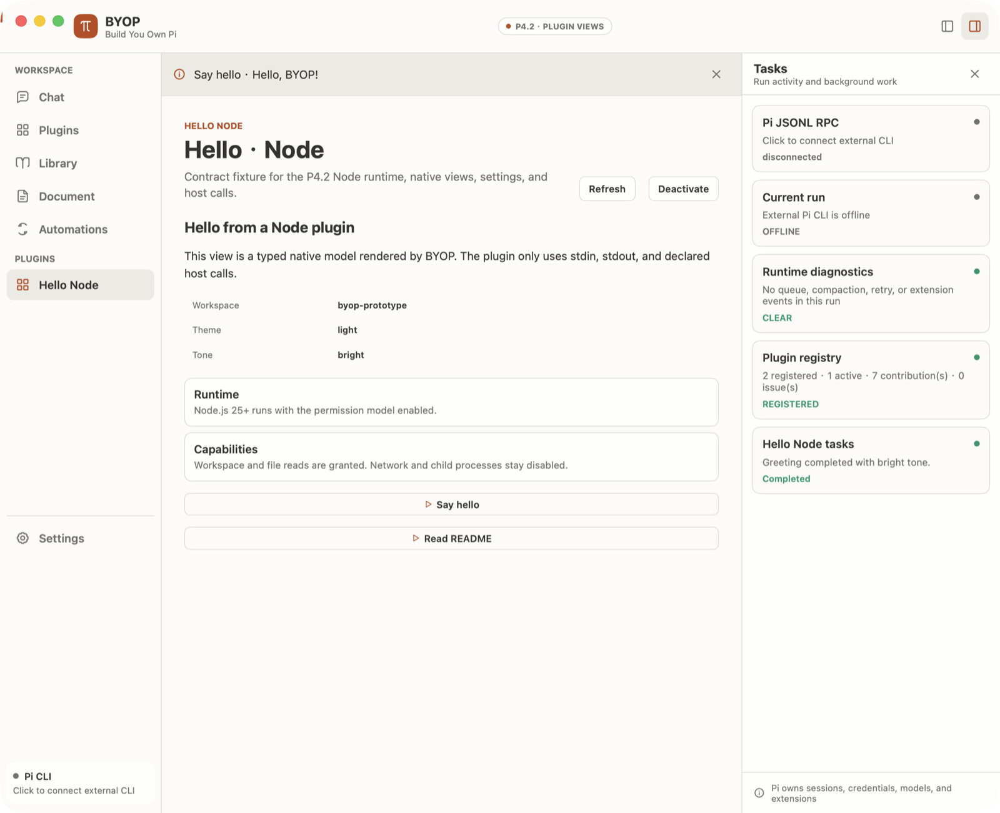
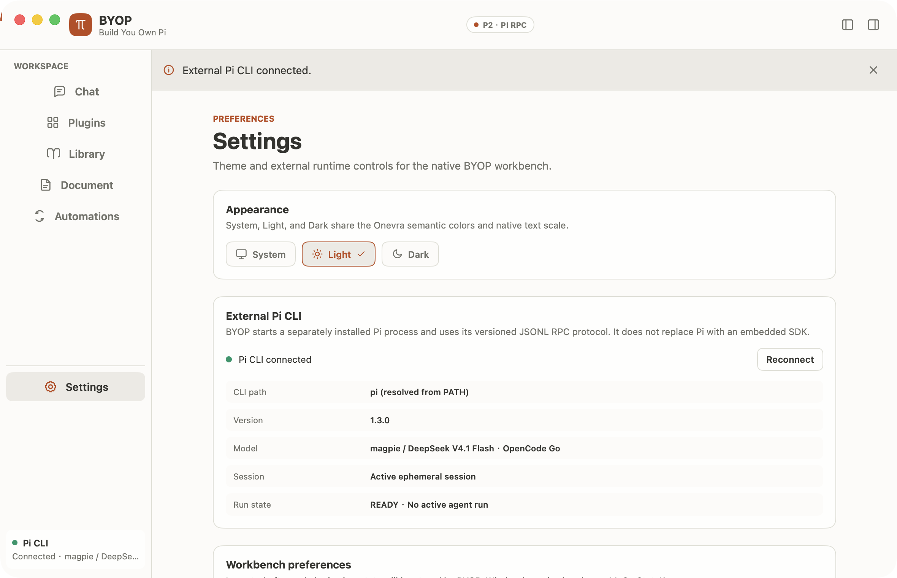
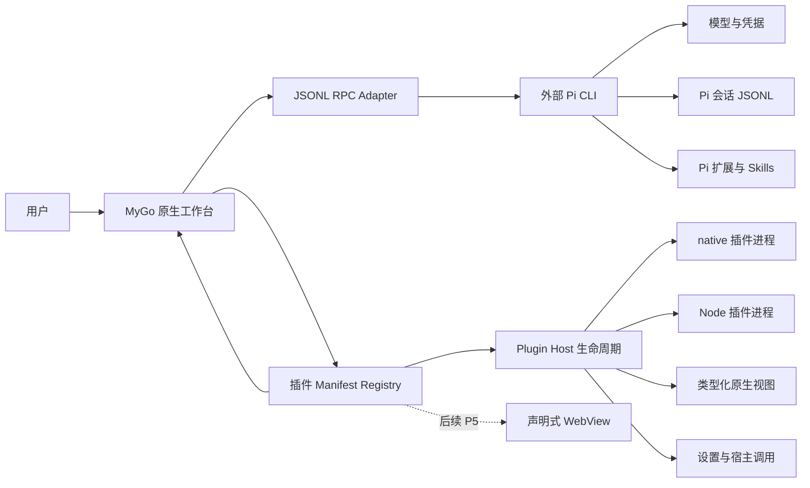

# BYOP

**Build You Own Pi**（BYOP）是一个基于 [MyGo](https://github.com/egoist/mygo) 原生 UI 的多插件工作台外壳，通过 JSONL RPC 调用单独安装的 [Pi CLI](https://github.com/earendil-works/pi)。

当前版本完成 P4.2 插件平台：在 P4 清单注册表与 P4.1 native 生命周期基础上，BYOP 支持 native 与 Node runtime、懒激活、类型化原生视图、插件设置注入、双向 JSON-RPC 宿主调用和能力检查。Node 插件同时受 Node permission model 和宿主 API 检查约束；native 插件没有进程级沙箱，宿主调用仍按清单检查。WebView 仍属于 P5。Chat 继续使用 Onevra 原生组件和外部 Pi CLI JSONL RPC；BYOP 不内置 Pi SDK，不直接改写 Pi 会话 JSONL，也不复制模型凭据。







## 当前能力

- MyGo 原生窗口，无 React、Next.js 或内置 WebView；
- Onevra 语义色、间距、圆角和 14 px 默认正文；Chat 输入框也调整为 14 px；
- Chat、Plugins、Library、Document、Automations、Settings 导航骨架；
- Light、Dark、System 三种主题；
- 默认收起的右侧任务栏；
- 外部 `pi --mode rpc --no-session` 进程适配器；
- `get_state` 握手、`prompt` 发送、流式 `message_update`、最终 `message_end`；
- 按 `toolCallId` 关联 `tool_execution_start/update/end`；
- 原生会话时间线按“文字 → 工具 → 文字”的真实顺序保留内容块；
- `tool_execution_start/update/end` 按 `toolCallId` 原位更新，不改变工具卡位置；
- Chat 使用 Onevra `FloatingConversation`、`Turn`、`ActivityGroup`、`Activity` 和 `GlassComposer`；
- 连续工具合并为可折叠的活动组，运行中显示最新动作，完成后显示“Ran N tools”；
- 运行中显示“Working · 耗时”，结束后折叠为“Worked for 耗时”，保留最终回复可见；
- 工具详情使用等宽文本，展示长参数、结果或实时输出和状态耗时；
- 运行中工具自动展开，完成、失败、取消或中断后自动折叠；
- Running、Completed、Failed、Cancelled、Interrupted 五种工具状态；
- 多个工具保留各自时间线位置，右侧任务栏显示最新运行或最近活动的工具；
- Stop、进程退出和重连分别把未完成工具标记为 Cancelled 或 Interrupted；
- 以 `agent_settled` 作为真实运行完成信号；
- Stop 使用 `clear_queue → abort`，并用 `agent_settled(aborted:true)` 确认结果；
- 重试等待中的 Stop 先发送 `abort_retry`，再清空队列并中止当前运行；
- 订阅 `queue_update`，在任务栏显示 steering 与 follow-up 队列数量；
- 订阅 `compaction_start/end`，显示 manual、threshold、overflow 压缩状态及压缩前后 token 估算；
- 订阅 `auto_retry_start/end`，显示重试次数、上限、倒计时和最终错误；
- 区分 `agent_end(willRetry)` 与 `agent_settled`，前者不会提前关闭当前轮次；
- provider 错误和失败重试保留在临时运行诊断，不进入永久助手消息块；
- `extension_error` 与 JSONL 协议错误分开显示，并记录扩展文件、事件和错误摘要；
- 进程退出、协议错误、请求超时、重连隔离和窗口关闭清理；
- 固定 20 px 导航图标槽位，展开与收起状态保持左边缘对齐；
- 扫描 `~/.byop/plugins` 与 `<cwd>/.byop/plugins`，也可通过 `BYOP_PLUGINS_DIR` 指定一个或多个目录；
- 严格解析 schema 1 `plugin.json`，拒绝未知字段、尾随 JSON、超过 1 MiB 的清单和不安全 entry 路径；
- 检查宿主版本 `0.4.2` 与 Plugin API `1` 兼容性；
- 标记插件 ID、跨插件贡献 ID 和同插件内重复贡献 ID；
- Plugins 页面支持搜索、空状态、问题提示、重新扫描，以及 navigation、command、view、task panel、setting 和 WebView 元数据预览；
- native 与 Node 插件按声明的 `onCommand:<id>`、`onView:<id>` 或 `lazy: true` 懒启动；两者都拒绝越出插件目录的 entry（含符号链接），native 还要求可执行文件，Node 只接受 `.js`、`.mjs`、`.cjs`；
- Node runtime 使用 `--permission`，按 `files`、`network` 和 `process` 能力增加文件系统、网络与子进程许可；路径先解析为真实绝对路径；
- 插件 `initialize` 收到合并后的设置与完整 capabilities；活动中的插件保存设置后收到 `settingsChanged`；
- 插件可以向宿主请求主题、设置、工作区与文件读写，显示通知、更新任务卡和刷新当前视图；宿主按清单与 capabilities 拒绝越权请求；
- 设置页按插件声明生成 string、number、boolean、select 字段，保存到 `~/.byop/plugin-settings/<pluginId>.json`，目录权限 `0700`、文件权限 `0600`；
- 主视图使用类型化 block 模型渲染 heading、text、notice、keyValue、list、code 和 button；未知 block 显示为 Unsupported block，未声明命令的按钮禁用；
- 带 navigation 的主视图进入侧栏 `PLUGINS` 区域；插件页面支持打开任意主视图，secondary 视图只在卡片中列出；
- 插件卡片显示 runtime、能力行、执行边界、inactive / starting / active / running / stopped / failed 生命周期状态、命令按钮、最近结果或错误，并提供 Open view 与 Deactivate；
- 视图在 UI goroutine 外渲染，支持 Refresh、Retry、自动刷新、错误态和重新扫描后的失效回退；
- 重新扫描和关闭窗口前会停用全部插件进程；插件意外退出时标记为 failed 并保留 stderr 尾部摘要。

Library、Document 和 Automations 目前仍是可运行的原生视觉骨架。WebView 视图、插件安装、附件、模型选择、会话历史与切换仍属于后续阶段；输入框中的附件按钮和模型标签目前只做展示。

**Plugin development hold：** P4.2 后插件平台功能已就绪，但在 Lex 明确要求前不开发功能插件；此前 Library 与 Document 的设计不得转为插件。`examples/` 只放契约 fixture，Library 与 Document 页面保持现状。

## 架构



职责边界：

| 对象 | 所有者 |
|---|---|
| 窗口、导航、主题、任务栏 | BYOP |
| 插件清单、目录扫描、贡献点和冲突状态 | BYOP |
| 模型、provider、OAuth、凭据 | Pi |
| 会话 JSONL、扩展、Skills、工具执行 | Pi |
| native / Node 插件生命周期、命令和视图 | BYOP Plugin Host（P4.2） |
| 插件设置、宿主调用和能力检查 | BYOP Plugin Host（P4.2） |
| 复杂 WebView 界面 | 后续阶段 P5 |

计划中的插件契约和迁移边界见 [Architecture](docs/architecture.md)。

## 运行

要求：

- Go 1.27.1 或更高版本；
- Node.js 25 或更高版本（只有使用 Node 插件时需要，可用 `BYOP_NODE` 指定路径）；
- 单独安装并可执行的 Pi CLI；
- Pi 的模型登录和 provider 配置已完成。

```sh
go run .
```

默认从 `PATH` 解析 `pi`。使用其他位置：

```sh
BYOP_PI_PATH=/absolute/path/to/pi go run .
```

只启动原生外壳、不连接 Pi：

```sh
BYOP_PI_CONNECT=0 go run .
```

默认扫描：

- `~/.byop/plugins`
- `<当前工作目录>/.byop/plugins`

使用隔离目录或指定多个目录：

```sh
BYOP_PLUGINS_DIR=/path/to/plugins go run .
BYOP_PLUGINS_DIR=/path/one:/path/two go run .
```

`BYOP_PLUGINS_DIR` 使用当前操作系统的路径列表分隔符；macOS/Linux 为 `:`，Windows 为 `;`。设置该变量后，BYOP 只扫描显式目录。目录不存在时，默认目录会被忽略，显式目录会在 Plugins 页面显示扫描问题。每个插件是根目录下的一项，清单文件名为 `plugin.json`。

最小原生插件示例（`bin/` 不入库，需要先构建）：

```sh
(cd examples/hello-native && go build -o bin/hello-native .)
BYOP_PLUGINS_DIR="$PWD/examples" BYOP_PAGE=plugins BYOP_PI_CONNECT=0 go run .
```

点击卡片上的 **Say hello** 会启动插件并显示结果；点击 **Deactivate** 会停用插件并结束进程。

P4.2 契约 fixture 使用无依赖的 Node 文件：

```sh
BYOP_PLUGINS_DIR="$PWD/examples" \
BYOP_PAGE=plugins \
BYOP_PI_CONNECT=0 \
go run .
```

从侧栏打开 **Hello Node** 可检查类型化视图、设置、任务更新、通知、README 宿主读取和 `settingsChanged → refreshView` 流程。该目录只是契约 fixture，不是功能插件。

截图和本地走查参数：

```sh
BYOP_THEME=dark BYOP_PAGE=plugins BYOP_TASKS=1 go run .
```

`BYOP_THEME` 支持 `system`、`light`、`dark`；`BYOP_PAGE` 支持 `chat`、`plugins`、`library`、`document`、`automations`、`settings`；`BYOP_TASKS=1` 默认展开任务栏；`BYOP_DEMO_TOOLS=1` 载入不连接 Pi 的隔离演示时间线。

## 验证

```sh
gofmt -w *.go
go build -o byop .
go vet ./...
go test ./...
jq empty design-system/onevra/tokens.json
jq empty design-system/pi-workbench/tokens.extensions.json
```

真实 Pi CLI 联调：

```sh
BYOP_PI_INTEGRATION=1 go test \
  -run 'TestPiRPCIntegration(MinimalLoop|Stop|Tool|Timeline|Compact)$' \
  -v -count=1 -timeout=8m
```

该测试会向已登录的 Pi 发送短提示，启动、停止一次较长回复，要求 Pi 连续执行两次安全的 `bash` 命令，并调用一次手动压缩 RPC。时间线测试验证两个工具各自关联正确，且 `BETWEEN_TOOLS` 文字位于两者之间、最终文字位于第二个工具之后。若未设置 `BYOP_PI_INTEGRATION=1`，集成测试会跳过。

验证记录见 [P4.2-validation.md](docs/P4.2-validation.md)、[P4.1-validation.md](docs/P4.1-validation.md)、[P4-validation.md](docs/P4-validation.md) 和 [P3-validation.md](docs/P3-validation.md)，P2 最小 RPC 闭环见 [P2-validation.md](docs/P2-validation.md)，P1 原生外壳走查见 [P1-validation.md](docs/P1-validation.md)。

## 设计系统

仓库内自带两份可复用 token，公开构建不依赖仓库外的本地路径：

- [Onevra 基础 token](design-system/onevra/tokens.json)
- [BYOP 扩展 token](design-system/pi-workbench/tokens.extensions.json)

正文 token 为 14 px，完整层级为 10 / 11 / 12 / 14 / 15 / 16 / 18 / 30 / 32 px。颜色、间距、圆角、动效、Loop 和工作台扩展语义均保留在 JSON 中；Go 源码通过 `theme.go` 固定当前原生主题子集。

## 参考

- MyGo `v0.5.5`：`4d8673cd2658a2c6e86b26c44751e57bf8174f91`
- Onevra `source v0.2026.13`：`ece5cd99c334703f7878209f77cc24af14a49b79`，Chat 组件作为 Go 依赖使用
- Pi 图标来自 Onevra 固定提交中的 Lucide `Pi` 图标

第三方许可见 [THIRD_PARTY_NOTICES.md](THIRD_PARTY_NOTICES.md)。

## 许可

BYOP 使用 MIT License，见 [LICENSE](LICENSE)。
