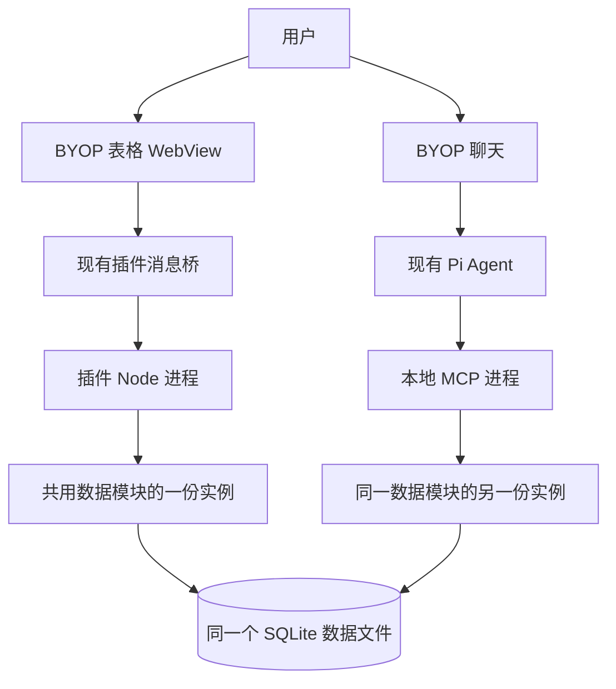
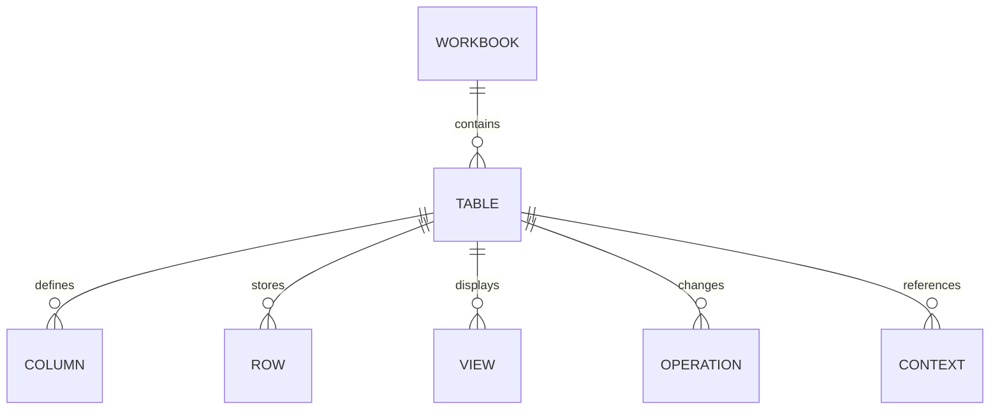

# BYOP 轻量表格插件详细设计

版本：v0.1  
日期：2026-10-28  
状态：设计稿，尚未实现  
设计对象：Lex 的本地个人表格插件，扶摇作为第一张表的字段参考

插件自己保存数据，提供类似 Excel 的表格编辑、筛选、搜索和汇总，同时允许 BYOP 中的 Pi Agent 通过工具操作同一份数据。第一版以一张表的日常使用为边界，不连接原扶摇数据库，不依赖原扶摇服务。

## 1 设计决定与范围

| 项目 | 本版设计 |
|---|---|
| 产品入口 | BYOP 导航中的“表格”；暂定插件 ID 为 `local.lightweight-table` |
| 数据归属 | 插件独立保存，插件升级与业务数据分开 |
| 使用规模 | 单用户、本机、一个数据文件、一张业务表；以约 1 万行、30 列作为初始设计规模，非已测性能承诺 |
| 存储 | SQLite，本地嵌入式文件，不运行数据库服务器 |
| 页面 | 本地 WebView 表格页面，使用 BYOP 主题与语言能力 |
| Agent | 复用 BYOP 的 Pi 会话与模型，通过本地 MCP 工具操作数据 |
| 保存 | 编辑完成后立即提交；只有收到成功回执才显示“已保存” |
| 修改规则 | 用户要求明确且记录唯一时直接执行；只有目标或值不明确时澄清，不新增逐次审批 |
| 恢复 | 最近操作可撤销；删除可恢复；不覆盖后续修改 |
| 数据交换 | CSV 与 `.xlsx` 导入、导出；Excel 文件不是内部存储 |

首版包含单元格编辑、增删记录、调整列宽和顺序、隐藏列、基础列管理、组合筛选、保存视图、精确汇总、Agent 读写、操作回执和撤销。数据库允许通过 `table_id` 区分数据，但首版界面和工具只开放默认表，不同时做多工作簿管理。

首版不包含跨表关联、多人协作、云同步、附件管理、完整公式引擎、数据透视表、宏、合并单元格或复杂财务计算。表格不会因新增一条“已还款”记录自动扣减其他行的本金；此类业务规则需要单独设计。

## 2 运行结构

插件包提供两个入口：页面使用的 BYOP 插件入口，以及 Pi 启动的 MCP 入口。两者加载同一版本的数据模块，各自建立数据库连接；没有额外后台 HTTP 服务、固定端口或自建进程间通信服务器。

“共用数据入口”表示复用同一套解析、查询、校验、事务和回执代码，不表示两个进程共享内存。并发写入由 SQLite 事务和行版本共同协调。SQLite 支持不同进程通过独立连接读取已提交事务；相关机制见 [SQLite 隔离说明](https://www.sqlite.org/isolation.html)。

| 模块 | 责任 |
|---|---|
| 表格页面 | 呈现查询结果、收集输入、保留编辑草稿和选择状态 |
| 插件入口 | 将页面消息交给数据模块，调用宿主的文件选择和聊天上下文能力 |
| MCP 入口 | 描述 Agent 工具，把工具参数转为同样的数据操作 |
| 共用数据模块 | 字段解释、条件查询、金额转换、事务写入、操作回执、撤销 |
| BYOP 宿主 | 插件专用存储位置、导航、消息桥、上下文附件、工具登记和状态 |
| Pi | 模型调用、会话、工具发现与调用，不持有第二份业务数据库 |

关闭表格页面只隐藏页面，Agent 仍可操作。停用整个插件时同时停用对应 MCP 入口；只关闭一个功能时，设置中明确区分“表格页面”和“Agent 工具”的状态。

## 3 文件与数据生命周期

沿用 BYOP 已有配置根目录的约定。拟新增业务数据目录为 `<BYOP_CONFIG_DIR>/plugin-data/local.lightweight-table/`，未覆盖配置根时位于用户目录下的 `.byop`。这是后续运行位置设计，本轮不创建数据目录或数据库。

| 文件或目录 | 内容 | 生命周期 |
|---|---|---|
| 插件安装目录 | 页面资源、插件入口、MCP 入口、共用模块 | 可随插件版本替换 |
| `tables.sqlite` | 表结构、行数据、视图、操作历史和上下文引用 | 独立于安装目录长期保存 |
| SQLite 日志文件 | 事务过程中产生的辅助文件 | 由 SQLite 管理，不要求用户操作 |
| 插件设置 | 默认表 ID、界面设置、数据文件位置 | 由宿主设置机制保存 |
| 导出文件 | 用户选择的 CSV / XLSX 或完整数据副本 | 仅在用户发起导出时生成 |

首版采用回滚日志模式和短写事务，优先保持运行结构简单。SQLite 的“单文件”指主要持久化数据文件，事务期间仍可能产生辅助日志，不能据此承诺运行时永远只有一个文件。依据：[SQLite 单文件说明](https://www.sqlite.org/onefile.html)。

卸载插件保留业务数据；界面隐藏、进程退出和插件升级都不清空数据。首次创建数据库在一个初始化事务内完成，两个进程同时启动时也只能初始化一次。数据库保存格式版本，升级迁移在独占迁移事务内执行；旧版本插件遇到更新的数据格式时说明不兼容，不尝试改写。

“导出完整数据副本”通过 SQLite 一致性快照产生新文件，不直接复制正在写入的主文件。CSV/XLSX 只包含业务表内容，不包含撤销历史、保存视图或内部标识，不能代替完整副本。依据：[SQLite Backup API](https://www.sqlite.org/backup.html)。首版不增加定时备份任务或自动同步。

## 4 数据结构

### 4.1 逻辑对象

| 内部对象 | 关键字段 | 用途 |
|---|---|---|
| `workbook_meta` | `workbook_id`, `format_version`, `name`, `timezone`, `created_at` | 一个数据文件的身份和格式；时区初始取用户环境并持久化 |
| `tables` | `table_id`, `name`, `schema_revision`, `data_revision`, `created_at` | 首版只有一个活动业务表；结构修改和数据修改分别递增版本 |
| `columns` | `column_id`, `table_id`, `label`, `type`, `required`, `config`, `position` | 字段定义；列 ID 固定，显示名称可以修改 |
| `rows` | `row_id`, `table_id`, `revision`, `values`, `created_at`, `updated_at`, `deleted_at` | 一条业务记录；值以列 ID 为键保存为结构化 JSON |
| `views` | `view_id`, `table_id`, `name`, `query`, `column_layout`, `revision` | 保存筛选、排序、显示列、列宽和固定列 |
| `operations` | `operation_id`, `request_id`, `payload_hash`, `source`, `before_after`, `receipt`, `undo_of`, `created_at` | 写入结果、重复请求识别和撤销依据 |
| `contexts` | `context_id`, `table_id`, `kind`, `row_ids_versions`, `query`, `schema_revision`, `data_revision`, `payload`, `request_id`, `payload_hash`, `state`, `created_at` | 选择与查询引用，以及待提交操作的规范化参数；操作字段仅在 `kind=prepared_change` 时使用 |

外键约束表、列、行和视图之间的归属。行 ID、列 ID、操作 ID 使用独立 UUID，不使用行号、名称或页面位置作为身份。`request_id` 在工作簿内唯一。

系统字段与用户数据分开；用户不能通过一个同名自定义列覆盖 `revision` 或 `row_id`。JSON 键只接受已存在且属于当前表的列 ID。首版索引覆盖表 ID、行 ID、删除状态与操作请求 ID；不为每个自定义列预建索引。

选择“列定义 + 行 JSON”是为了支持新增列而不为每个用户字段做数据库迁移。它适用于本版规模；复杂跨表分析或大规模数据不在此结构的首版目标内。

### 4.2 列类型与数值规则

| 类型 | 页面行为 | 内部保存 | Agent 输入与输出 |
|---|---|---|---|
| 短文本 | 单行编辑 | 字符串或 `null` | 字符串；保留编号前导零 |
| 长文本 | 详情区多行编辑 | 字符串或 `null` | 按需读取完整内容 |
| 整数 | 数字编辑器 | 安全整数或 `null` | 十进制整数字符串 |
| 小数 | 固定精度编辑器 | 按列精度缩放后的安全整数 | 十进制字符串，如 `"12.345"` |
| 金额 | 右对齐，显示币种和小数位 | 最小货币单位的安全整数 | `"2000.00"`，币种由列定义提供 |
| 日期 | 日历选择 | `YYYY-MM-DD` 或 `null` | 同格式字符串，不带时区转换 |
| 单选 | 下拉选项 | 稳定 option ID 或 `null` | 工具返回可选 ID 与名称，写入使用 ID |
| 布尔 | 勾选或清空 | `true`、`false`、`null` | 三者明确区分 |

小数精度在建列时确定，首版支持 0–6 位；金额模板为 CNY、2 位小数。金额字符串通过十进制解析转换成整数，不先转为浮点数再乘 100。单值缩放后的绝对值不得超过 JavaScript 安全整数范围，超出时返回字段错误。超出列精度的输入要求修正，不静默四舍五入。

汇总在数据模块使用精确整数累加，再转为十进制字符串；即使累计结果超过单值安全整数范围，也不能回落到浮点计算。首版只提供计数、求和、最小、最大，不加入平均值的舍入规则。不同币种分别汇总，不自动换算。

`null` 表示未填写，数值 0 表示明确为零。文本清空统一保存为 `null`，但保留非空文本中的合法空格。排序时空值统一放最后；筛选“为空”单独表达，不把空值当 0。金额列只记录数值，不自行推断借贷方向。

创建时间、修改时间保存为 UTC 时间戳，页面按工作簿时区显示。“本月”“下个月”在请求开始时按工作簿时区展开为明确日期区间；存成视图时区分动态日期条件和固定日期条件。

### 4.3 扶摇示例字段

下面是第一张表的建议模板，字段均为设计示例，不来源于真实账本。基础列可增加、改名和隐藏。

| 列 | 类型 | 说明 |
|---|---|---|
| 名称 | 短文本，必填 | 一条记录的显示名称，不要求唯一 |
| 机构 | 短文本 | 债权方或机构名称 |
| 分类 | 单选 | 待分类、贷款、信用卡、其他；可以编辑选项名称 |
| 本金 | 金额 CNY | 手动记录值，不随其他字段自动重算 |
| 待还金额 | 金额 CNY | 独立记录值，不推断为本金减已还金额 |
| 还款日 | 日期 | 一次明确的日期，不隐含每月重复计划 |
| 状态 | 单选 | 未处理、处理中、已结清；可按需要调整 |
| 备注 | 长文本 | 解释、处理情况、沟通摘要 |

允许名称重复。Agent 遇到同名记录，结合机构、日期等字段区分；仍无法区分时再问用户。状态变化不会隐式改动金额。首版增加列时，已有行对应值为空；重命名不影响视图和工具引用。已有数据的列不提供原地改类型，先新建列再明确转换；删除列暂以隐藏替代，避免首版增加数据结构恢复流程。

有数据的表新增列默认可空；只有现有行都已有值时才能改为必填。单选选项重命名保留 option ID；已被使用的选项不能直接移除，先明确替换这些记录中的值。

## 5 表格界面

### 5.1 布局

| 区域 | 内容与行为 |
|---|---|
| 顶栏 | 表名、保存状态；新增记录、导入、导出、撤销 |
| 视图和查询栏 | “全部”“本月待还”等保存视图；搜索框、筛选、排序、列设置 |
| 条件区 | 当前生效条件，可逐项删除；显示“已修改视图”，提供保存与还原 |
| 表格 | 行选择框、业务列、当前焦点；首列可固定，行内容不透明 |
| 表格底部 | 总记录数、筛选后数量、选中数量、分页和筛选范围的合计 |
| 详情区 | 当前行完整字段，长备注编辑；位于插件内部，不占用 BYOP 任务栏 |
| Agent 入口 | “询问这条”“询问所选”“询问筛选结果”；转到 BYOP 现有聊天 |

窄窗口保留主要列和横向滚动，详情使用覆盖式抽屉。搜索和筛选入口保持可见，低频操作进入“更多”。不强行把所有列压窄，也不降低部分列字号来挤入窗口。

沿用 BYOP 的 12/14/18 px 字号、主题颜色、0.5 px 边框和减少动态设置。首版不增加自动播放或循环动画。文本用语言包；表名、列名、用户输入按数据原样显示。

### 5.2 编辑、选择和保存

| 操作 | 规则 |
|---|---|
| 单击单元格 | 选中并显示焦点，不立即开始编辑 |
| 双击或 Enter | 进入编辑；输入法组词期间 Enter 只确认组词 |
| Tab / Shift+Tab | 提交当前格并移动到下一个或上一个可编辑格 |
| Esc | 取消尚未提交的当前编辑，恢复读取值 |
| 点击其他位置 | 提交当前格；校验失败保留输入并提示原因 |
| 新增记录 | 显示新行草稿，必填信息完整后提交；草稿不计入查询和汇总 |
| 多选 | 使用行选择框；表头默认选本页，另有明确的“选中全部筛选结果” |
| 清空 | 清空当前单元格；必填列不允许提交空值；不把 Delete 键解释为删整行 |
| 删除记录 | 使用明确的删行命令，软删除后从正常视图移除，回执提供恢复 |
| 复制 | 首版支持复制当前格及“复制选中行”为制表符文本 |
| 批量粘贴 | 首版走“从剪贴板导入”的列映射预览；不承诺完整 Excel 范围粘贴 |
| Cmd+Z | 正在编辑时撤销文本输入；不在编辑时撤销最近可撤销的数据操作 |

页面状态区分“正在保存”“已保存”“未保存：原因”。磁盘写入失败时保留当前草稿，不刷新成旧值后假装成功。应用关闭导致的未提交编辑不承诺自动恢复；页面存在未提交草稿时，返回聊天前先提交或保留在当前页面，不静默丢弃。

单行多字段的详情保存作为一个事务。连续改单元格是独立操作；批量修改是一项操作。保存成功后如果该行不再满足筛选条件，行从当前结果中移除并提示“已保存，记录不再符合当前筛选”，提供“查看记录”。

### 5.3 搜索、筛选与视图

搜索只覆盖当前表的短文本和长文本列，提供字面子串匹配。ASCII 大小写忽略；不承诺拼音、分词、模糊匹配或完整 Unicode 大小写折叠。金额和日期使用类型筛选，不把显示字符串的匹配当数值比较。

| 类型 | 首版条件 |
|---|---|
| 文本 | 包含、不包含、等于、不等于、为空、不为空 |
| 整数、小数、金额 | 等于、大于、大于等于、小于、小于等于、闭区间、为空 |
| 日期 | 某日、之前、之后、闭区间、本月、下个月、为空 |
| 单选 | 属于所选集合、不属于所选集合、为空 |
| 布尔 | 是、否、为空 |

不同列条件取“并且”；同列多选项取“或者”。搜索条件与筛选条件取“并且”。“不等于”和“不包含”默认排除空值，空值由独立条件处理。首版不开放任意嵌套 AND/OR 表达式。

所有筛选、排序和汇总由共用数据模块执行；表格组件只呈现结果和编辑状态，不再用组件自带逻辑过滤一遍。多列排序以列表顺序为优先级，最后追加行 ID 作为稳定排序依据。文本采用明确的二进制词典顺序，不承诺中文拼音排序。

界面每页默认 100 行；返回结果包含匹配总数、表版本、实际排序和续页信息。表数据版本发生变化时，重新查询当前范围，避免沿用旧页造成重复或漏行。长备注在列表中只返回预览，详情再加载全文。汇总覆盖全部匹配记录，不只计算已加载的一页；界面明确标注范围。

查询引用固定匹配 ID、排序与读取版本。分页和按该引用汇总时，如果数据版本已变，返回“结果已变化，请刷新”；不把不同时间的页面或合计拼成一个结果。选择上下文固定的是目标集合，读取时可以展示这些目标的最新值，但必须指出版本变化；修改仍需以重新准备时明确读取的版本为准。Agent 不能在不检查新值的情况下自动采用更新后的版本重试。

保存视图只保存查询和布局，不复制行。切换视图清空选择，筛选条件变化也清空选择，避免隐藏的旧选择混入新的批量操作。列宽和显示列可保存；未保存的视图修改保留在当前页面，不能覆盖已保存版本。

## 6 保存一致性与撤销

### 6.1 共用写入事务

一次写入按以下顺序处理。所有步骤属于数据操作语义，不是额外用户审批。

写事务开始后再次读取当前版本。更新、删除要求预期行版本匹配；插入验证当前结构版本。批量操作在一个事务内完成，任意目标行冲突或参数错误时整批不提交。读写锁等待有界，忙时返回可重试状态，不无限等待或强制覆盖。

每次成功操作递增受影响行的 `revision` 和表的 `data_revision`，同步记录前后值和操作回执。对某行新增又删除、撤销又恢复等变化，版本只能递增，不能恢复旧版本号。

`request_id` 与规范化操作内容绑定：相同编号和相同内容返回原回执，不再执行；相同编号但内容不同返回冲突。已撤销的操作被重复提交时返回其原结果及已撤销状态，不重新应用。

页面在发送时生成请求编号。Agent 写入分为准备和提交两个内部工具步骤：准备返回由数据层生成并保存的请求编号、固定目标和规范化参数，提交只引用该编号。Agent 不需要自行编造请求编号，也不依赖 MCP 提供模型的 tool-call ID。准备操作不是用户确认步骤。

若提交后连接中断，先按原编号查询结果。找到回执就按回执继续；未找到则只能使用同一个编号重试。已取消的聊天不能被解释为数据必然回滚，仍要读取操作状态。

### 6.2 并发与撤销

两个进程对同一行都读到版本 7：先提交者把它变为版本 8，后提交者得到版本冲突并读取新值。用户手动输入的草稿仍保留，显示当前值供其判断；Agent 也不能静默覆盖刚发生的人工修改。

撤销以一次操作为单位，根据保存的前后值生成一个新的反向操作。仅当所有目标行仍处于原操作产生的版本时执行；有后续改动则整项撤销失败并指出受影响记录，不抹掉之后的工作。新增记录的撤销为软删除；删除记录的撤销为恢复；批量导入的撤销为软删除该批新增行。

首版提供最近操作列表和撤销，不提供任意历史时间点恢复或重做。结构修改和视图修改不混入数据撤销栈；“撤销”按钮明确指数据操作。数据历史暂不自动清理，容量增长后再根据实际使用增加清理功能。

## 7 Agent 操作方式

### 7.1 上下文如何进入聊天

用户可以在普通聊天中直接要求查询，也可以从表格选择上下文后进入聊天。输入区显示可移除的上下文标签，如“表格 · 本月待还 · 12 条”。第一版不要求聊天和表格同时分屏。

| 上下文 | 发送时固定的内容 |
|---|---|
| 当前记录 | 工作簿、表、行 ID、行版本 |
| 选中记录 | 选中行 ID 和版本；不会因后台排序或页面切换改目标 |
| 当前筛选结果 | 当时匹配的完整 ID 集合、对应行版本、筛选条件与数量 |
| 当前表 | 表 ID 和结构版本；查询时读取当前数据 |

“当前筛选结果”在发送时由数据模块重新执行条件并形成快照；若匹配数量与页面显示变化，标签更新为实际快照数量。未提交草稿必须先提交完成，才可把其记录作为已保存数据交给 Agent。

上下文引用绑定本次发送，不随页面后来选中的行漂移。历史聊天保留可解释的引用，但修改仍按当前版本检查。“刷新这批查询”会生成新引用，不能悄悄扩大旧引用的范围。

没有附加上下文时，Agent 根据表结构查询。用户说“这笔”但没有明确指向时，展示候选记录；用户明确说“所有符合条件的记录”时，工具固定全部匹配集合，不把当前第一页误当全部。

### 7.2 工具契约

以下为拟新增工具，不是 BYOP 目前已经提供的接口。MCP 只负责调用协议，查询和写入仍由插件数据模块处理。Pi 已支持本地 stdio MCP，依据：[Pi MCP 文档](https://github.com/earendil-works/pi/blob/main/packages/coding-agent/docs/mcp.md)。

| 工具 | 主要输入 | 主要输出与行为 |
|---|---|---|
| `table_describe` | 可省略的默认表 ID | 列 ID、显示名、类型、精度、选项、结构版本、工作簿时区 |
| `table_read_context` | `context_id` | 固定范围、数量、原始条件、版本；记录内容按需读取 |
| `table_query` | 列投影、搜索、类型条件、排序、页大小、续页标识 | 行 ID、版本、所需字段、匹配总数、查询引用；默认 20 行，最多 100 行 |
| `table_read_rows` | 明确行 ID、字段、分页或文本偏移 | 完整字段或长文本分段，不把所有备注一次塞进上下文 |
| `table_aggregate` | 查询引用或查询条件、列 ID、计数/求和/最小/最大 | 精确结果、实际范围、空值数量、单位和币种 |
| `table_prepare_change` | 新增/修改/删除、目标引用、字段和值；撤销时提供原操作 ID | 固定目标、版本、规范化参数、请求编号、变更摘要；不改变业务行 |
| `table_commit_change` | 准备步骤返回的请求编号 | 原子提交或原回执；不再接收另一套字段值 |
| `table_operation` | 请求编号或操作 ID | 已准备、已提交、已撤销、冲突或未知；返回实际回执 |

撤销也通过准备和提交执行，准备时把原操作 ID 与反向修改绑定。一个原操作只能有一项已提交的撤销；对同一操作重复撤销返回已有撤销回执，不产生第二次反向修改。页面“撤销”按钮直接完成这两步，不增加用户确认。

首版 Agent 不修改列类型、清空整库或管理工作簿文件。普通增改删覆盖用户已要求的业务数据操作。条件使用列 ID 和结构化运算符；工具不暴露任意 SQL，也不让模型生成文件修改脚本。

修改字段采用补丁语义：未提供的字段保留，显式 `null` 才表示清空。单次准备只能针对一个表和一种业务动作，批量目标在数据层保存，不通过聊天枚举全部行。准备记录和上下文引用同属 `contexts`，通过 `kind` 区分，提交所需参数由数据层持久化；不依赖 Agent 的文字摘要恢复。

待提交操作还记录其来源上下文与用户轮次引用，便于恢复时查找同一轮已经准备的操作；断线后不重新准备一笔等价写入。参数更正生成新的准备记录并明确废弃旧记录。普通查询引用可以在重开会话后重新生成，已经提交操作的请求编号与回执则长期保留。首版不自动清理未提交准备记录，操作列表将其与已保存操作区分。

准备提交前必需的目标与值都明确时，Agent 连续调用准备和提交，用户不需要再点确认。只有同名对象、含糊日期、无法确定的字段值或冲突会触发澄清。用户只要求“看看怎么改”时，停在准备结果并解释，不执行提交。

### 7.3 查询与变更结果

| 回执字段 | 含义 |
|---|---|
| `status` | `prepared`、`committed`、`conflict`、`invalid`、`undone`、`unavailable` |
| `operation_id` / `request_id` | 查回执与撤销的依据；查询回执不存在不能直接推断原操作失败 |
| `table_id`, `data_revision` | 操作归属和提交后的数据版本 |
| `affected_count` | 实际改变的行数；无变化时为 0 |
| `changes_preview` | 少量记录的前后值，总量由 count 表达 |
| `result_ref` | 用于在表格打开结果的内部引用，不能是任意可执行地址 |
| `undo_available` | 当前是否支持撤销；点击时还会重新检查版本 |

Agent 回答示例：“已将选中的 3 条记录状态改为‘处理中’，其他字段未变。”同时提供“在表格中查看”和“撤销”入口。入口需要宿主理解结构化结果，不能只靠模型生成链接。

缺少匹配数据返回“0 条”，不当作工具故障。读取部分字段被截断时返回明确的继续读取标识。筛选用的表格文本按数据处理，不作为 Agent 的指令。只把当前任务需要的字段返回给模型；本地存储并不意味着云端模型推理也在本地，所选模型仍可能接收这些工具结果。

### 7.4 三个完整例子

| 用户要求 | 执行路径 | 结果 |
|---|---|---|
| “下个月要还多少” | 读列定义和时区 → 按还款日查询 → 对待还金额求和 | 明细入口、合计、空值条数；空金额不伪装成 0 |
| “把选中的记录标记为处理中” | 读取发送时固定的上下文 → 准备修改 → 提交 | 全部成功或全部冲突，表格按当前视图刷新 |
| “新增一条样例，机构为示例银行，待还金额 2,000 元，下月 15 日还” | 按请求当天解析日期 → 规范化金额 → 准备新增 → 提交 | 新行 ID、实际保存值和查看入口；名称缺失且无合理已给值时再询问 |

## 8 导入与导出

| 环节 | 首版规则 |
|---|---|
| 文件选择 | 用户选择 CSV 或 XLSX；不读取任意目录中的文件 |
| 工作表选择 | XLSX 显示工作表列表，单次导入一张；不静默使用第一张 |
| 列映射 | 按名称建议映射，可改列、忽略列、明确新增列 |
| 数据预览 | 展示类型转换和行数；导入预览属于数据整理步骤，不是 Agent 写入审批 |
| 提交方式 | 首版只追加新行，不按名称自动合并，也不覆盖已有记录 |
| 错误处理 | 无效日期、超精度金额、缺少必填项标出源行号；修正后整批提交，不默认跳过错误行 |
| 重复导入 | 同一次导入重试复用请求编号；重新选择同一文件是新的明确导入，不以内容相同为由自动删重 |
| 导出范围 | 全部、当前筛选结果、选中记录；范围和列选择清楚显示 |
| 导出结果 | UTF-8 CSV 或 XLSX，列名为用户显示名称，编号按文本，日期按日历日期 |

XLSX 读取已保存的单元格值；公式仅在有缓存结果时作为导入候选，并在预览标注，插件不重新计算公式。无缓存结果、合并单元格含糊或不支持的单元格类型时指出具体位置，不猜值。CSV 中 `03/04/2026` 等不明确日期要求选择格式；不自动把贷款编号转成数字。

导出 XLSX 时，只在往返不会损失有效数字时写成数值单元格，超出 Excel 精度范围的内容按文本保存并说明。文本以文本类型导出，包含 `=` 的备注不生成公式。CSV 的文本转义和电子表格打开方式在导出选项中说明，避免把用户文本误当公式。

原文件由宿主文件选择接口授权读取，文件内容由 Node 侧分块处理；大文件不作为 base64 消息穿过 WebView。解析和预览可分批进行，最终业务写入保持一个事务。超过初始设计规模时报告文件规模和处理限制，不自动截断数据。

文件桥采用句柄方式：宿主将所选输入复制到插件数据目录中的临时导入区，返回可读取的句柄；插件输出先写入同一数据目录的临时导出区，宿主再写到用户选择的位置。完成或取消后清理临时文件。无需为每次选文件重启插件，也无需开放整个文件系统。页面批量输入同样先分块暂存，再由一次提交合并写入业务行；桥接消息按序列化后的字节数限制在 48 KiB 内，为现有 64 KiB 上限预留封装空间。单页超出预算时减小返回行数并提供续页标识。

导出文件另存到用户选择位置。Excel/CSV 的往返用于业务数据交换，不承诺保留原工作簿公式、排版、图表或内部行 ID。

## 9 页面与 Agent 的数据同步

页面编辑成功后使用回执更新行，再重新查询受影响的筛选结果与合计。Agent 写入由另一个进程完成，页面通过表的 `data_revision` 和 `schema_revision` 发现变化。

首版在页面可见时约每秒检查一次轻量版本号；离开页面停止检查，返回或重新获得焦点时立即检查。该机制属于页面刷新，不新增自动化调度器。只有版本变化才拉取数据，不每秒重载整张表。

收到变化时保留滚动位置、列布局和未提交草稿。正在编辑的行如果被外部修改，显示冲突状态；不在用户输入中途替换内容。已有 `host.refreshView` 对 WebView 会重载页面，因此不能作为每次保存后的同步方法。

后台修改导致已选记录不再满足筛选时，界面从选择集合中移除不再显示的行；此前已经发送到聊天的上下文引用仍保留其原始范围。

## 10 BYOP 需要补充的能力

本节以当前本地 BYOP `ebfeb4b` 为核对基线。名称是设计名称，不是现有可调用接口。

| 能力 | 当前代码 | 首版需要的增量 |
|---|---|---|
| 本地页面与消息 | 已有 `contributes.webviews`、`plugin.postMessage` | 复用，不新建远程页面入口 |
| 主题和语言 | 已有主题变量及语言事件 | 复用并覆盖表格编辑器、下拉菜单、空状态 |
| 私有数据目录 | 现有 Node 读写权限围绕插件根和工作目录 | 新增插件持久数据目录；仅给该目录所需读写能力，避免把整份项目当数据目录 |
| 原生文件选择 | 当前插件桥没有导入导出文件契约 | 增加选文件、选保存位置和文件传输句柄；不把原始文件内容塞进大消息 |
| 聊天上下文 | 当前没有表格选择附件 | 增加结构化上下文附件；发送时冻结引用，输入区显示范围 |
| MCP 登记 | Pi 支持 MCP；BYOP 插件清单没有 MCP contribution | 增加插件工具入口声明、按插件管理 Pi 配置，并显示连接状态 |
| 结果打开与撤销 | 当前工具事件可显示，未有本插件动作 | 为表格工具回执增加“查看记录”“撤销”的结构化动作处理 |
| 数据刷新 | 现有 WebView refresh 会重载 | 由插件页面增量查询；视图可见性由宿主通知或受验证的页面事件提供 |

现有插件清单严格拒绝未知字段，因此新增数据目录或 MCP 声明时，需要明确更新清单结构、验证与兼容性，不能直接在旧清单里添加字段后假定有效。

MCP 登记只修改此插件拥有的配置项，保留其他服务器配置。按用户级登记以便不同 BYOP 工作目录中的聊天都能使用；工具入口接收明确的工作簿位置。当前 Pi 支持配置变更后 reload，但 BYOP 如何可靠触发和观察重载需要实现阶段核实；首版可以明确提示从新会话生效，不声称当前会话已经热加载。

插件停用时，由宿主管理启用状态并更新 MCP 配置；已启动的适配器在下一次调用前读取宿主管理状态，返回“插件已停用”。进行中的提交按实际事务结果结束，随后查回执；停用不会删除数据库。恢复时重新注册同一个插件项，不生成重复工具。

宿主只增加上述通用接点，表格查询、金额类型、撤销和导入映射留在插件中。不会把扶摇业务字段写入 BYOP 核心。

## 11 技术选择

| 部分 | 设计选择 | 说明 |
|---|---|---|
| 表格页面 | React + AG Grid Community 候选 | 使用网格、编辑、行选择和虚拟化；组件版本在实现开始时固定 |
| 表格外围 | 插件自己的筛选栏、合计栏、详情抽屉 | 统一数据层语义，不依赖付费高级筛选和状态栏 |
| 数据访问 | Node 内置 `node:sqlite` 候选 | 避免额外数据库服务和本地扩展编译；需核实实际 Node 版本 API |
| 数据接口 | 共享 TypeScript 模块，发布为本地 JS | 插件和 MCP 都加载同一发布版本 |
| Excel | ExcelJS 候选，Node 侧读写 | 和网格组件分开，实现普通数据导入导出 |
| Agent 协议 | MCP stdio | 沿用 Pi 的现有能力，不在 BYOP 内再建模型调用循环 |

AG Grid Community 为 MIT 许可，提供基础网格功能；高级 Excel 导出、范围选择和增强剪贴板等属于 Enterprise 能力。本版不用这些付费接口：导入导出交给独立文件模块，范围粘贴走明确的导入预览，自建筛选与汇总。依据：[AG Grid Community 与 Enterprise](https://www.ag-grid.com/react-data-grid/community-vs-enterprise/)。是否选用该组件还需在实际 MyGo WebView 中核实输入法和键盘表现；本轮未安装或试运行。

截至本次查证，Node 官方文档把 `node:sqlite` 标为 Release candidate，不能写成完全稳定 API；Node 25 与 26 文档还存在数据库类名称差异。实现应按实际 Node 版本固定调用方式，并与 BYOP 当前要求的 Node ≥25 做兼容核对，不使用“最新版文档等于本机版本”的假设。依据：[Node 25 SQLite](https://nodejs.org/docs/latest-v25.x/api/sqlite.html)、[Node 当前 SQLite](https://nodejs.org/api/sqlite.html)。

ExcelJS 的读写能力以[官方仓库](https://github.com/exceljs/exceljs)为候选依据；实现前只核实本次要用的数值、日期和工作表接口，不预先承诺完整 Excel 兼容。

## 12 边界和异常反馈

| 情况 | 页面与 Agent 行为 |
|---|---|
| 没有记录 | 显示新增或导入入口，不自动填入真实数据或样例 |
| 找不到记录 | 返回未找到，保留原查询条件 |
| 查询匹配多条 | 查询正常展示；指令只要求一条修改时先确定目标 |
| 字段格式错误 | 精确到列和记录；当前操作未保存 |
| 数据已被修改 | 保留当前输入，显示最新值或返回冲突，重新确定修改内容 |
| 写入结果暂不明确 | 查原请求编号，不换编号重复执行 |
| 数据文件不可写或磁盘不足 | 显示“未保存”及原因，不只给一个网络错误 |
| 数据文件损坏 | 报告文件与错误，保留原文件，不创建空文件覆盖 |
| MCP 未连接 | 表格仍能手动使用，Agent 工具状态显示未连接 |
| 页面不可用 | MCP 可继续操作，返回结构化回执；之后打开页面读取真实状态 |
| 插件整体停用 | 页面和工具均显示停用，数据文件保留 |

## 13 后续实施的直接验收场景

本节列出与首版功能直接对应的检查，不代表本轮已经执行，也不扩大为性能压测或全量回归。后续代码修改仍按 BYOP 项目现有检查要求执行。

| 场景 | 预期结果 |
|---|---|
| 新增记录并重开插件 | 字段值、金额和日期保持一致 |
| 金额输入、清空和求和 | 分级精度准确，空值与零区分，累计不发生浮点误差 |
| 筛选结果超过一页 | 页面、Agent、合计和导出使用一致范围 |
| 同名两行，用户指定其中一条 | 只修改固定 ID 的记录 |
| 发送选择后改变排序或切换页面 | Agent 仍使用发送时的固定范围 |
| 页面与 Agent 修改同一版本 | 一次成功，另一次得到可解释的冲突 |
| 一批记录中一行发生冲突 | 整批不写入，不出现部分成功伪装全部成功 |
| 保存成功但客户端未收到响应 | 同一请求编号查到原结果，重试不产生重复行 |
| 删除、撤销以及撤销前发生后续编辑 | 可恢复未被改动的操作；存在后续修改则不覆盖 |
| CSV/XLSX 导入并导出 | 列映射、前导零、日期、空值与金额保持规定语义 |
| 中文输入法、Tab 和 Esc | 组词不误提交，焦点与取消行为符合设计 |
| 插件停用和重新启用 | 工具状态一致，不删除数据或重复登记 |

实施顺序建议为：数据模块及最小宿主接点 → 可编辑表格 → Agent 查询和写入 → 导入导出及结果联动。每一阶段都交付可验证的完整链路；本稿不指定工期，也不自动启动实现。

## 14 核对依据与设计边界

| 依据 | 支持的判断 |
|---|---|
| `plugin_manifest.go` | 当前 contribution 类型；严格拒绝未知清单字段 |
| `plugin_node.go` | Node ≥25 要求、插件文件与工作目录读写参数 |
| `plugin_settings.go` | BYOP 配置根与插件设置文件位置 |
| `plugin_webview.go` | 本地页面、消息桥、64 KiB 消息限制及刷新重载行为 |
| `plugin_host_calls.go` | 现有宿主调用，不含表格上下文或文件选择接口 |
| `plugin_view.go` | 现有原生视图块，未提供可编辑网格 |
| `pi_rpc.go` | 外部 Pi RPC 进程，沿用 Pi 自身模型和工具能力 |
| `AGENTS.md` | 插件设计系统、语言包、开发边界和现有检查要求 |

本版的产品方向已由用户确认；SQLite、字段模板、组件候选、工具名和具体交互属于本稿建议设计，尚未获得逐项实现验收。本轮只核对本地代码和官方文档，未创建数据库、安装依赖、运行插件、读取真实账本或执行真实 Agent 写入。
