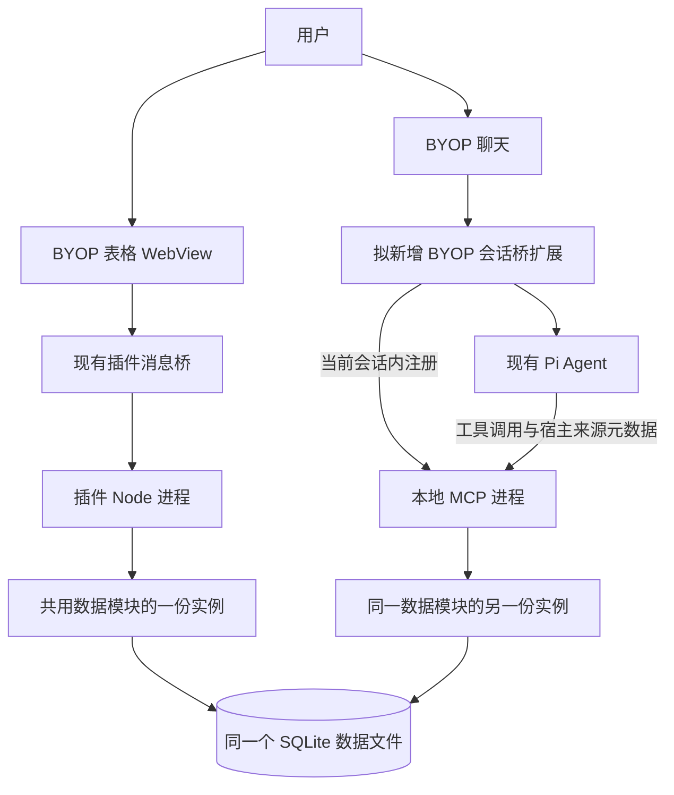
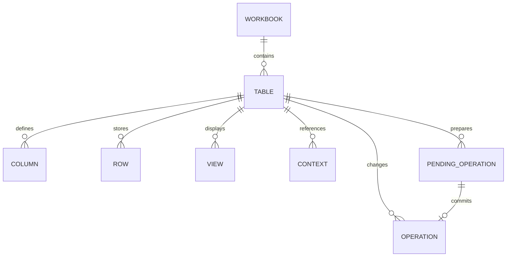
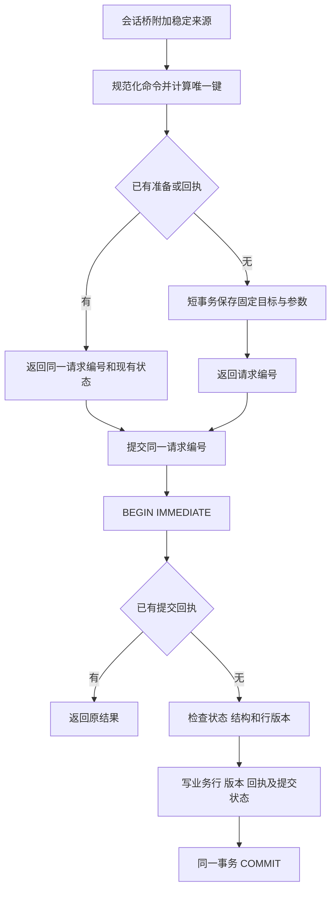

# BYOP 轻量表格插件详细设计

版本：v0.2

日期：2026-10-28

状态：设计稿，尚未实现

设计对象：Lex 的本地个人表格插件，扶摇作为第一张表的字段参考

插件自己保存数据，提供类似 Excel 的表格编辑、筛选、搜索和汇总，同时允许 BYOP 中的 Pi Agent 通过工具操作同一份数据。第一版以一张表的日常使用为边界，不连接原扶摇数据库，不依赖原扶摇服务。

本版处理 2026-10-28 的设计评审。v0.1 保留作为历史版本；本版的变化都属于设计，未实现或验收。

| 评审主题 | v0.2 的处理 |
|---|---|
| Agent 防重复写入 | 宿主持久化消息身份；会话桥传入来源；准备阶段也去重；提交按唯一键返回原回执 |
| BYOP 会话级 MCP | 由显式加载的 Pi 扩展登记和注销，不修改任何用户级或 workspace MCP 配置 |
| SQLite 并发 | WAL、有限锁等待、短写事务、明确检查点与一致性副本规则 |
| 撤销归属 | 页面快捷键只针对本页面操作；Agent 操作从其回执或历史入口撤销 |
| 两类进程的文件权限 | 复用同一启动参数生成器，插件与 MCP 都仅写各自所需的数据目录 |
| 数据对象职责 | `contexts` 与 `pending_operations` 分开；消息投递身份独立持久化 |
| 付费组件 | 明确复制、筛选、合计和 Excel 文件处理由插件实现，不调用 AG Grid Enterprise API |
| GitHub 案例 | 增加源码与文档核实的四类参考，以及不能直接照搬的边界，见第 15 节 |

## 1 设计决定与范围

| 项目 | 本版设计 |
|---|---|
| 产品入口 | BYOP 导航中的“表格”；暂定插件 ID 为 `local.lightweight-table` |
| 数据归属 | 插件独立保存，插件升级与业务数据分开 |
| 使用规模 | 单用户、本机、一个数据文件、一张业务表；以约 1 万行、30 列作为初始设计规模，非已测性能承诺 |
| 存储 | SQLite，本地嵌入式文件，不运行数据库服务器 |
| 页面 | 本地 WebView 表格页面，使用 BYOP 主题与语言能力 |
| Agent | 复用 BYOP 的 Pi 会话与模型，仅在 BYOP 会话内注册本地 MCP 工具 |
| 保存 | 编辑完成后立即提交；只有收到成功回执才显示“已保存” |
| 修改规则 | 用户要求明确且记录唯一时直接执行；只有目标或值不明确时澄清，不新增逐次审批 |
| 恢复 | 最近操作可撤销；删除可恢复；不覆盖后续修改 |
| 数据交换 | CSV 与 `.xlsx` 导入、导出；Excel 文件不是内部存储 |

首版包含单元格编辑、增删记录、调整列宽和顺序、隐藏列、基础列管理、组合筛选、保存视图、精确汇总、Agent 读写、操作回执和撤销。数据库允许通过 `table_id` 区分数据，但首版界面和工具只开放默认表，不同时做多工作簿管理。

首版不包含跨表关联、多人协作、云同步、附件管理、完整公式引擎、数据透视表、宏、合并单元格或复杂财务计算。表格不会因新增一条“已还款”记录自动扣减其他行的本金；此类业务规则需要单独设计。

## 2 运行结构

插件包提供页面使用的 BYOP 插件入口和 Pi 启动的 MCP 入口。两者加载同一版本的数据模块，各自建立数据库连接；没有额外后台 HTTP 服务、固定端口或自建进程间通信服务器。BYOP 另提供一个会话桥扩展，负责当前 Pi 会话内的 MCP 注册和消息来源传递，业务操作仍留在插件中。每个 Pi 会话可以有自己的 MCP 子进程，均使用同一个工作簿文件；进程之间不能靠内存锁去重。

“共用数据入口”表示复用同一套解析、查询、校验、事务和回执代码，不表示两个进程共享内存。并发写入由 SQLite 事务和行版本共同协调。SQLite 支持不同进程通过独立连接读取已提交事务；相关机制见 [SQLite 隔离说明](https://www.sqlite.org/isolation.html)。

| 模块 | 责任 |
|---|---|
| 表格页面 | 呈现查询结果、收集输入、保留编辑草稿和选择状态 |
| 插件入口 | 将页面消息交给数据模块，调用宿主的文件选择和聊天上下文能力 |
| MCP 入口 | 描述 Agent 工具，把工具参数转为同样的数据操作 |
| 共用数据模块 | 字段解释、条件查询、金额转换、事务写入、操作回执、撤销 |
| BYOP 宿主与会话桥 | 插件存储位置、导航、消息桥、上下文附件、持久化消息身份、会话级工具登记和状态 |
| Pi | 模型调用、会话、工具发现与调用，不持有第二份业务数据库 |

关闭表格页面只隐藏页面，Agent 仍可操作。停用整个插件时同时停用对应 MCP 入口；只关闭一个功能时，设置中明确区分“表格页面”和“Agent 工具”的状态。

## 3 文件与数据生命周期

沿用 BYOP 已有配置根目录的约定。拟新增业务数据目录为 `<BYOP_CONFIG_DIR>/plugin-data/local.lightweight-table/`，未覆盖配置根时位于用户目录下的 `.byop`。这是后续运行位置设计，本轮不创建数据目录或数据库。

| 文件或目录 | 内容 | 生命周期 |
|---|---|---|
| 插件安装目录 | 页面资源、插件入口、MCP 入口、共用模块 | 可随插件版本替换 |
| `tables.sqlite` | 表结构、行数据、视图、操作历史和上下文引用 | 独立于安装目录长期保存 |
| `tables.sqlite-wal` / `tables.sqlite-shm` | WAL 与共享内存辅助文件，可能包含尚未归并的已提交数据 | 由 SQLite 管理，不手动删除或只复制其中一个 |
| 插件设置 | 默认表 ID、界面设置、数据文件位置 | 由宿主设置机制保存 |
| 导出文件 | 用户选择的 CSV / XLSX 或完整数据副本 | 仅在用户发起导出时生成 |

首版采用 WAL，理由是页面读取和一个或多个 Agent 进程写入可能并发。WAL 能让读与写并行，但仍只允许一个写事务；它不替代请求去重或行版本检查。回滚日志本身也是正确的方案，本次改动是场景取舍，不代表已经测出旧方案存在性能故障。依据：[SQLite WAL](https://www.sqlite.org/wal.html)、[SQLite 事务](https://www.sqlite.org/lang_transaction.html)。

| 参数或动作 | 本版决定 |
|---|---|
| 数据位置 | 本机非同步数据目录；活动数据库不放入网络共享和云盘同步目录 |
| `journal_mode` | 初始化时设为 WAL 并读回结果；每次建立连接核实实际模式 |
| `busy_timeout` | 每条连接设置 3000 ms；忙时返回暂不可用并保留原请求编号 |
| 写事务 | `BEGIN IMMEDIATE`，取写锁后再核对回执、结构和行版本 |
| 持久化 | 每条连接 `synchronous=FULL`；以明确保存语义为先，后续只有实际延迟问题才讨论取舍 |
| 外键 | 每条连接启用 `foreign_keys=ON` |
| 检查点 | 保留自动检查点，初值 1000 页；不在每次保存或页面刷新时强制 TRUNCATE |
| 读取 | 每页或每次汇总使用短读事务，不在模型推理或分页等待期间保持事务 |
| 退出 | 完成或结束本进程的事务并关闭连接；由 SQLite 处理日志，不假设其他会话已退出 |

以上时间和检查点数值是起始配置，不是性能承诺。单次忙错误结束本次提交尝试，不再叠加无界循环；重试从同一请求编号查回执开始。已结束的读事务释放快照，避免长时间占用旧页面影响检查点。不得通过删除 WAL 来解决锁或空间问题。完整副本继续使用 Backup API，包含已提交但尚未归并到主文件的内容。参数语义依据：[SQLite PRAGMA](https://www.sqlite.org/pragma.html)。

卸载插件保留业务数据；界面隐藏、进程退出和插件升级都不清空数据。首次建库及升级迁移先获取写事务，再读取格式版本并决定是否需要迁移，多个进程不能同时执行同一迁移。启用 WAL 在迁移事务外执行。WAL 下 `BEGIN EXCLUSIVE` 不会额外阻止读者，不能把它当成停止旧进程的手段；升级时宿主先注销并停止此插件的旧进程，再启动新版本。旧版本插件遇到更新格式时说明不兼容，不尝试改写。

“导出完整数据副本”通过 SQLite 一致性快照产生新文件，不直接复制正在写入的主文件。CSV/XLSX 只包含业务表内容，不包含撤销历史、保存视图或内部标识，不能代替完整副本。依据：[SQLite Backup API](https://www.sqlite.org/backup.html)。首版不增加定时备份任务或自动同步。

## 4 数据结构

### 4.1 逻辑对象

| 内部对象 | 关键字段 | 用途 |
|---|---|---|
| `workbook_meta` | `workbook_id`, `format_version`, `name`, `timezone`, `created_at` | 一个数据文件的身份和格式；时区初始取用户环境并持久化 |
| `tables` | `table_id`, `name`, `schema_revision`, `data_revision`, `created_at` | 首版只有一个活动业务表；结构修改和数据修改分别递增版本 |
| `columns` | `column_id`, `table_id`, `label`, `type`, `required`, `config`, `position` | 字段定义；列 ID 固定，显示名称可以修改 |
| `rows` | `row_id`, `table_id`, `revision`, `values`, `created_at`, `updated_at`, `deleted_at` | 一条业务记录；值以列 ID 为键保存为结构化 JSON |
| `views` | `view_id`, `table_id`, `name`, `query`, `column_layout`, `revision` | 保存筛选、排序、显示列、列宽和固定列 |
| `operations` | `operation_id`, `request_id`, `payload_hash`, `source`, `source_session_id`, `source_message_id`, `source_view_instance_id`, `before_after`, `receipt`, `undo_of`, `created_at` | 已提交的写入、来源与撤销依据；`undo_of` 有唯一约束 |
| `contexts` | `context_id`, `table_id`, `kind`, `row_ids_versions`, `query`, `schema_revision`, `data_revision`, `created_at` | 选择和查询引用，不保存待提交操作 |
| `pending_operations` | `request_id`, `table_id`, `execution_scope`, `intent_hash`, `payload_hash`, `normalized_payload`, `expected_versions`, `state`, `supersedes_request_id`, `created_at` | 准备参数、唯一身份和状态；`(execution_scope, intent_hash)` 唯一 |

外键约束表、列、行和视图之间的归属。行 ID、列 ID、操作 ID 使用独立 UUID，不使用行号、名称或页面位置作为身份。`request_id` 在工作簿内唯一，已提交回执关联原准备记录。另由 BYOP 在自己的会话状态目录持久化消息投递信封，包含会话身份、消息 ID、投递状态、用户原话与选择引用；这是聊天来源信息，不混入业务表。

系统字段与用户数据分开；用户不能通过一个同名自定义列覆盖 `revision` 或 `row_id`。JSON 键只接受已存在且属于当前表的列 ID。首版索引覆盖表 ID、行 ID、删除状态与操作请求 ID；不为每个自定义列预建索引。

选择“列定义 + 行 JSON”是为了支持新增列而不为每个用户字段做数据库迁移。它适用于本版规模；复杂跨表分析或大规模数据不在此结构的首版目标内。

### 4.2 列类型与数值规则

| 类型 | 页面行为 | 内部保存 | Agent 输入与输出 |
|---|---|---|---|
| 短文本 | 单行编辑 | 字符串或 `null` | 字符串；保留编号前导零 |
| 长文本 | 详情区多行编辑 | 字符串或 `null` | 按需读取完整内容 |
| 整数 | 数字编辑器 | 安全整数或 `null` | 十进制整数字符串 |
| 小数 | 固定精度编辑器 | 按列精度缩放后的安全整数 | 十进制字符串，如 `"12.345"` |
| 金额 | 右对齐，显示币种和小数位 | 最小货币单位的安全整数 | `"2000.00"`，币种由列定义提供 |
| 日期 | 日历选择 | `YYYY-MM-DD` 或 `null` | 同格式字符串，不带时区转换 |
| 单选 | 下拉选项 | 稳定 option ID 或 `null` | 工具返回可选 ID 与名称，写入使用 ID |
| 布尔 | 勾选或清空 | `true`、`false`、`null` | 三者明确区分 |

小数精度在建列时确定，首版支持 0–6 位；金额模板为 CNY、2 位小数。金额字符串通过十进制解析转换成整数，不先转为浮点数再乘 100。单值缩放后的绝对值不得超过 JavaScript 安全整数范围，超出时返回字段错误。超出列精度的输入要求修正，不静默四舍五入。

汇总在数据模块使用精确整数累加，再转为十进制字符串；即使累计结果超过单值安全整数范围，也不能回落到浮点计算。首版只提供计数、求和、最小、最大，不加入平均值的舍入规则。不同币种分别汇总，不自动换算。

`null` 表示未填写，数值 0 表示明确为零。文本清空统一保存为 `null`，但保留非空文本中的合法空格。排序时空值统一放最后；筛选“为空”单独表达，不把空值当 0。金额列只记录数值，不自行推断借贷方向。

创建时间、修改时间保存为 UTC 时间戳，页面按工作簿时区显示。“本月”“下个月”在请求开始时按工作簿时区展开为明确日期区间；存成视图时区分动态日期条件和固定日期条件。

### 4.3 扶摇示例字段

下面是第一张表的建议模板，字段均为设计示例，不来源于真实账本。基础列可增加、改名和隐藏。

| 列 | 类型 | 说明 |
|---|---|---|
| 名称 | 短文本，必填 | 一条记录的显示名称，不要求唯一 |
| 机构 | 短文本 | 债权方或机构名称 |
| 分类 | 单选 | 待分类、贷款、信用卡、其他；可以编辑选项名称 |
| 本金 | 金额 CNY | 手动记录值，不随其他字段自动重算 |
| 待还金额 | 金额 CNY | 独立记录值，不推断为本金减已还金额 |
| 还款日 | 日期 | 一次明确的日期，不隐含每月重复计划 |
| 状态 | 单选 | 未处理、处理中、已结清；可按需要调整 |
| 备注 | 长文本 | 解释、处理情况、沟通摘要 |

允许名称重复。Agent 遇到同名记录，结合机构、日期等字段区分；仍无法区分时再问用户。状态变化不会隐式改动金额。首版增加列时，已有行对应值为空；重命名不影响视图和工具引用。已有数据的列不提供原地改类型，先新建列再明确转换；删除列暂以隐藏替代，避免首版增加数据结构恢复流程。

有数据的表新增列默认可空；只有现有行都已有值时才能改为必填。单选选项重命名保留 option ID；已被使用的选项不能直接移除，先明确替换这些记录中的值。

## 5 表格界面

### 5.1 布局

| 区域 | 内容与行为 |
|---|---|
| 顶栏 | 表名、保存状态；新增记录、导入、导出、撤销 |
| 视图和查询栏 | “全部”“本月待还”等保存视图；搜索框、筛选、排序、列设置 |
| 条件区 | 当前生效条件，可逐项删除；显示“已修改视图”，提供保存与还原 |
| 表格 | 行选择框、业务列、当前焦点；首列可固定，行内容不透明 |
| 表格底部 | 总记录数、筛选后数量、选中数量、分页和筛选范围的合计 |
| 详情区 | 当前行完整字段，长备注编辑；位于插件内部，不占用 BYOP 任务栏 |
| Agent 入口 | “询问这条”“询问所选”“询问筛选结果”；转到 BYOP 现有聊天 |

窄窗口保留主要列和横向滚动，详情使用覆盖式抽屉。搜索和筛选入口保持可见，低频操作进入“更多”。不强行把所有列压窄，也不降低部分列字号来挤入窗口。

沿用 BYOP 的 12/14/18 px 字号、主题颜色、0.5 px 边框和减少动态设置。首版不增加自动播放或循环动画。文本用语言包；表名、列名、用户输入按数据原样显示。

### 5.2 编辑、选择和保存

| 操作 | 规则 |
|---|---|
| 单击单元格 | 选中并显示焦点，不立即开始编辑 |
| 双击或 Enter | 进入编辑；输入法组词期间 Enter 只确认组词 |
| Tab / Shift+Tab | 提交当前格并移动到下一个或上一个可编辑格 |
| Esc | 取消尚未提交的当前编辑，恢复读取值 |
| 点击其他位置 | 提交当前格；校验失败保留输入并提示原因 |
| 新增记录 | 显示新行草稿，必填信息完整后提交；草稿不计入查询和汇总 |
| 多选 | 使用行选择框；表头默认选本页，另有明确的“选中全部筛选结果” |
| 清空 | 清空当前单元格；必填列不允许提交空值；不把 Delete 键解释为删整行 |
| 删除记录 | 使用明确的删行命令，软删除后从正常视图移除，回执提供恢复 |
| 复制 | 插件从当前值或固定选择生成制表符文本并调用宿主剪贴板；不使用 AG Grid Enterprise 剪贴板 |
| 批量粘贴 | 首版走“从剪贴板导入”的列映射预览；不承诺完整 Excel 范围粘贴 |
| Cmd+Z | 正在编辑时撤销文本输入；不在编辑时只撤销当前页面实例最近的手动数据操作 |

页面状态区分“正在保存”“已保存”“未保存：原因”。磁盘写入失败时保留当前草稿，不刷新成旧值后假装成功。应用关闭导致的未提交编辑不承诺自动恢复；页面存在未提交草稿时，返回聊天前先提交或保留在当前页面，不静默丢弃。

单行多字段的详情保存作为一个事务。连续改单元格是独立操作；批量修改是一项操作。保存成功后如果该行不再满足筛选条件，行从当前结果中移除并提示“已保存，记录不再符合当前筛选”，提供“查看记录”。

### 5.3 搜索、筛选与视图

搜索只覆盖当前表的短文本和长文本列，提供字面子串匹配。ASCII 大小写忽略；不承诺拼音、分词、模糊匹配或完整 Unicode 大小写折叠。金额和日期使用类型筛选，不把显示字符串的匹配当数值比较。

| 类型 | 首版条件 |
|---|---|
| 文本 | 包含、不包含、等于、不等于、为空、不为空 |
| 整数、小数、金额 | 等于、大于、大于等于、小于、小于等于、闭区间、为空 |
| 日期 | 某日、之前、之后、闭区间、本月、下个月、为空 |
| 单选 | 属于所选集合、不属于所选集合、为空 |
| 布尔 | 是、否、为空 |

不同列条件取“并且”；同列多选项取“或者”。搜索条件与筛选条件取“并且”。“不等于”和“不包含”默认排除空值，空值由独立条件处理。首版不开放任意嵌套 AND/OR 表达式。

所有筛选、排序和汇总由共用数据模块执行；表格组件只呈现结果和编辑状态，不再用组件自带逻辑过滤一遍。多列排序以列表顺序为优先级，最后追加行 ID 作为稳定排序依据。文本采用明确的二进制词典顺序，不承诺中文拼音排序。

界面每页默认 100 行；返回结果包含匹配总数、表版本、实际排序和续页信息。表数据版本发生变化时，重新查询当前范围，避免沿用旧页造成重复或漏行。长备注在列表中只返回预览，详情再加载全文。汇总覆盖全部匹配记录，不只计算已加载的一页；界面明确标注范围。

查询引用固定匹配 ID、排序与读取版本。分页和按该引用汇总时，如果数据版本已变，返回“结果已变化，请刷新”；不把不同时间的页面或合计拼成一个结果。选择上下文固定的是目标集合，读取时可以展示这些目标的最新值，但必须指出版本变化；修改仍需以重新准备时明确读取的版本为准。Agent 不能在不检查新值的情况下自动采用更新后的版本重试。

保存视图只保存查询和布局，不复制行。切换视图清空选择，筛选条件变化也清空选择，避免隐藏的旧选择混入新的批量操作。列宽和显示列可保存；未保存的视图修改保留在当前页面，不能覆盖已保存版本。

## 6 保存一致性与撤销

### 6.1 身份与去重范围

防重复从“准备操作”开始。只在提交时检查一个新生成的 UUID，不能处理准备结果丢失后模型又准备一次的情况。宿主消息身份、规范化操作身份和提交请求编号必须区分。

| 身份 | 谁产生并保存 | 稳定范围 |
|---|---|---|
| `source_session_id` | BYOP 的逻辑聊天身份 | Pi 进程重启后继续使用；聊天分支建立独立来源 |
| `source_message_id` | BYOP 在接受一次用户发送时生成并持久化 | 排队、工具重试、网络重连和“重试本轮”沿用；用户明确新发一条消息时才新建 |
| `execution_scope` | 会话桥结合工作簿、来源会话和已投递消息身份计算；合并输入使用固定的有序消息 ID 集合 | 一次指令或明确合并投递的指令集合，不等于整个聊天 |
| `intent_hash` | 共用数据模块对规范化业务命令计算 | 相同动作、同一目标和同一字段值保持一致；忽略临时调用 ID |
| `request_id` | 数据模块第一次准备时分配，并与唯一键绑定 | 重复准备返回同一个编号；数据库重开也不改变 |
| `operation_id` | 提交成功时生成 | 作为实际保存回执和撤销对象 |

唯一去重键为 `(workbook_id, execution_scope, intent_hash)`，工作簿文件内的约束可省略重复的 `workbook_id` 列。`intent_hash` 包含动作、表 ID、固定目标 ID、规范化补丁或新增行数组；金额 `2000` 与 `2000.00` 先按列精度归一，更新目标 ID 排序、对象键排序。新增数组保留每一项及重复次数，不能把用户要求的两条相同记录合并。撤销命令以原操作 ID 为目标。

行版本、结果 ID、tool-call ID、随机临时编号和当前时间不进入业务指纹；首次准备把行版本和结构版本固化到 `normalized_payload`，并另算 `payload_hash` 检查内容完整性。动态日期按该用户消息的持久化时间和工作簿时区解析，重试不能重新按跨日后的“今天”计算。内容指纹处理结构相同的命令，不声称能识别模型换了一套字段后仍属同一自然语言意图。

一条消息允许不同指纹的多项操作，例如先新增 A 再修改 B；每项独立提交，不宣称整条聊天指令具有跨操作原子性。一条消息中完全相同的命令默认为重试；确需新增两条相同记录时，一次新增数组包含两个元素。跨消息的新指令可以再次执行相同内容，不能用全局内容哈希吞掉用户的合法操作。

页面手动修改使用 `source_view_instance_id + client_command_id`：一次编辑提交生成一个稳定命令 ID，保存响应丢失时保留编号重试。页面重新打开后不盲目重放未提交草稿；恢复中的请求先查原结果。

### 6.2 准备和提交

准备与提交是内部工具步骤，不增加用户确认。

准备事务先查询唯一键，再插入；并发插入遇到唯一约束时读取获胜者的记录。重复准备不得覆盖原始参数或重新分配行版本；返回原规范化内容和状态。已经提交的命令直接返回回执。模型尚未拿到请求编号就断线时，再次准备同一命令也只能得到原编号。

提交只接受已有请求编号。获得写事务后，先查已提交回执，再检查待提交状态和版本；顺序不能倒过来，否则已经成功的重试会因行版本已更新而被错误判为冲突。业务行、行版本、表版本、操作前后值、回执和准备记录的 `committed` 状态在同一个 SQLite 事务内保存。

同一编号重复提交返回原回执；禁止在提交时附带另一套字段值。已撤销的原操作仍返回原回执及撤销状态，不重新应用。每次实际修改只递增版本，不把版本恢复到旧值；无变化操作也保存回执，但不伪造受影响行数。

更新、删除和撤销检查行版本，全部操作检查相关结构版本。一个批次任意行冲突则整批不改业务数据。冲突结论可在本次事务中写入准备记录，之后同一编号返回同一结论；用户基于最新数据重新发起或更正操作才生成新的执行范围或内容。不得仅替换预期版本后自动覆盖。

模型推理、文件解析、网络调用、用户等待和大段数据预览都在事务之外。准备与提交之间没有长事务，也不另设已经提交到磁盘的 `executing` 状态；真正执行期由 SQLite 写锁和事务表达，避免进程崩溃留下无法判断的“执行中”。

### 6.3 状态与恢复

| 状态或故障点 | 后续行为 |
|---|---|
| 准备响应丢失 | 通过稳定执行范围和业务指纹找到原准备，返回原请求编号 |
| 两个进程同时准备同一命令 | 数据库唯一约束只保留一个准备记录 |
| `prepared` | 参数已经固定，允许提交；查状态时不据此断言另一个进程没有正在提交 |
| `committed` | 返回已保存回执，不再次执行 |
| `rejected` | 返回原校验或版本冲突；不修改原准备后继续提交 |
| `superseded` | 参数更正已产生新的准备，旧编号不再提交；废弃旧记录和新建替代记录同事务完成 |
| 提交前进程退出 | 未提交事务回滚；重开后用原编号继续核对 |
| 提交成功但回复丢失 | 回执和业务数据同事务已存在，重试返回原结果 |
| `busy` 或通信超时 | 不更换编号，不把“没收到”当作“没写入”；下一次先查回执 |
| 用户取消对话 | 停止后续调用；已经提交的改动仍以回执为准 |

`table_operation` 可按请求编号查询，也可列出当前会话桥来源消息的已准备和已提交操作，支持模型恢复后找回编号。新用户消息中的“继续刚才那笔”应先定位原请求再提交或查结果，不重新准备一笔等价写入。旧消息恢复和聊天分支必须保留原请求与原来源的关系；新分支上的新操作使用新执行范围。

本方案保证的是同一稳定键内的重复准备和重复提交不重复改变本地数据，不把模型语义正确性、所有跨消息重复或外部副作用都描述成 exactly-once。首版工具只修改这一份本地数据文件。

### 6.4 并发与撤销归属

两个进程对同一行都读到版本 7：先提交者把它变为版本 8，后提交者得到版本冲突并读取新值。用户手动输入的草稿仍保留，显示当前值供其判断；Agent 也不能静默覆盖刚发生的人工修改。

撤销以一次操作为单位，根据保存的前后值生成一个新的反向操作。仅当所有目标行仍处于原操作产生的版本时执行；有后续改动则整项撤销失败并指出受影响记录，不抹掉之后的工作。新增记录的撤销为软删除；删除记录的撤销为恢复；批量导入的撤销为软删除该批新增行。

首版提供最近操作列表和撤销，不提供任意历史时间点恢复或重做。结构修改和视图修改不混入数据撤销栈；“撤销”按钮明确指数据操作。数据历史暂不自动清理，容量增长后再根据实际使用增加清理功能。

`Cmd+Z` 只从当前页面实例的手动操作栈选择候选；Agent 的修改不会进入该栈。页面重开产生新实例，历史操作仍可从操作列表明确选择。Agent 回执和操作列表的“撤销”必须引用具体 `operation_id`。数据库对 `undo_of` 设置唯一约束，两个进程同时撤销同一操作只会生成一个反向操作。即使撤销快捷键指向手动操作，如果 Agent 后来修改了同一行，仍按版本规则报冲突。

## 7 Agent 操作方式

### 7.1 上下文如何进入聊天

用户可以在普通聊天中直接要求查询，也可以从表格选择上下文后进入聊天。输入区显示可移除的上下文标签，如“表格 · 本月待还 · 12 条”。第一版不要求聊天和表格同时分屏。

| 上下文 | 发送时固定的内容 |
|---|---|
| 当前记录 | 工作簿、表、行 ID、行版本 |
| 选中记录 | 选中行 ID 和版本；不会因后台排序或页面切换改目标 |
| 当前筛选结果 | 当时匹配的完整 ID 集合、对应行版本、筛选条件与数量 |
| 当前表 | 表 ID 和结构版本；查询时读取当前数据 |

“当前筛选结果”在发送时由数据模块重新执行条件并形成快照；若匹配数量与页面显示变化，标签更新为实际快照数量。未提交草稿必须先提交完成，才可把其记录作为已保存数据交给 Agent。

上下文引用绑定本次发送，不随页面后来选中的行漂移。历史聊天保留可解释的引用，但修改仍按当前版本检查。“刷新这批查询”会生成新引用，不能悄悄扩大旧引用的范围。

没有附加上下文时，Agent 根据表结构查询。用户说“这笔”但没有明确指向时，展示候选记录；用户明确说“所有符合条件的记录”时，工具固定全部匹配集合，不把当前第一页误当全部。

### 7.2 工具契约

以下为拟新增工具，不是 BYOP 目前已经提供的接口。MCP 只负责调用协议，查询和写入仍由插件数据模块处理。Pi 已支持本地 stdio MCP，依据：[Pi MCP 文档](https://github.com/earendil-works/pi/blob/main/packages/coding-agent/docs/mcp.md)。

| 工具 | 主要输入 | 主要输出与行为 |
|---|---|---|
| `table_describe` | 可省略的默认表 ID | 列 ID、显示名、类型、精度、选项、结构版本、工作簿时区 |
| `table_read_context` | `context_id` | 固定范围、数量、原始条件、版本；记录内容按需读取 |
| `table_query` | 列投影、搜索、类型条件、排序、页大小、续页标识 | 行 ID、版本、所需字段、匹配总数、查询引用；默认 20 行，最多 100 行 |
| `table_read_rows` | 明确行 ID、字段、分页或文本偏移 | 完整字段或长文本分段，不把所有备注一次塞进上下文 |
| `table_aggregate` | 查询引用或查询条件、列 ID、计数/求和/最小/最大 | 精确结果、实际范围、空值数量、单位和币种 |
| `table_prepare_change` | 新增/修改/删除、目标引用、字段和值；撤销时提供原操作 ID；更正时指定被替代请求 | 会话桥附加来源，按唯一键创建或返回原准备；不改变业务行 |
| `table_commit_change` | 准备步骤返回的请求编号 | 原子提交或原回执；不再接收另一套字段值 |
| `table_operation` | 请求编号、操作 ID，或当前来源消息内的操作列表 | 返回准备状态和已提交回执，支持丢失编号后的恢复查询 |

撤销也通过准备和提交执行，准备时把原操作 ID 与反向修改绑定。一个原操作只能有一项已提交的撤销；对同一操作重复撤销返回已有撤销回执，不产生第二次反向修改。页面“撤销”按钮直接完成这两步，不增加用户确认。

首版 Agent 不修改列类型、清空整库或管理工作簿文件。普通增改删覆盖用户已要求的业务数据操作。条件使用列 ID 和结构化运算符；工具不暴露任意 SQL，也不让模型生成文件修改脚本。

修改字段采用补丁语义：未提供的字段保留，显式 `null` 才表示清空。单次准备只针对一个表和一种业务动作；同类新增可使用数组，保留重复项。批量目标在数据层保存，不通过聊天枚举全部行。上下文保存在 `contexts`，固定操作保存在 `pending_operations`，回执保存在 `operations`；三者通过 ID 关联，不依赖模型的文字摘要恢复。

工具公开业务参数，来源字段由会话桥在调用前填入保留的 `_byop` 对象，不能要求模型填写或沿用模型自报值。该对象包括工作簿、会话、消息来源及对应信封引用；其内容不是秘密，作用是正确关联操作。MCP 入口根据启动绑定和宿主信封核对关联；缺失时返回来源不可用，不临时生成另一套身份。普通查询可以继续，写入需要可识别的来源。

MCP 输入 schema 明确预留可选 `_byop` 字段，使桥注入后的参数仍通过服务端解析；它不属于模型必填业务参数。即使模型提供该字段，桥也以本次真实来源替换。适配器不能只收到任意字符串就认定其有效，更不能把 JSON-RPC ID、Pi tool-call ID 和宿主消息 ID 混为一谈。

参数更正通过 `supersedes_request_id` 明确指向被替代的未提交准备，不能自动废弃同一条消息中的其他合法操作。已提交操作的更正是一个新的明确修改或撤销，不修改原回执。普通查询引用可重建，已提交的请求编号长期保留；首版不自动清理历史，也不把准备记录过期后当成全新命令重做。

准备提交前必需的目标与值都明确时，Agent 连续调用准备和提交，用户不需要再点确认。只有同名对象、含糊日期、无法确定的字段值或冲突会触发澄清。用户只要求“看看怎么改”时，停在准备结果并解释，不执行提交。

### 7.3 查询与变更结果

| 回执字段 | 含义 |
|---|---|
| `status` | `prepared`、`committed`、`rejected`、`superseded`、`undone`、`not_found`、`unavailable`；错误细分放在 `code` |
| `operation_id` / `request_id` | 查回执与撤销的依据；另返回 `replayed` 标识是否读取了已有结果；未找到不能直接推断原操作失败 |
| `table_id`, `data_revision` | 操作归属和提交后的数据版本 |
| `affected_count` | 实际改变的行数；无变化时为 0 |
| `changes_preview` | 少量记录的前后值，总量由 count 表达 |
| `result_ref` | 用于在表格打开结果的内部引用，不能是任意可执行地址 |
| `undo_available` | 当前是否支持撤销；点击时还会重新检查版本 |

Agent 回答示例：“已将选中的 3 条记录状态改为‘处理中’，其他字段未变。”同时提供“在表格中查看”和“撤销”入口。入口需要宿主理解结构化结果，不能只靠模型生成链接。

缺少匹配数据返回“0 条”，不当作工具故障。读取部分字段被截断时返回明确的继续读取标识。筛选用的表格文本按数据处理，不作为 Agent 的指令。只把当前任务需要的字段返回给模型；本地存储并不意味着云端模型推理也在本地，所选模型仍可能接收这些工具结果。

### 7.4 三个完整例子

| 用户要求 | 执行路径 | 结果 |
|---|---|---|
| “下个月要还多少” | 读列定义和时区 → 按还款日查询 → 对待还金额求和 | 明细入口、合计、空值条数；空金额不伪装成 0 |
| “把选中的记录标记为处理中” | 读取发送时固定的上下文 → 准备修改 → 提交 | 全部成功或全部冲突，表格按当前视图刷新 |
| “新增一条样例，机构为示例银行，待还金额 2,000 元，下月 15 日还” | 按请求当天解析日期 → 规范化金额 → 准备新增 → 提交 | 新行 ID、实际保存值和查看入口；名称缺失且无合理已给值时再询问 |

## 8 导入与导出

| 环节 | 首版规则 |
|---|---|
| 文件选择 | 用户选择 CSV 或 XLSX；不读取任意目录中的文件 |
| 工作表选择 | XLSX 显示工作表列表，单次导入一张；不静默使用第一张 |
| 列映射 | 按名称建议映射，可改列、忽略列、明确新增列 |
| 数据预览 | 展示类型转换和行数；导入预览属于数据整理步骤，不是 Agent 写入审批 |
| 提交方式 | 首版只追加新行，不按名称自动合并，也不覆盖已有记录 |
| 错误处理 | 无效日期、超精度金额、缺少必填项标出源行号；修正后整批提交，不默认跳过错误行 |
| 重复导入 | 同一次导入重试复用请求编号；重新选择同一文件是新的明确导入，不以内容相同为由自动删重 |
| 导出范围 | 全部、当前筛选结果、选中记录；范围和列选择清楚显示 |
| 导出结果 | UTF-8 CSV 或 XLSX，列名为用户显示名称，编号按文本，日期按日历日期 |

XLSX 读取已保存的单元格值；公式仅在有缓存结果时作为导入候选，并在预览标注，插件不重新计算公式。无缓存结果、合并单元格含糊或不支持的单元格类型时指出具体位置，不猜值。CSV 中 `03/04/2026` 等不明确日期要求选择格式；不自动把贷款编号转成数字。

导出 XLSX 时，只在往返不会损失有效数字时写成数值单元格，超出 Excel 精度范围的内容按文本保存并说明。文本以文本类型导出，包含 `=` 的备注不生成公式。CSV 的文本转义和电子表格打开方式在导出选项中说明，避免把用户文本误当公式。

原文件由宿主文件选择接口授权读取，文件内容由 Node 侧分块处理；大文件不作为 base64 消息穿过 WebView。解析和预览可分批进行，最终业务写入保持一个事务。超过初始设计规模时报告文件规模和处理限制，不自动截断数据。

文件桥采用句柄方式：宿主将所选输入复制到插件数据目录中的临时导入区，返回可读取的句柄；插件输出先写入同一数据目录的临时导出区，宿主再写到用户选择的位置。完成或取消后清理临时文件。无需为每次选文件重启插件，也无需开放整个文件系统。页面批量输入同样先分块暂存，再由一次提交合并写入业务行；桥接消息按序列化后的字节数限制在 48 KiB 内，为现有 64 KiB 上限预留封装空间。单页超出预算时减小返回行数并提供续页标识。

导出文件另存到用户选择位置。Excel/CSV 的往返用于业务数据交换，不承诺保留原工作簿公式、排版、图表或内部行 ID。

## 9 页面与 Agent 的数据同步

页面编辑成功后使用回执更新行，再重新查询受影响的筛选结果与合计。Agent 写入由另一个进程完成，页面通过表的 `data_revision` 和 `schema_revision` 发现变化。

首版在页面可见时约每秒检查一次轻量版本号；离开页面停止检查，返回或重新获得焦点时立即检查。该机制属于页面刷新，不新增自动化调度器。只有版本变化才拉取数据，不每秒重载整张表。

收到变化时保留滚动位置、列布局和未提交草稿。正在编辑的行如果被外部修改，显示冲突状态；不在用户输入中途替换内容。已有 `host.refreshView` 对 WebView 会重载页面，因此不能作为每次保存后的同步方法。

后台修改导致已选记录不再满足筛选时，界面从选择集合中移除不再显示的行；此前已经发送到聊天的上下文引用仍保留其原始范围。

## 10 BYOP 需要补充的能力

本节以当前本地 BYOP `ebfeb4b` 为核对基线。名称是设计名称，不是现有可调用接口。

| 能力 | 当前代码 | 首版需要的增量 |
|---|---|---|
| 本地页面与消息 | 已有 `contributes.webviews`、`plugin.postMessage` | 复用，不新建远程页面入口 |
| 主题和语言 | 已有主题变量及语言事件 | 复用并覆盖表格编辑器、下拉菜单、空状态 |
| 私有数据目录 | 现有 Node 读写权限围绕插件根和工作目录 | 插件与 MCP 统一生成 Node 启动参数，均只写插件数据目录及所需状态文件 |
| 原生文件选择 | 当前插件桥没有导入导出文件契约 | 增加选文件、选保存位置和文件传输句柄；不把原始文件内容塞进大消息 |
| 聊天上下文与消息来源 | 当前没有表格选择附件，也未把宿主消息身份传给 MCP | 增加消息投递信封、会话桥和结构化附件，发送时固定来源与范围 |
| MCP 登记 | Pi 支持扩展会话注册；BYOP 插件清单没有 MCP contribution | BYOP 显式加载会话桥，按会话 register/unregister，并显示实际工具状态 |
| 结果打开与撤销 | 当前工具事件可显示，未有本插件动作 | 为表格工具回执增加“查看记录”“撤销”的结构化动作处理 |
| 数据刷新 | 现有 WebView refresh 会重载 | 由插件页面增量查询；视图可见性由宿主通知或受验证的页面事件提供 |

现有插件清单严格拒绝未知字段，因此新增数据目录或 MCP 声明时，需要明确更新清单结构、验证与兼容性，不能直接在旧清单里添加字段后假定有效。

### 10.1 仅在 BYOP 会话内注册 MCP

BYOP 启动外部 Pi 时，通过现有 `--extension` 参数显式加载自己的会话桥文件。桥不安装到全局扩展目录，也不写 `~/.pi/agent/mcp.json` 或项目 `.pi/mcp.json`。普通终端启动的 Pi 因没有加载此桥，不会因此多出扶摇表格工具；用户原有 MCP 不变。

会话桥调用 `pi.registerMcpServer(name, config)`，配置本地 Node 可执行文件、MCP 入口、工作簿绝对位置与当前宿主会话绑定。注册是内存态，扩展重新加载或新建会话时重新登记。插件停用或会话关闭时使用 `pi.unregisterMcpServer(name)`，使对应连接关闭且工具不可调用。已进入 SQLite 提交的操作仍按其实际回执判断，注销不是事务回滚。

本版八个工具默认 `exposure=direct`，便于这个小工具集直接出现在模型可用列表中；这是本插件的交互选择，不是 MCP 协议要求，`codemode` 也并非不能使用。调用通过 direct 或嵌套 codemode 到达时，都必须走同一来源绑定和请求去重逻辑。

服务器名按插件和工作簿身份稳定派生。Pi 的文件配置同名项会覆盖扩展注册，所以桥在登记后检查实际来源；发现同名覆盖时显示具体冲突，不覆盖用户配置或悄悄连到另一份账本。只有连接完成且工具可调用才显示“已连接”，不能把 register 调用返回当作连接成功。

依据：本机 Pi 1.4.0 的 `docs/mcp.md`、`docs/extensions.md`，以及 GitHub 的 [会话 MCP 测试](https://github.com/earendil-works/pi/blob/a92283056d915c758799fcd904948ff0cb42628c/packages/coding-agent/test/suite/agent-session-mcp.test.ts)。源码包含动态注册、注销和同名文件配置优先的测试；本轮阅读了测试，没有运行它。

### 10.2 把稳定消息身份传到工具

不能把 Pi RPC 的响应 `id` 当作用户消息 ID；它用于匹配一次 RPC 请求。当前普通 prompt 也没有直接传递任意业务元数据的字段。v0.2 为此明确增加宿主会话桥路径，不假定原接口已经透传这些信息。

| 步骤 | 拟新增契约 |
|---|---|
| 宿主接收用户发送 | 先持久化消息信封：工作簿、逻辑聊天/分支、`source_message_id`、发送时间、正文、上下文引用、投递方式 |
| 交给 Pi | 宿主通过会话桥注册的内部命令传递信封引用；命令名为设计契约，不是 Pi 内置命令 |
| 会话桥入队 | 读取信封，使用 `pi.sendMessage` 的自定义消息 `details` 携带来源，正文仍是用户原话，按 steer/followUp 方式入队 |
| 实际进入模型上下文 | 由消息生命周期确认已投递；仅“进入队列”不能切换当前操作来源 |
| 发出工具调用 | 来源固定到产生该调用的模型请求；`tool_call` 钩子附加 `_byop`，并绑定当前 tool-call ID 供异步完成时读取 |
| MCP 准备与提交 | 与启动会话和宿主信封核对后计算稳定唯一键；工具重试不依赖新的 tool-call ID |
| 重连与恢复 | 从宿主信封、Pi 持久化自定义消息及数据库请求记录恢复；不只依赖内存中的“最后一条消息” |

本机 Pi 自定义消息可以携带 `details`，转换给模型时保留正文并作为 user 内容处理；`details` 不需要塞进模型提示词。桥使用专用类型 `byop.user-message`，普通聊天正文与图片原样传递。BYOP 目前主要按普通 user 消息呈现，所以还需为该类型补齐用户气泡、历史恢复、消息计数与命名流程的识别。这个成本属于宿主适配，不能写成零改动。已有斜杠命令和技能调用继续走其原有解析流程，不把命令文本误当普通自定义消息；命令引发的表格写入若没有可追溯来源，返回具体缺失信息，不猜测当前用户消息。

两个消息同时排队时必须分别保留信封；新消息尚未真正投递时，旧消息的工具调用继续归属旧消息。消息在一次模型请求中合并投递时，把其有序来源集合固定为本轮来源范围，不能仅取最后一个 ID。重试沿用该范围。模型同一次请求可以并行执行不同工具，每个调用保留相同来源快照与独立业务指纹，不能用一个不断变化的全局变量归属请求。

重复投递同一信封应返回已有投递状态。若崩溃发生在 Pi 已持久化消息但宿主尚未收到确认之间，重启时先从 Pi 会话历史对账；不能确定时不自动再发起一轮写入。这里处理的是宿主内部恢复，不增加用户每次操作的审批步骤。用户点击“重试本轮”沿用原身份；用户新发一条相同文字则视为新的明确指令。

`registerMcpServer`、自定义消息及 `tool_call` 输入修改在本机文档/类型中已有依据；信封命令、BYOP 渲染适配、投递对账和精确调用归属属于待实现契约，仍需按第 13 节做直接验证。

### 10.3 两个数据进程使用一致的文件范围

插件 Node 入口与 MCP Node 入口都使用同一个启动参数生成器：只读插件发布目录，只读需要的宿主会话信封，只写该插件的数据目录（含 WAL、SHM、临时导入导出）。MCP 通过 `registerMcpServer` 的 command/args 同样带入这些参数，不能依赖 Pi 进程会自动传递文件限制。

这些参数不是新的用户审批界面，沿用宿主现有 Node 权限机制。数据库解析后的绝对位置在两个入口必须一致；数据文件、模型凭据和任意项目源码不通过工具参数随意切换。Node 权限行为与内置 SQLite 的实际配合仍需在实现时验证，本稿不把它描述成已验证的系统级隔离。

宿主只增加上述通用接点，表格查询、金额类型、撤销和导入映射留在插件中。不会把扶摇业务字段写入 BYOP 核心。

## 11 技术选择

| 部分 | 设计选择 | 说明 |
|---|---|---|
| 表格页面 | React + AG Grid Community 候选 | 使用网格、编辑、行选择和虚拟化；组件版本在实现开始时固定 |
| 表格外围 | 插件自己的筛选栏、合计栏、详情抽屉 | 统一数据层语义，不依赖付费高级筛选和状态栏 |
| 数据访问 | Node 内置 `node:sqlite` 候选 | 避免额外数据库服务和本地扩展编译；需核实实际 Node 版本 API |
| 数据接口 | 共享 TypeScript 模块，发布为本地 JS | 插件和 MCP 都加载同一发布版本 |
| Excel | ExcelJS 候选，Node 侧读写 | 和网格组件分开，实现普通数据导入导出 |
| Agent 协议 | 会话级 MCP stdio + BYOP 会话桥 | 沿用 Pi 的模型调用与工具管线，宿主只补来源与生命周期 |

AG Grid Community 为 MIT 许可，提供基础网格功能；高级 Excel 导出、范围选择和增强剪贴板等属于 Enterprise 能力。本版不用这些付费接口：导入导出交给独立文件模块，范围粘贴走明确的导入预览，自建筛选与汇总。依据：[AG Grid Community 与 Enterprise](https://www.ag-grid.com/react-data-grid/community-vs-enterprise/)。是否选用该组件还需在实际 MyGo WebView 中核实输入法和键盘表现；本轮未安装或试运行。

“复制选中行”、筛选面板、汇总栏和 XLSX 文件处理均由插件自己的模块负责，不调用 Enterprise 的 Clipboard、Tool Panel、Status Bar 或 Excel Export。首版验收核对实际导入的社区包与调用点，不以界面上没有付费提示作为唯一判断。相似案例使用 Tabulator，作为替代组件参考保留；本轮未因此更换既定候选，也不假定两者所有功能与包体相同。

截至本次查证，Node 官方文档把 `node:sqlite` 标为 Release candidate，不能写成完全稳定 API；Node 25 与 26 文档还存在数据库类名称差异。实现应按实际 Node 版本固定调用方式，并与 BYOP 当前要求的 Node ≥25 做兼容核对，不使用“最新版文档等于本机版本”的假设。依据：[Node 25 SQLite](https://nodejs.org/docs/latest-v25.x/api/sqlite.html)、[Node 当前 SQLite](https://nodejs.org/api/sqlite.html)。

ExcelJS 的读写能力以[官方仓库](https://github.com/exceljs/exceljs)为候选依据；实现前只核实本次要用的数值、日期和工作表接口，不预先承诺完整 Excel 兼容。

## 12 边界和异常反馈

| 情况 | 页面与 Agent 行为 |
|---|---|
| 没有记录 | 显示新增或导入入口，不自动填入真实数据或样例 |
| 找不到记录 | 返回未找到，保留原查询条件 |
| 查询匹配多条 | 查询正常展示；指令只要求一条修改时先确定目标 |
| 字段格式错误 | 精确到列和记录；当前操作未保存 |
| 数据已被修改 | 保留当前输入，显示最新值或返回冲突，重新确定修改内容 |
| 写入结果暂不明确 | 查原请求编号，不换编号重复执行 |
| 数据文件不可写或磁盘不足 | 显示“未保存”及原因，不只给一个网络错误 |
| 数据文件损坏 | 报告文件与错误，保留原文件，不创建空文件覆盖 |
| MCP 未连接 | 表格仍能手动使用，Agent 工具状态显示未连接 |
| 页面不可用 | MCP 可继续操作，返回结构化回执；之后打开页面读取真实状态 |
| 插件整体停用 | 页面和工具均显示停用，数据文件保留 |

## 13 后续实施的直接验收场景

本节列出与首版功能直接对应的检查，不代表本轮已经执行，也不扩大为性能压测或全量回归。后续代码修改仍按 BYOP 项目现有检查要求执行。

| 场景 | 预期结果 |
|---|---|
| 新增记录并重开插件 | 字段值、金额和日期保持一致 |
| 金额输入、清空和求和 | 分级精度准确，空值与零区分，累计不发生浮点误差 |
| 筛选结果超过一页 | 页面、Agent、合计和导出使用一致范围 |
| 同名两行，用户指定其中一条 | 只修改固定 ID 的记录 |
| 发送选择后改变排序或切换页面 | Agent 仍使用发送时的固定范围 |
| 页面与 Agent 修改同一版本 | 一次成功，另一次得到可解释的冲突 |
| 一批记录中一行发生冲突 | 整批不写入，不出现部分成功伪装全部成功 |
| 保存成功但客户端未收到响应 | 同一请求编号查到原结果，重试不产生重复行 |
| 准备结果未送达模型，模型再次准备 | 相同来源和规范化命令返回原请求编号，最多提交一次 |
| 同一消息两项不同操作，或批量新增两条相同记录 | 不同业务动作均被执行；数组内的合法重复记录不被去掉 |
| 用户新发相同文字与“重试本轮” | 前者是新指令，后者沿用原来源，不能混为同一种去重 |
| 两个 BYOP 会话同时提交同一请求 | 数据库唯一约束和事务只形成一个回执 |
| 提交事务中途退出，以及提交后回复丢失 | 前者不留下部分业务数据，后者查到已提交回执 |
| 删除、撤销以及撤销前发生后续编辑 | 可恢复未被改动的操作；存在后续修改则不覆盖 |
| Agent 刚修改另一行，用户在页面按 Cmd+Z | 只选择本页面的手动操作；Agent 操作不进入页面撤销栈 |
| CSV/XLSX 导入并导出 | 列映射、前导零、日期、空值与金额保持规定语义 |
| 中文输入法、Tab 和 Esc | 组词不误提交，焦点与取消行为符合设计 |
| 插件停用和重新启用 | 工具状态一致，不删除数据或重复登记 |
| 普通终端 Pi 与两个 BYOP 聊天分别启动 | 只有 BYOP 会话加载此 MCP；其注册和注销互不串扰 |
| 同名 MCP 文件配置、替代 MCP 扩展或连接失败 | 明确报告实际状态，不覆盖用户配置，不假装已连接 |
| 排队、插话、重连、分支与消息恢复 | 每次写入绑定已投递的来源；待投递消息不夺走正在执行工具的归属 |
| 两个数据进程都启用目录参数 | SQLite 主文件与辅助文件能正常访问，进程之间的允许目录一致 |
| WAL 下短查询、批量写入和快照导出 | 查询不持有跨模型等待的事务；忙错误有界，完整副本含已提交数据 |

实施顺序建议为：数据模块及最小宿主接点 → 可编辑表格 → Agent 查询和写入 → 导入导出及结果联动。每一阶段都交付可验证的完整链路；本稿不指定工期，也不自动启动实现。

## 14 核对依据与设计边界

| 依据 | 支持的判断 |
|---|---|
| `plugin_manifest.go` | 当前 contribution 类型；严格拒绝未知清单字段 |
| `plugin_node.go` | Node ≥25 要求、插件文件与工作目录读写参数 |
| `plugin_settings.go` | BYOP 配置根与插件设置文件位置 |
| `plugin_webview.go` | 本地页面、消息桥、64 KiB 消息限制及刷新重载行为 |
| `plugin_host_calls.go` | 现有宿主调用，不含表格上下文或文件选择接口 |
| `plugin_view.go` | 现有原生视图块，未提供可编辑网格 |
| `pi_rpc.go` | 外部 Pi RPC 进程；自定义消息来源与显示适配尚需新增 |
| 本机 Pi 1.4.0 的 `docs/mcp.md`、`docs/extensions.md`、`dist/core/extensions/types.d.ts`、`dist/core/messages.js` | 会话 MCP 注册、自定义消息 details、tool_call 输入修改，以及自定义消息转模型 user 内容的实际依据 |
| `AGENTS.md` | 插件设计系统、语言包、开发边界和现有检查要求 |

本版的产品方向已由用户确认；字段模板、组件候选、工具名和具体交互仍是设计契约。2026-10-28 上一轮在本机以内存库确认了 Node v26.10.0 提供 `DatabaseSync`，SQLite 为 3.53.4；这不是磁盘 WAL 或并发验证。本轮只更新文档、读取 GitHub 案例和本机代码，未创建业务数据库、安装依赖、运行插件、读取真实账本或执行真实 Agent 写入。

## 15 GitHub 类似案例与借鉴边界

检索日期：2026-10-28。先按 spreadsheet、SQLite、MCP 检索，再核对仓库中的具体文件。以下都只是源码和文档核实，不表示这些仓库已经在本机运行，也不表示其完整产品适合直接作为 BYOP 插件。

### 15.1 SQLite Spreadsheet Sync

仓库：[MauricioPerera/sqlite-spreadsheet-sync](https://github.com/MauricioPerera/sqlite-spreadsheet-sync)。核对快照：`30b942da6ecdd94e07ae7a28d1ba72e503ab401c`；仓库 LICENSE 为 ISC。

这是产品形态最接近的例子：React 页面使用 Tabulator，提供单元格编辑与 Excel/CSV 文件操作；`mcp.js` 和页面后端引用同一个 `database.js`，MCP 通过 stdio 调用 SQLite 的读取、新增和修改方法。读到的数据库模块还把批量导入放入独立连接的事务。

| 可借鉴 | 本设计不直接照搬的部分 |
|---|---|
| 页面和 MCP 复用数据模块及同一数据文件 | 项目使用 Express 和网页服务，不是 BYOP 原生插件 |
| 表格交互与导入导出分离 | 自带多表、webhook 等范围超出本版目标 |
| 批量导入使用独立事务连接 | 所读 `add_row` 路径没有稳定请求编号、回执去重和预期版本，不能拿它证明防重复已经解决 |
| Tabulator 可作网格组件备选 | MCP 存在整表读取和 SQL 查询入口，与本设计的分页、结构化条件不同 |

另外，所读 `database.js` 初始化会输出 `console.log`，而 `mcp.js` 先调用该初始化再启动 stdio 服务；直接复用时可能混入协议 stdout。这是仅凭源码能看出的差异，未做运行复现。当前任务只借鉴结构，不复制其入口代码。

具体证据：[MCP 入口](https://github.com/MauricioPerera/sqlite-spreadsheet-sync/blob/30b942da6ecdd94e07ae7a28d1ba72e503ab401c/mcp.js)、[数据库模块](https://github.com/MauricioPerera/sqlite-spreadsheet-sync/blob/30b942da6ecdd94e07ae7a28d1ba72e503ab401c/database.js)、[页面](https://github.com/MauricioPerera/sqlite-spreadsheet-sync/blob/30b942da6ecdd94e07ae7a28d1ba72e503ab401c/frontend/src/App.jsx)、[MCP 说明](https://github.com/MauricioPerera/sqlite-spreadsheet-sync/blob/30b942da6ecdd94e07ae7a28d1ba72e503ab401c/docs/MCP.md)、[LICENSE](https://github.com/MauricioPerera/sqlite-spreadsheet-sync/blob/30b942da6ecdd94e07ae7a28d1ba72e503ab401c/LICENSE)。

### 15.2 Grist Core

仓库：[gristlabs/grist-core](https://github.com/gristlabs/grist-core)。核对快照：`897d07997d0d101b7fe5ecfaca61bb5f4e3a6ce0`；该快照 LICENSE.txt 为 Apache-2.0。

`DocStorage.ts` 明确将文档保存为 SQLite 文件，并有文档身份、插件数据及操作历史的内部表；`ActionHistoryImpl.ts` 把操作内容和来源信息编码、计算校验值，并提供历史记录管理。可借鉴“一个文档的数据与其操作记录一起保存”的组织方式。

Grist 是完整的表格数据产品，具有独立的数据引擎、协作和历史模型，不能因同用 SQLite 就整套引入。它的 `getSqliteMode()` 支持多个模式且该快照默认值为 `nosync`，因此不能说“Grist 默认用 WAL，所以我们也必须用 WAL”；本设计的 WAL 决策依据自身读写方式与 SQLite 官方语义。

具体证据：[文档存储](https://github.com/gristlabs/grist-core/blob/897d07997d0d101b7fe5ecfaca61bb5f4e3a6ce0/app/server/lib/DocStorage.ts)、[操作历史](https://github.com/gristlabs/grist-core/blob/897d07997d0d101b7fe5ecfaca61bb5f4e3a6ce0/app/server/lib/ActionHistoryImpl.ts)、[LICENSE](https://github.com/gristlabs/grist-core/blob/897d07997d0d101b7fe5ecfaca61bb5f4e3a6ce0/LICENSE.txt)。

### 15.3 Pi 会话级 MCP

仓库：[earendil-works/pi](https://github.com/earendil-works/pi)。GitHub 核对快照：`a92283056d915c758799fcd904948ff0cb42628c`；与本机 1.4.0 文档交叉核对，不假定默认分支和本机源码完全一致。

官方 MCP 文档描述由扩展登记当前会话的服务器；测试包含扩展加载时连接、运行中动态登记与注销、不同 exposure，以及文件配置同名项优先。它直接支持本版会话级 MCP 的生命周期设计。

Pi 的 `registerMcpServer` 本身不替 BYOP 生成用户消息身份，也不自动给工具加幂等键。自定义消息信封、工具来源注入和 BYOP 的显示适配仍是本项目待实现部分。`direct` 是小工具集的展示选择，不是注册成功的必要条件。

具体证据：[MCP 文档](https://github.com/earendil-works/pi/blob/a92283056d915c758799fcd904948ff0cb42628c/packages/coding-agent/docs/mcp.md)、[扩展契约](https://github.com/earendil-works/pi/blob/a92283056d915c758799fcd904948ff0cb42628c/packages/coding-agent/docs/extensions.md)、[会话 MCP 测试](https://github.com/earendil-works/pi/blob/a92283056d915c758799fcd904948ff0cb42628c/packages/coding-agent/test/suite/agent-session-mcp.test.ts)。

### 15.4 AWS Powertools Idempotency

仓库：[aws-powertools/powertools-lambda-typescript](https://github.com/aws-powertools/powertools-lambda-typescript)。核对快照：`4468b5209cb6e8ded133d5b2ba52aca65328b833`。

`BasePersistenceLayer` 在操作前解析稳定身份，分开保存幂等键和内容哈希，复用原身份查询并校验内容；`IdempotencyHandler` 根据进行中或完成状态返回不同结果，完成后可重用保存的响应。这是防重复操作机制的参考，不是表格插件案例。

本版借鉴稳定身份、内容校验和回执复用，不引入 AWS、DynamoDB、Lambda 或云端锁。尤其不能把“先做业务，再另写成功记录”照搬到本插件：本地业务数据和回执都在同一个 SQLite 里，必须同事务提交，才能处理写完业务后进程退出的情况。

具体证据：[IdempotencyHandler](https://github.com/aws-powertools/powertools-lambda-typescript/blob/4468b5209cb6e8ded133d5b2ba52aca65328b833/packages/idempotency/src/IdempotencyHandler.ts)、[BasePersistenceLayer](https://github.com/aws-powertools/powertools-lambda-typescript/blob/4468b5209cb6e8ded133d5b2ba52aca65328b833/packages/idempotency/src/persistence/BasePersistenceLayer.ts)。

### 15.5 本版采用的组合

| 设计问题 | 参考来源 | 本版采用 |
|---|---|---|
| 表格与 Agent 操作同一数据 | SQLite Spreadsheet Sync | 双入口共用数据模块，本地数据独立保存 |
| 数据与操作历史如何组织 | Grist Core | 稳定文档身份，业务数据与历史一起持久化 |
| 工具只进入 BYOP 会话 | Pi 自身文档与测试 | 显式扩展加载，按会话注册和注销 MCP |
| 请求重试如何不重复写 | AWS Powertools 的机制 | 稳定来源和内容身份、准备去重、已提交回执复用 |
| 本地读写并发 | SQLite 官方文档 | WAL、短事务、有限锁等待和一致性副本 |

这几项共同形成可实施的设计依据；本轮没有发现可直接安装、同时满足全部 BYOP 契约的现成插件，也未据此扩大为完整表格平台。
