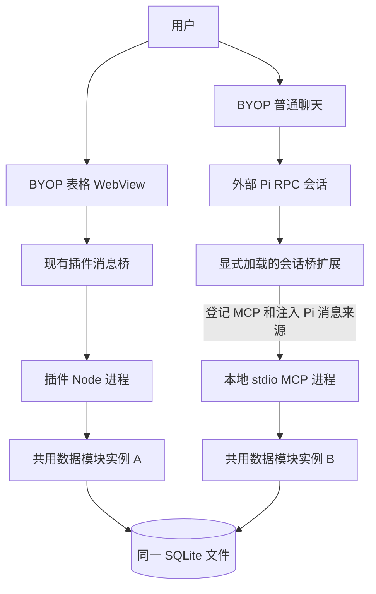
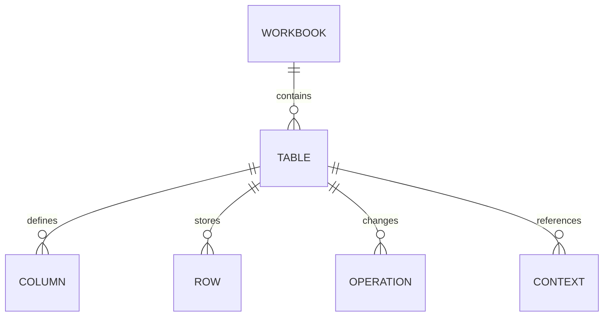
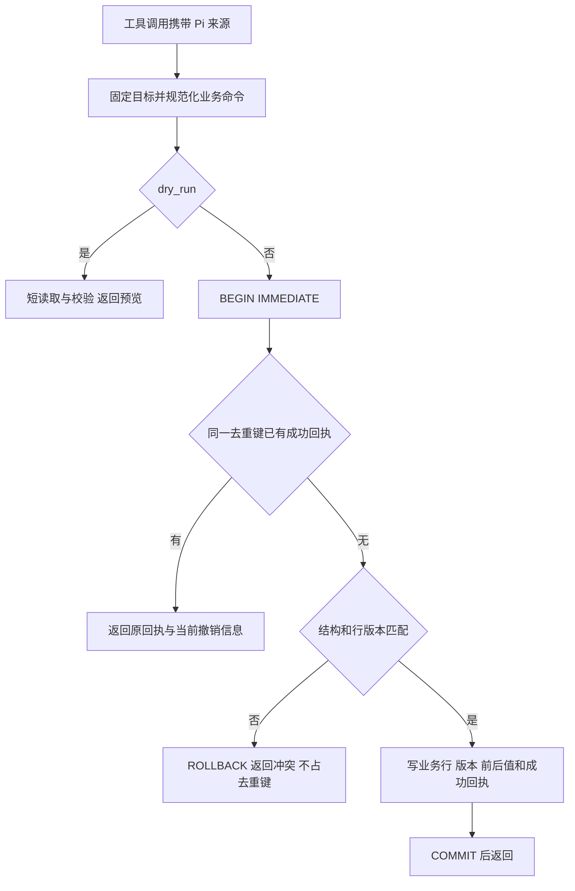

# BYOP 轻量表格插件详细设计

版本：v0.5

日期：2026-10-28

状态：收敛设计稿；三项定向修订已完成，尚未实现或运行验证

设计对象：Lex 的本地个人表格插件，扶摇作为第一张表的字段参考。

插件独立保存数据，提供类似 Excel 的表格编辑、筛选、搜索和汇总，允许 BYOP 中的 Pi Agent 操作同一份数据。第一版以本机单用户、一张表为边界，不连接原扶摇数据库，不依赖原扶摇服务。

本版仅处理 v0.4 复审的三个问题，并同步直接关联的数据契约与验收场景；v0.1–v0.4 保留作为历史。首版范围不变，不增加 Agent 工具或恢复消息信封、准备/提交两步流程。

| 修订主题 | v0.5 决定 |
|---|---|
| 运行与消息来源 | 先按 Pi 运行生命周期判定能否继承来源，再定位消息 ID；中止或崩溃后不能仅凭旧历史恢复写入来源 |
| 导入重试 | 首次提交前固化导入计划和新对象 ID；按独立于内容的导入任务身份查回执，同身份不同计划报错 |
| 单选导入歧义 | 默认名称模式，ID 模式显式选择；多项匹配必须明确映射，禁止任选第一项 |

既有单步 `table_change`、Pi 用户消息 ID、用户重发按新消息处理、本地 stdio MCP、WAL、批量设置字段和首版精简继续有效。首版网格只使用社区能力，复制、筛选、合计和 XLSX 由插件实现。

## 1 首版范围

| 项目 | 首版决定 |
|---|---|
| 入口 | BYOP 导航中的“表格”；插件 ID 暂定 `local.lightweight-table` |
| 规模 | 一个 SQLite 文件、一张业务表；约 1 万行、30 列作为设计规模，非已测性能承诺 |
| 页面 | 本地 WebView；单元格编辑、增删记录、所选记录批量设置一个字段、详情抽屉、列宽/顺序/隐藏 |
| 列管理 | 文本、数字、日期、单选四类；数字包含金额显示；新增列、改名，删除列先以隐藏替代 |
| 查询 | 搜索、基础组合筛选、多列排序、分页、计数与精确求和 |
| Agent | 描述表结构、查询与汇总、单步增改删、历史和明确撤销；共五个工具 |
| 文件交换 | CSV/XLSX 追加导入和导出；只交换业务数据 |
| 保存 | 编辑后提交；收到数据库成功回执才显示“已保存” |
| 并发 | 页面与 Agent 共用一份数据；行版本冲突时不覆盖其他修改 |
| 撤销 | 从最近操作或特定回执撤销一次数据操作；不提供重做 |
| 操作授权 | 用户目标和值明确时直接执行；仅含糊指向或冲突需要澄清，无逐次确认步骤 |

| 后移或不纳入首版 | 首版替代 |
|---|---|
| 保存视图、动态日期视图 | 当前页面保留筛选；列布局保存在插件设置，只有一套布局 |
| 查询快照与跨页结果引用服务 | 普通查询返回版本；变化时重新查询；只有交给 Agent 修改的范围保存固定上下文 |
| 数据级 Cmd+Z、多页面撤销栈 | 输入时由编辑器撤销文本；数据操作从历史明确撤销 |
| 独立整数/小数/金额/布尔类型体系 | 一个固定精度数字类型，金额是带币种的数字配置；首版无布尔列 |
| 完整数据库副本导出、定时备份、同步 | CSV/XLSX 数据交换；不把它当完整备份 |
| 工作簿管理、跨表关联、多人协作 | 一个工作簿、一张表；保留稳定 ID |
| 范围粘贴、公式、透视表、宏、合并单元格 | 单格编辑、批量设置一个字段与追加导入；不模拟完整 Excel |
| 扶摇业务自动计算 | 不计息、不分摊还款、不自动扣减本金；扶摇仅作字段模板 |

## 2 运行结构

页面入口和 MCP 入口加载同一发布版本的数据模块，各自打开数据库连接。会话桥只负责 MCP 生命周期、来源关联和状态上报，不保存第二份业务数据。首版不增加 HTTP 服务、固定端口、云端锁或自建进程通信服务；多个 Pi 运行实例可能各有一个 MCP 子进程，写入由数据库协调。

| 模块 | 职责 |
|---|---|
| 表格页面 | 展示查询、编辑草稿、筛选和选择 |
| 插件入口 | 页面消息、文件句柄、上下文标签、数据模块调用 |
| MCP 入口 | 五个工具的业务参数和结果；将调用交给数据模块 |
| 数据模块 | 列校验、条件查询、精确数值、版本、事务、回执与撤销 |
| BYOP 宿主 | 插件目录、文件选择、普通聊天、会话桥加载、结果动作 |
| 会话桥 | 从 Pi 当前分支关联消息 ID、注入来源、登记/注销 MCP、上报工具状态 |

关闭页面只隐藏页面，Agent 工具仍可使用。插件整体启停按第 10 节在 Pi 空闲后生效；不新增“页面/Agent 各自启停”的多开关设置。

## 3 SQLite 与文件生命周期

业务数据设计位置为 `<BYOP_CONFIG_DIR>/plugin-data/local.lightweight-table/`，默认在用户目录的 `.byop` 下。实际数据库位置必须是本机非同步目录；配置根若位于云盘，业务文件应使用单独的本地数据位置。本版不创建业务数据库。

| 文件 | 用途与生命周期 |
|---|---|
| 插件安装目录 | 页面、插件入口、MCP 入口、共用数据模块；升级时可替换 |
| `tables.sqlite` | 列、行、固定上下文和成功操作历史；独立于插件安装长期保存 |
| `tables.sqlite-wal` / `tables.sqlite-shm` | SQLite 管理的日志与共享内存文件；不能手动删除或只复制主文件 |
| 插件设置 | 默认表、列布局、数据位置；不存业务数据 |
| 临时导入导出区 | 所选文件、固化的导入计划与行数据、导出中间结果；导入结果明确且页面收到回执后，或尚未提交时取消后清理；结果不明时先查回执，见第 8 节 |

WAL 允许读写并行，但同时仍只有一个写事务。它不负责请求去重或防止旧版本覆盖。活动文件不放在网络共享或云盘同步目录。依据：[SQLite WAL](https://www.sqlite.org/wal.html)。

| 参数或动作 | 设计 |
|---|---|
| `journal_mode` | 初始化时在事务外启用 WAL 并读回；每条连接核实模式 |
| `busy_timeout` | 每条连接 3000 ms；一次有界等待，忙时返回 `busy`，不另加无限重试 |
| 所有写事务 | `BEGIN IMMEDIATE` 后执行数据库检查；覆盖数据、列管理、上下文创建和格式迁移 |
| `synchronous` | 每条连接设为 `FULL`；本版不新增持久化调节设置 |
| `foreign_keys` | 每条连接启用 `ON` |
| 自动检查点 | 保持 SQLite 默认；通常 1000 页，可受编译配置影响；不在每次保存时强制 TRUNCATE |
| 读取 | 每次分页、明细或汇总使用短读事务；事务结束后才等待模型或用户 |
| 异常退出 | 未提交事务回滚；成功写入与成功回执一起恢复 |
| 正常退出 | 结束本进程的事务并关闭连接；不能假设其他连接已退出 |

写入不能先在读事务中取快照，再临时升级为写事务；WAL 下旧快照升级可能返回 `SQLITE_BUSY_SNAPSHOT`，不是延长锁等待就能解决。校验失败回滚；COMMIT 或连接异常时结束残留事务，再用原来源与原命令查询或重放，不能让后续请求继续使用不明确的事务状态。依据：[SQLite 事务](https://www.sqlite.org/lang_transaction.html)、[结果码](https://www.sqlite.org/rescode.html#busy_snapshot)、[PRAGMA](https://www.sqlite.org/pragma.html)。

“已保存”表示 SQLite 已成功提交，并按应用进程崩溃后的恢复语义处理。不能把它写成任何断电或硬件故障下绝不丢失的保证；macOS 的 `fullfsync` 默认关闭，本版保持默认。依据：[fullfsync](https://www.sqlite.org/pragma.html#pragma_fullfsync)。

Node 的同步 SQLite 调用会阻塞所在 Node 进程，锁等待期间页面插件可能暂时不能回复消息；不能承诺 3000 ms 等待不影响交互。通过事务外解析文件、短写事务和约定规模控制成本；首版不额外引入 worker 池或写入调度服务。

首次建库和迁移均先取写事务，再读格式版本。升级时宿主等待运行结束、停止旧插件和 MCP 进程后替换发布文件；旧版本遇到更高格式版本不改写。WAL 的 `BEGIN EXCLUSIVE` 不能代替停止旧进程。卸载保留业务数据。

首版没有完整数据库备份界面。以后若增加一致性副本，应使用 [SQLite Backup API](https://www.sqlite.org/backup.html)，不能复制正在写入的主文件来冒充完整副本。

## 4 数据结构与字段

### 4.1 逻辑对象

| 对象 | 主要字段 | 用途 |
|---|---|---|
| `workbook_meta` | `workbook_id`, `format_version`, `name`, `timezone`, `created_at` | 数据文件身份、格式、时区 |
| `tables` | `table_id`, `name`, `schema_revision`, `data_revision` | 首版只有默认表；结构和数据分别递增版本 |
| `columns` | `column_id`, `table_id`, `label`, `type`, `required`, `config`, `position`, `hidden` | 列 ID 固定；名称可改；隐藏只影响默认展示和导出 |
| `rows` | `row_id`, `table_id`, `revision`, `values`, `created_at`, `updated_at`, `deleted_at` | 以列 ID 为键保存 JSON 值；软删除 |
| `contexts` | `context_id`, `table_id`, `row_ids`, `captured_versions`, `schema_revision`, `data_revision`, `query_description`, `created_at` | 交给 Agent 的固定目标集合；不保存待执行指令 |
| `operations` | `operation_id`, `table_id`, `source_kind`, `source_session_id`, `source_message_ids`, `client_command_id`, `execution_scope`, `dedupe_kind`, `dedupe_key`, `intent_hash`, `command_hash`, `canonical_command`, `before_after`, `receipt`, `undo_of`, `created_at` | 仅保存成功操作及无变化成功回执；承担去重、来源和撤销 |

首版没有待提交操作、保存视图或宿主消息信封对象。成功回执唯一约束为 `(execution_scope, dedupe_key)`；`dedupe_kind` 记录 `intent`、`command` 或 `import`，工作簿身份由当前文件限定。导入的执行范围只由工作簿、来源类型和 `client_command_id` 确定，`dedupe_key` 固定为 `import`；计划哈希保存在 `command_hash`，用于比对内容，不参与导入任务身份。`undo_of` 对非空值唯一，防止跨来源重复撤销。

行、列、上下文、操作使用独立 UUID。消息身份使用 Pi 自己生成的条目 ID，不能用时间、文字、行号或 JSON-RPC ID 替代。`source_message_ids` 是有序 ID 数组，通常只有一项；详细来源见第 10 节。页面与导入操作的 `source_kind`、稳定客户端命令 ID 和其执行范围一起保存在来源信息中。

外键约束对象归属。系统版本与用户值分开，同名列不能覆盖系统字段。行值只接受本表已有列 ID；首版索引覆盖表 ID、行 ID、删除状态、操作唯一键及撤销引用，不为所有自定义列建立索引。JSON 行结构用于支持增加列而不做每列物理迁移。

### 4.2 四类列与精度

| 类型 | 页面与存储 | Agent 约定 |
|---|---|---|
| 文本 | 字符串或 `null`；短/长仅为编辑器配置 | 保留编号前导零；长内容按需分段读取 |
| 数字 | 按列精度缩放的安全整数；精度 0–6；可配置币种 | 输入输出十进制字符串；金额默认 CNY、2 位 |
| 日期 | `YYYY-MM-DD` 或 `null` | 日历日期，不做时区平移 |
| 单选 | 稳定 option ID 或 `null` | 描述工具返回 ID 与名称，写入用 ID |

数字通过十进制解析缩放，不能先转浮点再乘 100。单值超过 JavaScript 安全整数范围或超过列精度时报告错误，不静默舍入。汇总用精确整数累加，超出单值安全整数范围也不能回到浮点；返回十进制字符串。首版提供计数与求和，不做平均值、最小/最大或自动换汇。

`null` 是未填写，0 是明确为零；文本清空为 `null`，非空文本的合法空格保留。空值排序统一在最后。不同币种分别求和。创建/更新时间用 UTC；页面按工作簿时区显示。相对日期由模型换算为明确日期后传给工具。会话桥注入来源消息时间后，`table_describe` 和 `table_query` 返回按工作簿时区计算的 `source_local_date`；工具说明要求“今天/本月/下月”以该日期换算。插件无法从已换算的具体日期重建用户原意，因此只提供基准日期，不声称能纠正模型换算错误。来源不可用时不返回来源日期，涉及相对日期的写入先澄清。

### 4.3 扶摇模板

| 列 | 类型 | 规则 |
|---|---|---|
| 名称 | 文本，必填 | 可以重名，不作为身份 |
| 机构 | 文本 | 债权方或机构名称 |
| 分类 | 单选 | 待分类、贷款、信用卡、其他 |
| 本金 | 数字，CNY、2 位 | 手动值，不自动扣减 |
| 待还金额 | 数字，CNY、2 位 | 独立值，不推断为本金减还款 |
| 还款日 | 日期 | 一次明确日期，不代表循环计划 |
| 状态 | 单选 | 未处理、处理中、已结清 |
| 备注 | 文本，多行编辑 | 解释与处理记录 |

模板不含真实账本数据。同名记录须按机构、日期等区分，仍不明确才澄清。状态变化不隐式改变金额。增加列时现有行为空；只有已有行都满足要求才能设为必填。有数据的列不原地改类型，删除列以隐藏替代。必填列不允许隐藏。隐藏列保留数据、参与检索和已有条件；页面和导出默认不显示，用户可在列设置或导出列选择中勾选。Agent 描述表结构时看到 `hidden=true`；未指定投影时不返回隐藏列，明确引用时可读写。单选改名保留 ID，已使用选项移除前先替换其数据。

## 5 表格界面

### 5.1 布局

| 区域 | 内容 |
|---|---|
| 顶栏 | 表名、保存状态、新增、导入、导出、最近操作 |
| 查询栏 | 搜索、筛选、排序、列设置；无保存视图入口 |
| 条件区 | 生效条件标签，可逐项删除 |
| 表格 | 行选择、字段、当前焦点；横向滚动、列宽/顺序/隐藏 |
| 底栏 | 总数、匹配数、选中数、分页、全部匹配范围的合计 |
| 详情抽屉 | 当前行完整字段和长备注 |
| Agent 入口 | 询问当前记录、所选记录或全部筛选结果；转到现有聊天 |

沿用 BYOP 的主题、12/14/18 px 字号、0.5 px 边框与语言包。窄窗口保留主要列和横向滚动，详情用覆盖抽屉；不缩小部分列字号挤入屏幕。正文区域不透明，不增加自动播放动画。

### 5.2 编辑与保存

| 操作 | 行为 |
|---|---|
| 单击 | 选中单元格；双击或 Enter 开始编辑 |
| Enter 与输入法 | 组词期间只确认组词，不提交 |
| Tab / Shift+Tab | 提交当前格并移动焦点 |
| Esc | 取消当前未提交输入 |
| 离开单元格 | 提交；校验失败保留输入和错误 |
| 新增 | 新行先作为草稿，必填完整后提交；草稿不计入查询 |
| 选择 | 表头默认选本页；另有“选中全部筛选结果” |
| 批量设置 | 对所选记录或全部筛选结果选择一个可见或已显示的字段，输入一个值或清空；确认即提交为一个操作 |
| 清空与删除 | 清空当前值；必填不可为空；删行用明确命令并软删除 |
| 复制 | 插件生成选中行的制表符文本，调用宿主剪贴板 |
| Cmd+Z | 编辑期间撤销文本；不触发数据库撤销 |
| 数据撤销 | 从最近操作或回执明确选择操作，按第 6 节处理 |

单格修改是独立事务；详情中多个字段一次保存为一个操作；一批导入也是一个操作。页面显示“正在保存 / 已保存 / 未保存：原因”。失败保留草稿，外部刷新不能覆盖输入。页面重开不自动重放旧草稿；未提交编辑不承诺崩溃恢复。

批量设置先由数据模块固定目标 ID 和当前版本；“全部筛选结果”不受当前页限制。面板显示目标数量、字段和新值，用户点“应用”就是本次操作，不再增加二次确认。提交使用 `table_change` 的更新路径和一个客户端命令 ID，任一行冲突或校验失败则整批不写入。必填列不能批量清空；单选只能选择已有选项；系统字段不可批量设置。成功后按一个操作进入最近操作，可整体撤销。

页面保存成功提示提供“撤销”入口，直接引用刚生成的 `operation_id`；提示消失后仍从最近操作撤销。保存后记录不符合当前筛选时移出结果，并提示已保存，提供查看入口。切换条件时清空选择；发送到聊天的旧上下文保持原目标。进入聊天前，相关未提交编辑须先完成保存，不能把草稿伪装为已保存记录。

### 5.3 搜索与分页

搜索覆盖文本列，采用字面子串匹配，忽略 ASCII 大小写；不承诺拼音或模糊检索。数字与日期使用类型条件。不同列条件为 AND，同列单选集合为 OR，首版无任意嵌套表达式。

| 列类型 | 条件 |
|---|---|
| 文本 | 包含、不包含、等于、不等于、为空、不为空 |
| 数字 | 等于、大于/小于及包含等号、闭区间、为空 |
| 日期 | 某日、之前、之后、闭区间、本月、下个月、为空 |
| 单选 | 属于/不属于所选集合、为空 |

“不等于/不包含”默认排除空值。查询、排序、求和统一在数据模块执行，网格不再次本地过滤。多列排序最后追加行 ID，文本按二进制词典顺序排序，不承诺拼音顺序。

页面默认每页 100 行；Agent 默认 20 行、最多 100 行，并受消息字节数限制。单次读取的页面、匹配数、可选合计应来自同一短读事务并返回 `data_revision`。跨页不维持数据库快照；续页携带上次版本，版本已变化时返回刷新提示并从新查询开始，不拼接不同版本。普通查询不创建持久化结果引用。

只有页面发送选择，或 Agent 明确需要固定一批修改目标时，才创建 `contexts`。上下文固定行 ID，不冻结永久数据副本；读取返回当前值、当前版本和变化标记。修改前必须读取并理解变化，不能静默把旧版本替换成新版本。

## 6 单步写入与防重复

### 6.1 来源和命令身份

| 身份 | 来源与稳定范围 |
|---|---|
| `source_session_id` | Pi `getSessionId()`；恢复原会话保持；新会话或 fork/clone 为新来源 |
| `source_message_ids` | 启动当前运行的一组普通用户消息条目 ID；按第 10.2 节规则取得，有序保存 |
| `execution_scope` | Agent 使用工作簿、来源类型、Pi 会话和消息组；手动编辑使用页面实例与客户端命令 ID；导入使用工作簿、`import` 来源类型与持久化客户端命令 ID，不包含页面实例 |
| `intent_hash` | 动作、表、明确目标与规范化字段值的指纹；忽略临时工具调用 ID、预期版本和当前时间 |
| `command_hash` | 动作、表、规范化目标、字段值、预期结构版本和预期行版本的指纹；忽略工具调用 ID、`dry_run`、上下文 ID 和当前时间 |
| `dedupe_key` | 普通新增使用 `intent_hash`；修改、删除、批量设置、撤销使用 `command_hash`；文件导入是独立内部入口，在任务执行范围内固定为 `import`，规则见第 8 节 |
| `operation_id` | 实际成功提交时生成；历史、查看和撤销依据 |

页面编辑或导入在首次提交前生成客户端命令 ID，同一次未获回执的重试必须保留；手动编辑改变提交内容时使用新 ID。导入计划固化后不可修改；编辑映射或重新预览需建立新计划和新 ID，只有原任务结果已明确才能把新计划作为后续导入提交。原回执不可改写。

对象键、更新目标 ID 排序；数字按列精度归一，`2000` 与 `2000.00` 等价。新增数组保留重复次数和顺序；一条消息要求新增两条相同记录时，在同一数组放两个元素。同一来源中单独重复同一个新增命令按重试处理。

修改、删除、批量设置和撤销按 `command_hash` 去重。一条消息依次执行“状态改为处理中 → 改回未处理 → 再改为处理中”时，第一次和第三次字段值相同但预期行版本不同，因此第三次会执行。响应丢失后的盲重试携带原预期版本，仍命中原回执。成功后读取新版本并提交同一值，会得到无变化成功回执，不会重复改变数据。撤销后重新应用同一修改时，撤销已经递增行版本，也会形成新的 `command_hash`。

新增仍按 `intent_hash` 去重，因为新增没有原行版本可区分重试和新动作。剩余限制：同一来源中“新增 → 撤销 → 再新增同样内容”会命中原新增回执，并返回其已撤销状态；不会自动恢复或再新增。用户确需重新建立该记录时，用新消息发出。

写入只接受明确行 ID 或不可变的 `context_id`，不直接接受会随数据库变化重新匹配的筛选条件。使用上下文时，将其固定行 ID 展开为规范化目标，再计算指纹；上下文 ID 本身不进入指纹，因此重新建立相同目标的上下文不会改变意图。按条件批量修改先查询并固定目标，重试复用该目标；不要重查条件后把新匹配集合当成旧请求。

预期行版本与结构版本不进入 `intent_hash`，但进入 `command_hash`。更新和删除必须提交已读取的预期版本；以上下文修改时可使用其首次读取版本，若冲突后重新读取，则显式传入同一固定目标的最新版本。插件绝不在提交时自行取最新版本冒充用户已读。

指纹归一使用明确类型和固定精度；回执保存规范化命令及数值解释，以便重放时识别原意。遇到结构变化导致无法可靠按原含义归一时，先查询历史，不把它当作一个新写入继续执行。

### 6.2 table_change 提交路径

规范化所需的上下文是不可变记录，数值解释必须固定；事务内再次核对当前结构，不能把事务外读取当成提交时的版本检查。取写锁后先按 `dedupe_key` 查回执，再校验版本。若顺序倒置，成功后的重试会因行版本已变被误判冲突。业务行、行版本、表版本、操作前后值、来源和回执在同一事务提交；并发提交由 SQLite 写锁和唯一约束保证只产生一次结果，不使用内存锁。

只保存成功操作。格式错误、冲突、忙错误不建立长期失败记录，也不占用成功去重键。冲突后可以在同一消息内读新值、判断仍符合原指令，再带新版本重试；不能仅机械替换版本。发生实际修改才递增行版本和表数据版本；无变化成功也保存回执、`affected_count=0`，避免稍后重放意外改变数据。

批量任意目标冲突则整批回滚。解析文件、网络调用、模型推理、长预览均在事务外。事务不是持久化的“执行中”状态；进程退出由 SQLite 决定事务是否提交，不需要业务状态机解锁。

`dry_run: true` 校验并返回预览，不写业务行或操作回执，不预留去重键，不返回待提交编号，也不持有锁等待正式执行。随后执行仍提交完整命令和预期版本，重新校验；预览不保证之后一定成功。目标 ID 可以引用已有上下文，预览不会把实时条件自动升级为长期固定请求。

### 6.3 重试和恢复边界

| 情况 | 处理 |
|---|---|
| 同一消息内响应丢失、工具重试 | 原来源和原命令重放；查到成功回执就返回 `replayed=true` |
| Pi 自动重试同一用户消息 | 新工具调用 ID 不进入去重键；跳过已省略的失败尝试后仍归属原用户消息，重复新增或相同版本修改命中原回执 |
| 同一消息内改回原值再应用 | 预期行版本已变化，修改形成新 `command_hash` 并执行 |
| 扩展触发的新运行，没有新 user | 运行生命周期先判定来源不可继承，不论历史中是否有最终回答；查询可用，写入返回来源不可用 |
| 同一来源在两个进程并发写入 | 只形成一个成功回执；不同消息的相同内容属于不同指令 |
| 提交前退出 | 未提交事务回滚；来源仍可确认的原运行内可重试；重开进程按第 10.2 节先查询历史，不自动恢复旧写入来源 |
| 提交后、回复前退出 | 业务和回执均存在；允许的原来源重放不重复执行；冷启动没有原运行证据时先读历史，不能猜测重放 |
| 校验失败或版本冲突 | 不占去重键；检查当前值后可重新调用 |
| 锁忙或通信超时 | 结果暂不明确；保留原命令，查询历史或在相同来源下重放 |
| 用户点击重试并再次发送 | 新的 Pi 用户消息 ID，按新指令处理，即使文字完全相同 |
| 新消息说“继续刚才那笔” | 先读历史；已成功就说明结果；不以“继续”自动创建等价新增 |
| 插话、消息组改变、新分支 | 新来源范围；之前已提交的操作仍在历史中，不承诺跨范围自动去重 |
| 无持久化会话模式 | 同进程仍可用条目 ID；进程退出后无原历史则不承诺原来源恢复，不用文本猜测身份 |

本设计保证同一稳定来源与同一规范化业务命令的成功写入至多一次，不保证自然语言语义识别、跨消息去重或宿主投递 exactly-once。点击重试后再次发送可能再次新增同样记录；不能依赖“模型通常会记得”来宣称不会重复。普通 prompt 接收结果不明时，不自动重新发送并假定还是同一来源。

### 6.4 历史与撤销

撤销引用具体 `operation_id`，生成一个新的反向操作并同事务保存回执。仅当所有目标行仍是原操作产生的版本时允许撤销，否则整项失败；版本始终递增，不恢复旧版本号。新增/导入的撤销为软删除，删行的撤销为恢复，修改的撤销恢复原字段值。

先查 `undo_of` 已有回执，再检查行版本；跨消息、跨进程对同一个原操作重复撤销也返回已有撤销结果。已撤销的原写入再次命中去重键时返回原回执并附撤销信息，不能重新应用。首版不提供重做或撤销一项撤销操作；结构变动、布局和无变化操作不进入可撤销数据操作列表。

最近操作列表区分页面、Agent、导入来源，显示时间、变更条数、预览和查看/撤销入口。不建设页面数据快捷键栈。成功回执和上下文首版不自动清理，以免删除去重依据后重放；容量管理待实际使用再评估。

## 7 Agent 工具与交互

### 7.1 五个工具

| 工具 | 输入 | 输出和行为 |
|---|---|---|
| `table_describe` | 可省略的默认表 ID | 工作簿/表 ID、列 ID、类型、选项、精度、隐藏状态、结构版本、时区，来源可用时返回 `source_local_date` |
| `table_query` | 条件或明确行 ID 或 `context_id`，投影、排序、分页，可选计数/求和，可选 `capture_targets` | 当前记录与版本、数量、可选合计；需要固定目标时返回 `context_id`；长文本支持分段；来源可用时附 `source_local_date` |
| `table_change` | 新增/修改/删除，固定目标，字段补丁或新增数组，预期结构与行版本，`dry_run` | 单步事务提交或预览；修改可对多行设置同一字段；同一去重键的成功回执直接复用 |
| `table_undo` | 原 `operation_id`，可选 `dry_run` | 反向操作；复用同一事务和去重模块，另受 `undo_of` 唯一约束 |
| `table_history` | 可选操作 ID、来源筛选、分页 | 成功操作、回执、撤销信息；省略来源时可查看近期操作，不只限当前消息 |

查询与写入不暴露任意 SQL 或文件路径。Agent 首版不管理列类型、工作簿文件、整库清空或文件导入。

条件和字段使用列 ID。补丁省略字段表示保留，显式 `null` 表示清空。单次修改只针对一张表和一种动作；同类新增可以数组提交，不宣称一条自然语言消息内多次工具调用共同原子提交。

`capture_targets=true` 在同一次数据库事务中固定全部匹配 ID 和版本，分页只影响返回的预览，不限制目标集合。保存上下文属于写数据库，使用 `BEGIN IMMEDIATE`；它不包含未来修改命令。没有该标志的查询只读，不创建上下文；因此不能把支持该标志的整个工具无条件标成只读。

### 7.2 从页面进入聊天

用户选择行或全部筛选结果时，由数据模块形成固定上下文，在 BYOP 普通输入区显示标签。发送时在原有用户正文附上可识别的 `context_id` 引用；模型用 `table_query(context_id)` 读取。标签只是附件展示和普通文字引用，不替换 user 消息角色，不增加宿主消息投递记录。

上下文属于特定工作簿和表，服务端核对归属。创建之后页面排序、筛选和选择变化不能改变其行集合。筛选范围按发送时实际匹配结果生成；数量变化时标签显示实际数量。新查询可以读取原目标的最新值，但不能悄悄扩大范围。

没有上下文时按字段查询；“这笔”未指明则列候选。同名、含糊日期或值不明确才澄清。用户只问“看看怎么改”时用 `dry_run`；明确要求改且目标和值齐全时直接 `table_change`。

### 7.3 回执与示例

| 回执字段 | 含义 |
|---|---|
| `status` | `committed`、`preview`、`conflict`、`invalid`、`busy`、`unavailable`、`not_found`；来源不可用使用 `unavailable` 和 `code=source_unavailable` |
| `operation_id` | 成功操作身份；失败和预览没有待提交编号 |
| `replayed` | 是否复用了已提交结果 |
| `table_id`, `data_revision`, `affected_count` | 归属、结果版本和实际变化数量 |
| `changes_preview` | 少量前后值；完整范围由数据模块保存 |
| `undo_available`, `undone_by` | 当前能否撤销、已经由哪项操作撤销；实际点击时再检查 |
| `result_ref`, `code` | 宿主认可的查看引用、具体错误原因 |

业务数据和原回执不可改写；重放时可另附当前撤销状态。不存在结果不等于原操作从未执行，结果不明时先按来源检查历史。历史可以包含完整命令用于恢复，但默认只向模型返回必要字段和短预览。

| 用户要求 | 执行 |
|---|---|
| 下个月要还多少 | 描述列/时区 → 查询日期范围并求和 → 返回范围、合计与空值数量 |
| 把所选记录标记为处理中 | 读取上下文和值/版本 → `table_change` 批量修改一个字段 → 回执与查看/撤销入口 |
| 新增一条样例 | 按用户消息时间确定日期 → 校验必填字段 → 一次新增；不足时再澄清 |
| 看看修改结果再说 | 查询目标 → `table_change(dry_run=true)` → 解释预览 |
| 撤销刚才那次导入 | 历史定位具体操作 → `table_undo`，有后续编辑则返回冲突 |

文本字段按数据处理，不作为 Agent 指令。数据留在本地，但云端模型仍可能收到工具返回的字段；查询只返回任务所需内容。查看与撤销按钮由结构化结果驱动，不靠模型生成可执行链接。

## 8 CSV 与 XLSX

| 环节 | 规则 |
|---|---|
| 选择 | 宿主原生选文件/保存位置；XLSX 明确选择工作表 |
| 表头与映射 | 默认首个非空行为表头，可在预览中改为其他行或无表头；按列名忽略前后空格和 ASCII 大小写建议映射，重名表头必须逐列选择 |
| 提交 | 首版只追加；无效日期、超精度、必填缺失标源行号；整批成功或整批失败 |
| 导入重试 | 同一任务复用已持久化的客户端命令 ID、计划与全部新对象 ID；先查成功回执再检查当前结构；重新选同一文件是新导入 |
| 导出范围 | 全部、当前筛选或所选；默认导出当前显示列，可勾选隐藏列 |
| 保真 | 前导零按文本，日期为日历日期，金额遵循列精度；不承诺原公式和格式 |

| 目标类型 | 导入规则 |
|---|---|
| 文本 | 去掉前后空格后为空的单元格记为 `null`；否则保留原文本，包括前导零和内部空格。XLSX 数字或日期映射到文本时，使用单元格显示文本；无显示文本则报告位置 |
| 数字 | 接受普通十进制、可选正负号、标准三位千分位逗号；只接受与列币种一致的前后缀，CNY 列接受 `¥`、`￥`、`CNY`、`RMB`。百分号、科学计数法、括号负数、其他币种和超精度值报错。XLSX 数值单元格先转为可往返的十进制字符串再校验精度 |
| 日期 | 接受 `YYYY-MM-DD` 与 XLSX 日期单元格，按工作簿的 1900 或 1904 日期系统转换。含非零时间的日期时间报错；`03/04/2026` 这类含糊格式必须由用户在预览中选择格式 |
| 单选 | 每列默认按名称匹配：仅去掉前后空格并忽略 ASCII 大小写。按 ID 导入必须在该列映射中显式选择，ID 区分大小写，不回退到名称。零匹配、多项匹配分别按下文规则处理 |
| 新增列 | 文件值只用于建议类型；用户确认列名、类型、精度/币种或选项后才导入 |
| 必填和错误值 | 必填空值、XLSX 错误单元格、不支持的布尔或公式结果按源工作表、行和列报告 |

单选映射按模式确定，不同时尝试 ID 和名称：

| 匹配结果 | 处理 |
|---|---|
| 名称模式匹配一项 | 固定为该 option ID；即使文本恰好等于另一选项 ID，也不解释为 ID |
| 名称模式匹配多项 | 在预览列出候选名称与 ID，由用户将该源值明确映射到其中一项；不能取第一项或自动新增 |
| 名称模式零匹配 | 标为未知值；可明确映射到已有选项，或选择“新增这些选项”；新增前按同一归一规则合并本批重复源值 |
| ID 模式匹配一项 | 使用该列已有的精确 option ID；其他列的同名选项不算匹配 |
| ID 模式零匹配 | 报未知 ID，不回退到名称，也不使用外部 ID 自动创建选项；用户可改用名称模式或明确映射到已有选项 |

空单元格先按空值/必填规则处理，不自动变成一个单选选项。上述选择在预览阶段完成后写入导入计划；提交时只使用固定的 option ID，不重新按名称猜测。若选项在此期间变化，按结构版本冲突处理。

首次提交前，Node 侧将计划和规范化行数据固化到本任务的导入暂存文件；文件成功写完后才允许提交。计划包含 `client_command_id`、工作簿/表身份、计划格式版本、预期结构版本、源工作表及行对应关系、列映射、单选解析模式与明确映射、类型转换配置、待新增列/选项/行的固定 UUID，以及规范化行数据。`plan_hash` 覆盖这些确定内容，不包含临时文件路径、页面实例或提交时间。它是导入恢复材料，不是新增的 Agent 准备工具或数据库待提交状态机。

| 阶段 | 导入协议 |
|---|---|
| 首次提交 | 由固化计划得到独立任务身份；`BEGIN IMMEDIATE` 后先查该任务的成功回执 |
| 已有成功回执 | 比较计划哈希；一致则返回原回执，包括当前撤销信息，不重建列/选项、不重新追加行；不再检查已经被首次导入改变的旧结构版本 |
| 同任务不同计划 | 返回 `import_plan_mismatch`，不把变化后的计划当作同一任务继续执行 |
| 没有成功回执 | 核对暂存计划哈希与当前结构版本，再一次写入新列、选项、行和成功回执；回执记录任务 ID 与计划哈希 |
| 两个连接同时提交 | 写锁及 `(execution_scope, dedupe_key)` 唯一约束只允许一个结果；后者读取同一回执 |
| 提交失败或事务回滚 | 不占成功去重键；计划不变可重试；需要调整映射或结构时先明确旧结果，再新建计划 |
| 超时、进程退出、页面重开 | 通过原任务 ID 查历史；暂存计划存在且无成功回执时可明确继续原任务；不重新解析文件、重分配 UUID 或生成新任务身份 |
| 暂存材料缺失 | 已有回执就展示已保存结果；查不到回执也不猜测或重建同 ID 的计划，报告无法继续该任务 |

原任务的暂存材料在收到明确成功回执并由页面确认收到后清理；结果未知时保留。未提交的取消可以清理；已发起提交后的取消先查结果，取消不等于回滚。用户重新选择同一文件明确建立新任务，仍允许再次导入。

待新增列、待新增单选选项和导入行在同一写事务内应用，失败不留下半成品。撤销该次导入只软删除新增业务行，列和选项保留；预览与回执注明这一点。

XLSX 公式只读取已保存缓存值并标注，不重新计算。无缓存、合并单元格含糊或不支持类型时报告位置，不猜值。CSV 的含糊日期要求明确格式。导出 XLSX 超出 Excel 有效数字能力的数字按文本保存并说明；文本以文本类型导出，不能把备注变成公式。CSV 的转义和电子表格打开行为在选项中说明。

原文件经宿主选择后复制到插件数据目录的临时区，以句柄传给插件；导出先写临时文件，再由宿主保存到所选位置。导入材料按本节的回执确认规则清理；导出完成或取消后清理。Node 侧解析与预览，文件内容不以大段 base64 穿过 WebView。桥消息按序列化后字节数控制在 48 KiB 内，为现有 64 KiB 上限留余量。

导出在一个短读事务中取得一致数据，然后在事务外编码和保存文件；不保持事务等待保存对话框。导入解析、映射和精度转换在写事务外完成；提交时重新检查结构版本。超过约定规模或字节预算明确报告，不静默截断。导出仅业务数据，不含 ID、历史和上下文，不能恢复完整数据库。

## 9 页面与 Agent 同步

页面保存成功先应用回执，再查询受影响结果和合计。Agent 是另一进程，页面可见时约每秒检查 `data_revision` 和 `schema_revision`；离开页面停止，返回或获焦时立即检查。版本不变不重载数据。

刷新保留滚动、列布局和草稿；正在编辑的行被外部更改时显示冲突，不替换输入。被外部改动后不再符合筛选的行从页面选择中移除，已发送上下文保持原范围。现有 `host.refreshView` 会重载 WebView，不用于每次数据同步。

## 10 会话级 MCP 与 Pi 用户消息来源

### 10.1 注册和生命周期

BYOP 主聊天启动 Pi 时用 `--extension` 显式加载会话桥；普通终端 Pi 不加载。桥调用 `pi.registerMcpServer` 注册本地 stdio 服务，不写用户/项目 MCP 配置。命名辅助、后续建议等禁用工具的 Pi 进程不加载此桥。

MCP 启动参数固定工作簿和插件发布目录，不固定聊天 ID。会话身份在每次调用注入；新会话/恢复时从 Pi 当前上下文取得，不能复用启动时缓存的旧会话身份。Pi 仍可按自己的会话切换生命周期关闭和重建 MCP 连接，首版不另建跨会话进程池。

| 事件 | 行为 |
|---|---|
| 会话启动或扩展重新加载 | 重新登记内存态服务器，获取当前会话信息 |
| 会话关闭、切换或 reload | 在 `session_shutdown` 清理来源缓存并注销；新 runtime 重新登记 |
| 插件启停，Pi 空闲 | 复用宿主进程重建与恢复流程，增删会话桥启动参数 |
| 插件启停，Pi 正在运行 | 显示“待当前运行结束后生效”；此时不能显示“已停用”，当前工具仍可能完成写入 |
| 插件升级 | 同样等待空闲，停止旧进程后替换发布文件，再启动同版本页面与 MCP |

不把注销解释成回滚；已成功写入以数据库回执为准。用户已有 Stop 行为保持；插件开关不另加中断或审批步骤。每个受影响的活跃 Pi 实例都要更新，不能只改新建聊天的参数。

五个工具首版使用 `exposure=direct`，也可从 codemode 调用；这不是协议必需条件。工具声明会进入加载该插件的聊天，首轮可能等待 Pi 的 MCP 连接；未就绪就显示实际状态，不称注册即连接成功。

服务器名由插件/工作簿稳定派生。Pi 文件配置同名项优先，桥应核对实际配置来源；冲突时报告，不能覆盖用户配置。工具执行结果中的工作簿 ID 也需与绑定一致，不能把另一个同名服务当本插件。连接过程仍由 Pi 管理，不额外开第二条健康检查连接。

状态通过 `ctx.ui.setStatus` 上报，宿主已有解析入口。区分“已登记”“工具已发现”“调用正常”“不可用/待切换”；只有真实调用成功才报调用正常。注册列表变化不是连接成功事件；实际连接错误的读取与 BYOP 映射属于待实现适配，不假定 Pi 已提供本插件的完整状态 API。

### 10.2 来源关联规则

Pi 普通用户消息仍通过原 RPC `prompt`、steer/followUp 进入会话，图片、技能解析、队列、计数、命名和 OpenViking 的普通 prompt 路径保持。上下文只附普通文字引用。删除 `byop.user-message`、宿主投递信封、自定义投递命令与跨存储对账。

本机 Pi 1.4.0 的消息条目有 `id/parentId`，来源使用 session manager 的条目 ID，而非消息正文或 RPC 请求 ID。消息事件被等待后才继续执行；普通用户消息进入 session manager 并在持久化模式下追加到会话文件，助手响应也在工具执行前入树。因此可以在工具执行钩子读取已存在的来源。扩展 `message_end` 钩子本身可能早于该条目持久化，不能在该钩子里假定当前消息 ID 已可读；也不能在早于队列投递的 `turn_start` 里提前固定来源。

来源处理分成两步：先判断当前运行是否有可继承的普通用户来源，再从 Pi 当前分支定位具体条目 ID。最终回答只是辅助边界，不能作为识别新运行的唯一依据。

| 生命周期事件 | 来源处理 |
|---|---|
| `session_start`、切换、fork、reload 或进程启动 | 初始来源为空，清除旧根调用映射；加载了聊天历史不等于恢复了原运行 |
| `before_agent_start.messageType=user` | 开始一个新的运行范围，记录当前会话和启动前的分支位置；等待本次普通 user 实际投递后才取得其 ID，不能借用启动前的旧 user |
| `before_agent_start.messageType=custom` | 清空可继承来源并标为不可用，不因旧分支缺少最终回答而向前借用 user |
| 普通 user 实际投递 | 在当前生命周期内记录投递事实；到模型响应完成、工具执行前从 session manager 解析已持久化的条目 ID；待投递队列不能更新来源 |
| 运行中的 steer 与多消息投递 | 新普通 user 投递后形成新消息组，作用于下一次模型请求；当前助手响应已开始的工具继续使用原快照 |
| Pi 自动重试或自动恢复 | 在同一尚未结束的用户运行内继承来源；新助手/工具调用 ID 不改变来源；`agent_end` 本身不清空，因为之后可能自动重试 |
| 正常最终回答后的自定义 followUp/扩展继续运行 | 对后续模型请求结束旧用户来源；没有新普通 user 就只允许查询。上下文补充消息本身不建立新的用户来源 |
| `agent_settled`（含 aborted）、`session_shutdown` | 清除活动来源和调用映射；即使没有最终回答也结束来源。宿主已发出停止请求的运行不再建立新的写入调用，已进入数据库事务的结果仍以回执为准 |

桥只记录当前运行所需的内存状态，运行标记不进入去重键，也不新建宿主消息信封。原用户运行中的 `custom_message` 可以作为上下文补充；它不能把一次空闲自定义启动升级为用户启动。若后续确有新的普通 user 被投递，则从该条目开始建立来源。

| 条目定位 | 规则 |
|---|---|
| 当前调用所属响应 | 根 tool-call ID 从当前分支叶节点向前取第一条包含它的助手消息；嵌套调用沿 `parentToolCallId` 继承根调用快照；不跨越生命周期确认的来源边界 |
| 用户 ID 组 | 只在本次运行中已观察到投递的普通 user 范围内定位；同批 user 按条目顺序保存，通常一项。纯补充 `custom_message`、系统/工具/元数据不冒充 user |
| 失败尝试 | 使用当前分支的 `context_edit` 结果识别已省略的失败响应和工具结果；自动重试跳过它们，不把 `agent_end` 或失败响应当用户重发 |
| 用户条目编辑 | 内容替换仍沿用原 ID；被省略的 user 不作为来源。原来源不再有效时返回不可用，不退回更早 user |
| 并发、插话与嵌套 | 每个根响应固定来源快照，嵌套继承；新普通 user 的投递只影响之后的响应，不改变已经发起的工具 |
| 无法确认 | 返回 `unavailable/source_unavailable`；不能仅因为历史中存在 user，就恢复写入来源 |

恢复聊天后可按已保存的 Pi 会话/消息 ID 查询操作历史，确认哪些写入已经成功。冷启动的桥没有原活动运行证据，首版不自动继续原来源写入；新发送的“继续”或“重试”都是新消息，应先读历史。原进程内的通信重连，只有运行状态仍在、会话和分支一致时才可沿用来源。原来源精确重放的数据库能力仍保留，但不能据此反推宿主可以无条件重放旧消息。

这种边界不承诺跨消息、跨新分支或跨重启的自动续写。它覆盖用户启动、多轮工具、自动重试与明确停止，避免恢复消息信封及跨存储投递对账。内存状态丢失时查询和人工编辑仍可使用。

### 10.3 传递来源与参数校验

桥可观察根调用来建立父子来源关联，但仅对本插件实际工具注入 `_byop`，内容包括绑定工作簿、Pi 会话 ID、消息 ID 组、消息时间。不是秘密，也不是认证令牌；用于正确归属。普通模型业务参数不包含该字段，不能由模型自报来源。

模型可见 schema 使用 `additionalProperties:false`。MCP 入口需要区分两层契约：`tools/list` 只公开业务 schema；`tools/call` 处理器先验证和提取保留的 `_byop`，再用同一业务 schema 校验剩余参数。不能用公开 schema 在服务端入口提前拒绝桥注入字段。Pi 在参数校验后执行 `tool_call`，源码显示修改后的参数传给 MCP；该结论是静态核对，端到端尚未运行。

若选定 MCP SDK 自动按公开 schema 校验完整参数，则需在该适配点处理内部字段；首版不以向模型暴露 `_byop` 或让模型填写幂等键替代。MCP 校验来源结构与固定工作簿绑定，不要求重新读取宿主信封或整份聊天文件，不新增认证系统。

### 10.4 文件范围和宿主改动

| 宿主接点 | 必要增量 |
|---|---|
| Node 数据目录 | 两个入口复用参数生成器；只读发布目录，数据目录同时具备读写权限，包括 WAL/SHM/临时区 |
| 会话桥加载 | 主聊天显式加载扩展；启停后按空闲重启路径生效 |
| 普通上下文标签 | 展示/移除引用；发送时附 `context_id` 普通文字 |
| 文件选择与句柄 | 选择输入、保存位置、临时区复制，不用大段消息传文件 |
| 工具结果动作 | 解析查看/撤销结构化回执 |
| 页面可见性 | 通知页面开始/停止版本检查 |

MCP 不继承 Pi 的文件限制，command/args 必须带上与插件对应的 Node 参数。Node 权限与 SQLite 辅助文件的实际配合待实现时验证。清单严格拒绝未知字段，任何数据目录/MCP 声明需要同步更新清单契约；不能直接加字段假定生效。表格查询、金额、导入映射均在插件里，不写进 BYOP 核心。

## 11 技术候选和组件费用

| 部分 | 候选与边界 |
|---|---|
| 页面 | React + AG Grid Community；网格、编辑、行选择、虚拟化 |
| 外围功能 | 插件自己的筛选、合计、详情和复制选中行 |
| 数据库 | Node 内置 `node:sqlite`；按实际 Node 固定 API |
| 共用模块 | TypeScript 发布为本地 JS，页面进程与 MCP 版本一致 |
| Excel | ExcelJS 独立读写；与网格收费功能分离 |
| Agent | 本地 stdio MCP + 小型 Pi 会话桥；保留后续其他客户端适配可能 |

AG Grid Community 候选不使用 Enterprise Clipboard、Tool Panel、Status Bar、Excel Export 或范围选择。数据交换由 ExcelJS，筛选/合计由共用数据模块；“界面没提示付费”不能代替核对实际包与调用点。Tabulator 保留作替代参考，不因此增加第二套实现。依据：[社区与企业功能](https://www.ag-grid.com/react-data-grid/community-vs-enterprise/)、[ExcelJS](https://github.com/exceljs/exceljs)。

此前本机核对为 Node v26.10.0、`DatabaseSync` 与 SQLite 3.53.4，只验证了内存库。实现时按实际 Node ≥25 环境固定接口，不把不同版本文档混用，也不把候选 API 稳定性写成保证。参考：[Node 25 SQLite](https://nodejs.org/docs/latest-v25.x/api/sqlite.html)、[Node SQLite](https://nodejs.org/api/sqlite.html)。

保留 MCP 不等于首版已经支持 Codex/Claude：其他客户端还没有 Pi 消息来源注入，需另做稳定来源适配。首版交付范围仍是 BYOP；不在本版增加这些客户端功能。

## 12 异常反馈

| 情况 | 行为 |
|---|---|
| 空表、0 条匹配 | 正常空结果，给新增/导入入口 |
| 字段错误、版本冲突 | 指明记录/字段，当前批次未写入，保留输入 |
| 保存结果不明 | 查历史或相同来源重放；不显示失败后自动新建另一笔 |
| 数据文件不可写、磁盘不足 | 显示未保存及具体原因 |
| 数据文件损坏 | 保留原文件并报错，不创建空文件覆盖 |
| MCP 未就绪或来源缺失 | 页面仍可手动使用；Agent 返回明确状态 |
| 页面关闭 | MCP 可继续；页面再打开读取真实数据库 |
| 插件待停用 | 明示待运行结束；完成切换后才显示已停用 |
| 原操作已撤销 | 重放返回原回执及撤销信息，不再应用 |

## 13 后续实现的直接验收场景

以下只覆盖本版功能，尚未执行；不增加全量回归体系或性能门槛。

| 场景 | 预期 |
|---|---|
| 编辑后重开、空值与金额求和 | 值保持、空值和零区分、精确累计 |
| 选择后改变筛选/排序 | Agent 仍指向原 ID 集合 |
| 普通查询跨页时数据变化 | 从新版本重新查询，不拼接混合结果 |
| 同一消息内新增响应丢失并重试 | 同一回执，只新增一次 |
| Pi 自动重试同一用户消息 | 新工具调用 ID 仍命中原来源；重复新增或相同版本修改只生效一次 |
| 同一消息内处理中 → 未处理 → 处理中 | 三次修改都执行，最终为处理中 |
| 同一消息内修改 → 撤销 → 再修改同值 | 第二次修改因预期版本不同而执行 |
| 同一消息内新增 → 撤销 → 再新增同样内容 | 返回原新增回执及撤销状态，不自动重建 |
| 扩展触发的新运行，包括上轮中止且没有最终回答 | `messageType=custom` 不借旧来源；写入返回来源不可用 |
| 自动重试的 agent_end 与真正结束的 agent_settled | 前者保留当前用户来源，后者清除，不能混为一类 |
| 冷启动恢复历史后自定义消息发起写入 | 只能查询原回执，不凭历史恢复活动来源；新普通 user 建立新来源 |
| 用户点击重试后再次发送相同新增 | 新用户 ID，允许再次新增，不误吞新指令 |
| 同一来源并发提交 | 一份成功回执；不同消息的相同内容各自执行 |
| 批量中一行冲突 | 整批不写入；失败不占去重键 |
| 冲突后读新值再提交相同业务命令 | 可在原来源重试；成功后再重放不覆盖后续修改 |
| 预览后页面改动目标行 | dry_run 无业务/回执写入；正式调用检查版本并报冲突 |
| 页面批量设置一个字段 | 全部目标一次写入或一次失败，整批可撤销 |
| 固定批量目标后其他记录进入筛选 | 原请求重试不扩大目标集合 |
| 提交中崩溃、提交后回复丢失 | 前者整批回滚，后者可查到业务与回执 |
| 重复撤销、撤销前有后续编辑 | 原操作最多撤销一次；不覆盖后续修改 |
| CSV/XLSX 往返和导入重试 | 前导零、日期、空值、精度正确；同一导入任务不重复 |
| 导入新增列/选项成功后回执丢失 | 同任务、同计划返回原回执，不分配新 UUID，也不因原结构版本过旧失败 |
| 导入同任务 ID 携带不同计划 | 返回 import_plan_mismatch；不追加业务数据 |
| 导入崩溃后页面重开或暂存材料缺失 | 使用原任务 ID 查回执；缺计划且无回执时不自动重建或提交 |
| 两个连接并发提交同一导入计划 | 只生成一次列、选项、行和回执 |
| 单选名称经去空格/大小写归一后重名 | 预览列出候选，明确映射；不任选或自动新增 |
| 单选名称恰好是另一选项的 ID | 名称模式只按名称、ID 模式只按 ID，不交叉猜测 |
| 单选未知 ID 与未知名称 | 未知 ID 报错；未知名称只有明确选择后才创建，ID 写入固定计划 |
| 导入数字和单选映射 | 币种符号、千分位、未知选项和含糊日期按第 8 节处理 |
| 隐藏列 | 页面和导出默认不显示，数据保留；Agent 可从描述中看到并明确引用 |
| 中文输入法、Tab、Esc | 不误提交，焦点和草稿行为符合设计 |
| 普通终端 Pi 与 BYOP 聊天 | 只有显式加载桥的主聊天拥有本插件工具 |
| 主聊天启停、切换、恢复、fork | 来源取当前 Pi 状态；启停待生效不误报；新来源边界明确 |
| 排队/插话、同批多 user、direct/codemode | 未投递消息不改变旧来源；嵌套工具继承正确根来源 |
| 桥注入与服务端解析 | 模型 schema 不含 `_byop`，内部字段仍能到达处理器；普通用户消息和队列不改角色 |
| Node 文件范围与 WAL | 主文件/辅助文件可用；所有写事务取写锁；忙错误有界，未提交内容不残留 |

实施顺序：数据模块及最小宿主接点 → 表格编辑与查询 → MCP 读写与回执 → CSV/XLSX 与结果联动。本版仅修订设计，不启动实现或代码验证。

## 14 依据与验证边界

| 依据 | 支持的判断 |
|---|---|
| BYOP `ebfeb4b` 的 `pi_rpc.go`、`chat_view.go`、`channel_refresh.go` | 普通 prompt、重试填回输入框、扩展状态解析、重启后恢复会话 |
| BYOP 插件清单、Node、WebView、host calls 相关文件 | 现有插件桥、目录参数、64 KiB 上限、待补文件/上下文接点 |
| Pi 1.4.0 `session-manager.js`、`agent-session.js`、agent-core 的 `agent-loop.js` / `agent.js` | 条目 ID、分支、消息持久化与工具执行顺序；自定义消息启动运行、自动重试省略失败尝试、fork 的新会话身份 |
| Pi `extensions/types.d.ts`、MCP `tools.js` | tool_call 参数在校验后可修改，并传至 MCP；嵌套调用的 parentToolCallId |
| Pi `docs/session-format.md`、`docs/extensions.md`、`docs/mcp.md` | 会话结构、会话级注册/注销、direct/codemode 与配置优先级 |
| SQLite 官方 WAL、PRAGMA、事务说明 | 日志、锁、检查点、FULL/fullfsync 的语义 |
| 第 15 节 GitHub 快照 | 表格/MCP 共用数据、历史组织与幂等机制的参考 |

v0.5 仅复核本轮三项修改及其关联条款；本机 Pi 的 `before_agent_start.messageType`、自动重试继续运行、`agent_settled` 与中止行为已做静态源码核对。SQLite、组件与 GitHub 案例沿用前版依据，不描述为本轮重新运行验证。

| 定向复核 | 文档推演结果 |
|---|---|
| 中止后无最终回答，再由 custom 启动 | 新运行先清空来源；历史回溯不能越过生命周期边界，原消息不会被借用 |
| 正常用户运行内自动重试 | agent_end 不清空来源；相同消息与原命令继续命中原回执；真正结束才清理 |
| 导入成功但回执丢失、包含新列/选项 | 固定任务身份优先命中回执，计划哈希一致则直接返回；不重新生成 UUID 或检查已经改变的旧结构 |
| 相同导入任务不同计划、并发重试 | 内容不一致报错；相同计划通过同事务和唯一键只保存一次 |
| 单选重名和 ID/名称碰撞 | 模式隔离，歧义通过预览明确映射并固定 ID，不留下任取第一项的分支 |

这三项设计缺口已在条款和验收场景层面收敛，不代表实现已验证。尚未创建业务数据库、安装依赖、运行插件或测试 MCP 写入、磁盘 WAL、Node 权限；生命周期钩子顺序、schema 分层、状态上报和 MyGo 交互留待后续最小链路验证。保留 MCP 是协议边界，不代表其他客户端已适配。

## 15 GitHub 类似案例与借鉴边界

沿用 v0.2 在 2026-10-28 的检索和快照核对；本版不把它们描述成重新运行的验证。此前先按 spreadsheet、SQLite、MCP 检索，再核对仓库中的具体文件。以下都只是源码和文档核实，不表示这些仓库已经在本机运行，也不表示其完整产品适合直接作为 BYOP 插件。

### 15.1 SQLite Spreadsheet Sync

仓库：[MauricioPerera/sqlite-spreadsheet-sync](https://github.com/MauricioPerera/sqlite-spreadsheet-sync)。核对快照：`30b942da6ecdd94e07ae7a28d1ba72e503ab401c`；仓库 LICENSE 为 ISC。

这是产品形态最接近的例子：React 页面使用 Tabulator，提供单元格编辑与 Excel/CSV 文件操作；`mcp.js` 和页面后端引用同一个 `database.js`，MCP 通过 stdio 调用 SQLite 的读取、新增和修改方法。读到的数据库模块还把批量导入放入独立连接的事务。

| 可借鉴 | 本设计不直接照搬的部分 |
|---|---|
| 页面和 MCP 复用数据模块及同一数据文件 | 项目使用 Express 和网页服务，不是 BYOP 原生插件 |
| 表格交互与导入导出分离 | 自带多表、webhook 等范围超出本版目标 |
| 批量导入使用独立事务连接 | 所读 `add_row` 路径没有稳定请求编号、回执去重和预期版本，不能拿它证明防重复已经解决 |
| Tabulator 可作网格组件备选 | MCP 存在整表读取和 SQL 查询入口，与本设计的分页、结构化条件不同 |

另外，所读 `database.js` 初始化会输出 `console.log`，而 `mcp.js` 先调用该初始化再启动 stdio 服务；直接复用时可能混入协议 stdout。这是仅凭源码能看出的差异，未做运行复现。当前任务只借鉴结构，不复制其入口代码。

具体证据：[MCP 入口](https://github.com/MauricioPerera/sqlite-spreadsheet-sync/blob/30b942da6ecdd94e07ae7a28d1ba72e503ab401c/mcp.js)、[数据库模块](https://github.com/MauricioPerera/sqlite-spreadsheet-sync/blob/30b942da6ecdd94e07ae7a28d1ba72e503ab401c/database.js)、[页面](https://github.com/MauricioPerera/sqlite-spreadsheet-sync/blob/30b942da6ecdd94e07ae7a28d1ba72e503ab401c/frontend/src/App.jsx)、[MCP 说明](https://github.com/MauricioPerera/sqlite-spreadsheet-sync/blob/30b942da6ecdd94e07ae7a28d1ba72e503ab401c/docs/MCP.md)、[LICENSE](https://github.com/MauricioPerera/sqlite-spreadsheet-sync/blob/30b942da6ecdd94e07ae7a28d1ba72e503ab401c/LICENSE)。

### 15.2 Grist Core

仓库：[gristlabs/grist-core](https://github.com/gristlabs/grist-core)。核对快照：`897d07997d0d101b7fe5ecfaca61bb5f4e3a6ce0`；该快照 LICENSE.txt 为 Apache-2.0。

`DocStorage.ts` 明确将文档保存为 SQLite 文件，并有文档身份、插件数据及操作历史的内部表；`ActionHistoryImpl.ts` 把操作内容和来源信息编码、计算校验值，并提供历史记录管理。可借鉴“一个文档的数据与其操作记录一起保存”的组织方式。

Grist 是完整的表格数据产品，具有独立的数据引擎、协作和历史模型，不能因同用 SQLite 就整套引入。它的 `getSqliteMode()` 支持多个模式且该快照默认值为 `nosync`，因此不能说“Grist 默认用 WAL，所以我们也必须用 WAL”；本设计的 WAL 决策依据自身读写方式与 SQLite 官方语义。

具体证据：[文档存储](https://github.com/gristlabs/grist-core/blob/897d07997d0d101b7fe5ecfaca61bb5f4e3a6ce0/app/server/lib/DocStorage.ts)、[操作历史](https://github.com/gristlabs/grist-core/blob/897d07997d0d101b7fe5ecfaca61bb5f4e3a6ce0/app/server/lib/ActionHistoryImpl.ts)、[LICENSE](https://github.com/gristlabs/grist-core/blob/897d07997d0d101b7fe5ecfaca61bb5f4e3a6ce0/LICENSE.txt)。

### 15.3 Pi 会话级 MCP

仓库：[earendil-works/pi](https://github.com/earendil-works/pi)。GitHub 核对快照：`a92283056d915c758799fcd904948ff0cb42628c`；与本机 1.4.0 文档交叉核对，不假定默认分支和本机源码完全一致。

官方 MCP 文档描述由扩展登记当前会话的服务器；测试包含扩展加载时连接、运行中动态登记与注销、不同 exposure，以及文件配置同名项优先。它直接支持本版会话级 MCP 的生命周期设计。

Pi 的 `registerMcpServer` 本身不替 BYOP 生成用户消息身份，也不自动给工具加幂等键。v0.3 从 Pi 普通用户消息条目取得身份，来源分组和工具注入仍是本插件待实现适配；不再创建自定义用户消息或宿主信封。`direct` 是小工具集的展示选择，不是注册成功的必要条件。

具体证据：[MCP 文档](https://github.com/earendil-works/pi/blob/a92283056d915c758799fcd904948ff0cb42628c/packages/coding-agent/docs/mcp.md)、[扩展契约](https://github.com/earendil-works/pi/blob/a92283056d915c758799fcd904948ff0cb42628c/packages/coding-agent/docs/extensions.md)、[会话 MCP 测试](https://github.com/earendil-works/pi/blob/a92283056d915c758799fcd904948ff0cb42628c/packages/coding-agent/test/suite/agent-session-mcp.test.ts)。

### 15.4 AWS Powertools Idempotency

仓库：[aws-powertools/powertools-lambda-typescript](https://github.com/aws-powertools/powertools-lambda-typescript)。核对快照：`4468b5209cb6e8ded133d5b2ba52aca65328b833`。

`BasePersistenceLayer` 在操作前解析稳定身份，分开保存幂等键和内容哈希，复用原身份查询并校验内容；`IdempotencyHandler` 根据进行中或完成状态返回不同结果，完成后可重用保存的响应。这是防重复操作机制的参考，不是表格插件案例。

本版借鉴稳定身份、内容校验和回执复用，不引入 AWS、DynamoDB、Lambda 或云端锁。尤其不能把“先做业务，再另写成功记录”照搬到本插件：本地业务数据和回执都在同一个 SQLite 里，必须同事务提交，才能处理写完业务后进程退出的情况。

具体证据：[IdempotencyHandler](https://github.com/aws-powertools/powertools-lambda-typescript/blob/4468b5209cb6e8ded133d5b2ba52aca65328b833/packages/idempotency/src/IdempotencyHandler.ts)、[BasePersistenceLayer](https://github.com/aws-powertools/powertools-lambda-typescript/blob/4468b5209cb6e8ded133d5b2ba52aca65328b833/packages/idempotency/src/persistence/BasePersistenceLayer.ts)。

### 15.5 本版采用的组合

| 设计问题 | 参考来源 | 本版采用 |
|---|---|---|
| 表格与 Agent 操作同一数据 | SQLite Spreadsheet Sync | 双入口共用数据模块，本地数据独立保存 |
| 数据与操作历史如何组织 | Grist Core | 稳定文档身份，业务数据与历史一起持久化 |
| 工具只进入 BYOP 会话 | Pi 自身文档与测试 | 显式扩展加载，按会话注册和注销 MCP |
| 请求重试如何不重复写 | AWS Powertools 的机制 | Pi 消息来源与业务指纹、table_change 同事务写入与成功回执复用 |
| 本地读写并发 | SQLite 官方文档 | WAL、全部写入先取锁、短事务与有限锁等待 |

这几项共同形成可实施的设计依据；此前检索未发现可直接安装、同时满足全部 BYOP 契约的现成插件，也未据此扩大为完整表格平台。
