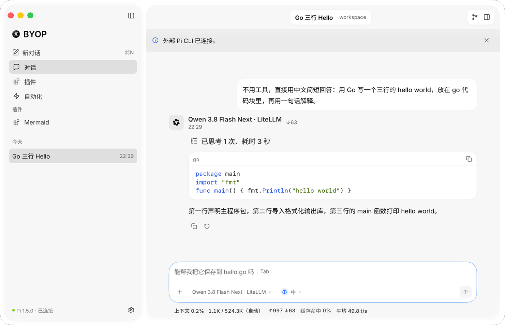
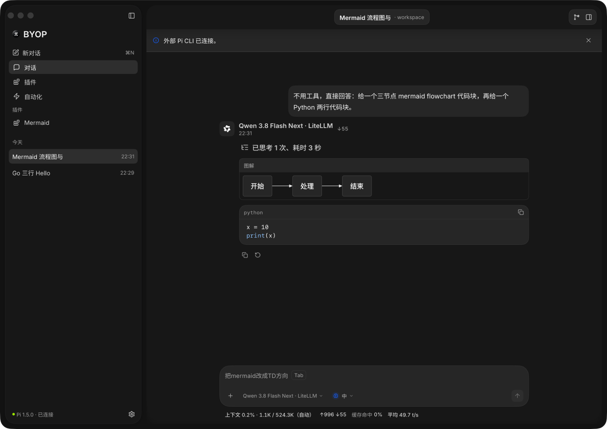
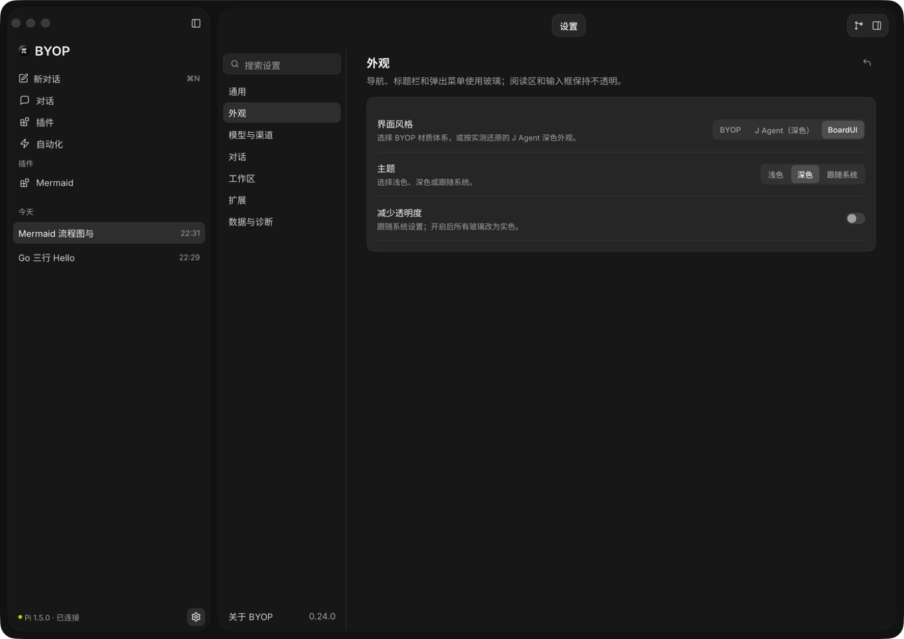
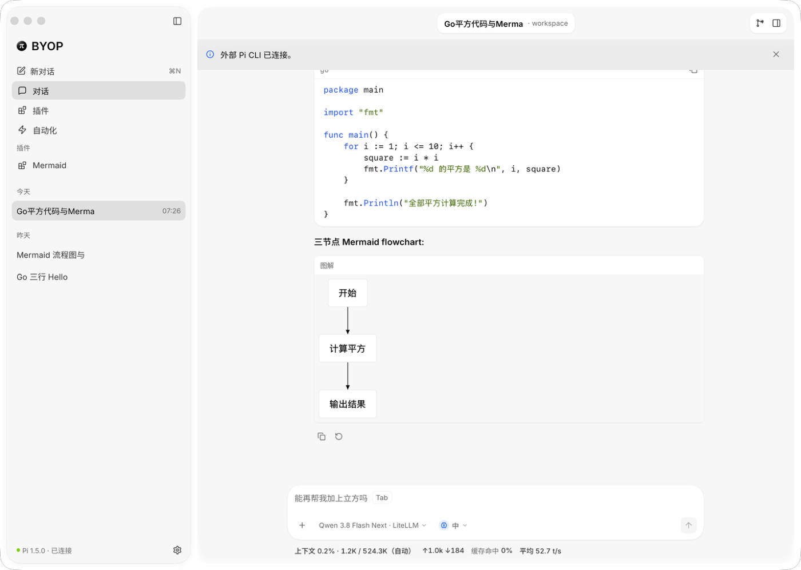
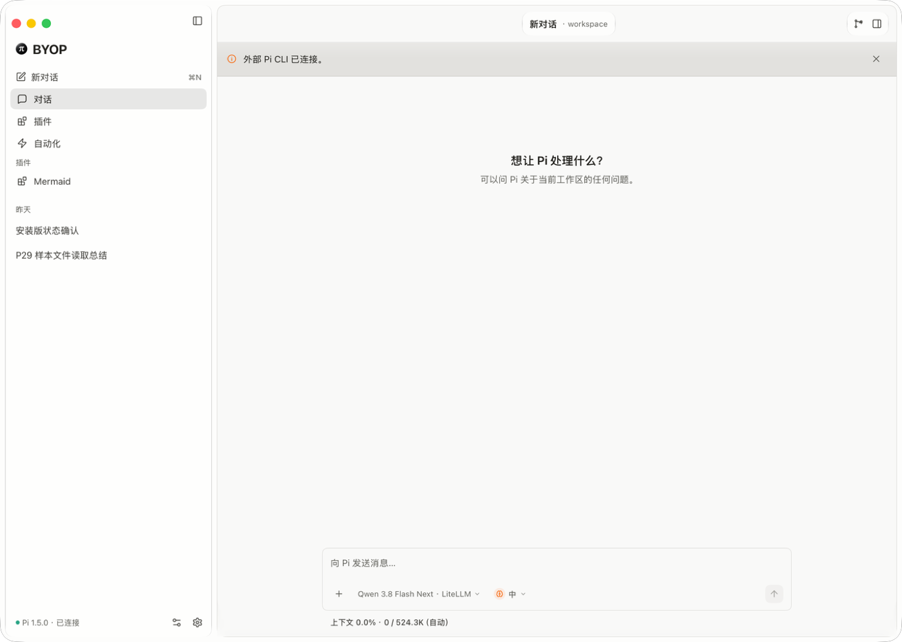

# P31 验证记录

版本：BYOP 0.24.0。基线：`a86d9e3`（0.23.0）。设计见 [P31-design.md](P31-design.md)（v2.1）。

## 范围

用户 2026-11-07 07:01 要求：用户消息改为右侧气泡、改用 BoardUI 蓝色与 Inter 字体，并按 BoardUI 对照审计修掉其余差异；问答确认蓝色、Inter 与气泡放进**单独的新外观预设**，中文用 Inter + 内嵌 Noto Sans SC。本阶段新增第三套外观预设 BoardUI（与 BYOP、J Agent 并列），BYOP 与 J Agent 的外观保持不变；代码块头部与复制按钮、标题优先两项按设计对所有预设生效。

## 开发与审核

- 协调方先在独立副本提交接口骨架（预设常量、`userBubbleRadius`、BoardUI 尺寸、配色与字体函数签名），两席据此并行。
- A 席 GLM 5.3 Flash：字体嵌入与注册、配色、外壳尺寸、玻璃与壁纸关闭、表面样式、标题优先、设置与文案、版本、许可声明。
- B 席 Qwen 3.8 Flash Next：右侧用户气泡、代码块头部与复制、对话区强调色、输入框圆角读预设值。
- 两席改动文件无重叠，协调方按文件合并。
- 审核：Cursor Claude Opus 5.5 @1m。首轮“修复后允许提交”（1 个 P1、4 个 P2），修复后复审结论见文末。

## 实现对照

| 设计 | 实现 | 覆盖 |
|---|---|---|
| §1 字体 | `fonts_embed.go` 嵌入 Inter 4.1（4 个字重）与 Noto Sans SC 2.004（3 个字重）；`ensureBoardUIFonts` 用 `sync.Once` 注册为 “BYOP Inter” / “BYOP Noto Sans SC”，失败只写日志并回落系统字体；插件主题字体仍优先 | `TestP31BoardUIFontRegistration` |
| §2 配色 | `boardUIThemePalette` 按设计表实现浅/深与高对比；主色 `#155dfc`（白字 5.25:1），强调文字浅 `#1447e6` / 深 `#8ec5ff` | `TestP31BoardUIPaletteValues`、`TestP31BoardUIContrastMatrix`、`p29_contrast_test.go` |
| §3 尺寸 | 外壳间距 12、主区圆角 24、输入框圆角 24、气泡圆角 16；BYOP 仍为 8 / 12 / 8 | `TestP31BoardUIMetricsAndSpacing`、`TestP31ComposerCardRadiusFollowsPreset` |
| §4 玻璃与壁纸 | BoardUI 下不画玻璃与壁纸；标题胶囊、右侧按钮组、浮层、侧栏卡片改为不透明；设置页隐藏壁纸与玻璃相关设置；侧栏底部玻璃按钮不构建 | `TestP31BoardUIGlassAndWallpaperOff`、`TestReviewBYOPKeepsGlassButtonInEveryMode` |
| §5 表面 | 抬升面、输入框、浮层、侧栏卡片、主区卡片的 BoardUI 分支 | `TestP31BoardUIRaisedAndComposerSurfaceStyles`、`TestP31BoardUIPopoverSurfaceStyles` |
| §6 右侧气泡 | 无头像与头部行，保留“你”的无障碍名；宽度上限 max(min(列宽×0.8, 560), 240)；附件芯片右对齐 | `TestP31BoardUIUserBubbleGeometry`、`TestP31BoardUIUserBubbleClipsUnbrokenText`、`TestReviewBoardUIAttachmentChipsEndAligned` |
| §7 代码块（所有预设） | 32px 头部：语言名 + 自建复制按钮；复制后显示“已复制”，1200ms 恢复；未闭合的代码块也可复制；闭合的 Mermaid 仍走图解卡片 | `TestP31CodeBlockHeaderOnEveryPreset`、`TestP31CodeBlockUnclosedStaysCopyable`、`TestP31ClosedMermaidKeepsTheDiagramCard` |
| §7 强调色 | BoardUI 下链接、代码关键字、思考强度当前档位用强调文字色；其它预设不变 | `TestP31BoardUIKeywordInkIsAccentText`、`TestP31OtherPresetsKeepThePressedAccentInk`、`TestP31ThinkingLevelInkFollowsPreset` |
| §8 标题优先（所有预设） | 标题不收缩、最多占胶囊 60%；路径只显示最后一级，完整路径放在提示里 | `TestP31TitleHeadingPrefersTitle`、`TestP31TitleHeadingKeepsHomeTilde` |
| §9 设置 | “界面风格”分段第三项 BoardUI；新增 4 条中英文案 | `TestP31PresetSwitchPersistsBoardUI` |

## 审核修复对照

| 条目 | 问题 | 修复 |
|---|---|---|
| P1-1 | BYOP 在浅色、高对比、减少透明度下丢失侧栏导航玻璃按钮 | 按钮只在 BoardUI 下不构建（`glassAllowed(p)`） |
| P2-1 | BoardUI 深色浮层阴影透明度不符；三处表面分支无测试 | 浅 .04+.02、深 .14+.10；补像素断言测试 |
| P2-2 | 附件芯片没有右对齐 | `chatAttachmentChipRow` 增加对齐参数，气泡传右对齐，其它调用方保持左对齐 |
| P2-3 | 输入框圆角、标题两个测试在旧代码下也能通过；缺超长无断点字符串测试 | 改为探测真实输入框像素、换成超长路径夹具；补气泡裁剪测试 |
| P2-4 | BoardUI 侧栏卡片内容未按圆角裁剪 | 内容包一层圆角裁剪 |
| P3 | 字体错误丢失、死代码、注释、多余嵌入、复制按钮无 Key、思考强度每帧重算配色 | 均已修改 |

## 自动检查

- `gofmt -l .` 无输出；`go vet .` 通过；`go test -count=1 .` 通过；`go test -shuffle=on -run 'P31|BoardUI|Review' .` 通过。
- `i18n check`：999 条，中英通过。
- `node --test assets/diagram/`：13 项通过；`node --test plugins/mermaid-diagram/test/`：17 项通过。
- `git diff --check` 通过。插件目录与 `vendor` 未改动。

## 原生验收

隔离配置（`~/AgentScratch/20261107-byop-p31v/`，BoardUI 浅色与深色各一份），外部 Pi CLI 真实连接。

合并版预检（审核修复前，临时编译）：

- 浅色：右侧气泡、代码块头部；点击复制后剪贴板内容与代码逐字一致，按钮变为“已复制”，1.6 秒后恢复为“复制代码”。
- 深色：Mermaid 代码块渲染为图解卡片，Python 代码块带头部与复制按钮；设置“外观”显示 BYOP / J Agent（深色）/ BoardUI 三项，壁纸与玻璃设置已隐藏；“关于”显示 0.24.0。

打包版复验（`/Applications/BYOP.app` 0.24.0，与 DMG 内二进制逐字节一致）：

- BoardUI 浅色：一次回答里先出 12 行 Go 代码、再出 Mermaid。**代码块还在流式输出时**点击复制，剪贴板拿到当时已输出的内容（复审 N1 修复生效）；输出结束后再次点击，剪贴板为完整 12 行，约 1 秒时按钮为“已复制”。Mermaid 纵向流程图在对话内渲染。
- BoardUI 深色：启动到空对话，外壳、侧栏、输入框为不透明深色表面。
- BYOP 回归：同一安装版用 0.23.0 的 BYOP 隔离配置启动，橙色强调色、外壳间距 8、输入框圆角 8 不变，侧栏底部导航玻璃按钮仍在（首轮 P1-1 修复生效）。

未做：J Agent 预设未在安装版重新走查（自动测试覆盖；审核确认 J Agent 不经过本阶段改动的外壳与输入框路径）、高对比与减少透明度的实机截图、英文界面实机截图、带附件消息的实机截图（均由自动测试覆盖）。

## 打包

- `mygo build -skip-notarize`（MyGo 0.5.5），未公证。
- `dist/darwin-arm64/BYOP 0.24.0 arm64.dmg`：28,146,615 字节，SHA-256 `454dd32dab760939e13b2e0f7ed3b2e7c559d1db74674cf1d4dbd82ad8bb15bb`。
- 体积增量：主程序 17,966,720 → 44,943,168 字节（+27.0 MB），DMG 8,052,295 → 28,146,615 字节（+20.1 MB）。增量几乎全部来自嵌入字体（合计 26,897,733 字节，主要是三份 Noto Sans SC）。
- `Contents/Resources` 内含 `OFL-Inter.txt` 与 `OFL-NotoSansSC.txt`。
- 已安装到 `/Applications/BYOP.app`。

## 已知限制

- 设置搜索在 BoardUI 下仍会因“壁纸”“玻璃”等词命中外观分类，但页面里已没有对应的设置项。
- 左上角红绿灯按钮的位置仍按外壳间距 8 计算，BoardUI（间距 12）下与标题栏错开 4px。
- 深色下强调色作为图形（如焦点外框以外的蓝色图形）对比度约 2.88:1，低于 3:1；文字用的强调文字色达标。
- 相同代码块共享“已复制”状态。
- 设计中列为暂缓的内容未实现：助手侧字号与行高调整、HUD 圆环胶囊、面包屑标题、悬停时间、彩色语言标签、渐变、JetBrains Mono。

## 复审结论

修复复审（Cursor）确认首轮 P1-1、P2-1、P2-2、P2-4 关闭，并做了 20 项变异验证。另发现两项：

- N1（P1）：复制按钮的 key 含代码哈希，流式输出中每来一个 token 就变，按下与松开落在不同按钮上，复制无效。修复：key 与“已复制”状态都改用语言与序号；开发席另发现 MyGo 的 `After` 只记最早一次唤醒，流式重建会把恢复时刻拖后，改为“已复制”期间每帧按剩余时间重新登记。新增 `TestP31CodeBlockCopySurvivesStreaming`，把 key 改回含哈希会失败。
- N2（P2）：输入框圆角测试的 BYOP 断言阈值改为 `> 3`；BYOP 被误改为 24 圆角时测试失败。

复审写明“这两项改完即可提交，不需要再整轮复审”。修复后协调方在主仓库复跑全部自动检查通过（含 P31 相关测试乱序运行 3 次）。

复审列出的 P3 未在本阶段处理：浅色表面阴影无像素测试；标题 60% 上限、气泡裁剪、侧栏卡片裁剪、思考强度调用点各自缺一条更严的测试；J Agent 用户消息的附件芯片不右对齐（0.23.0 已存在，非本阶段回归）。
