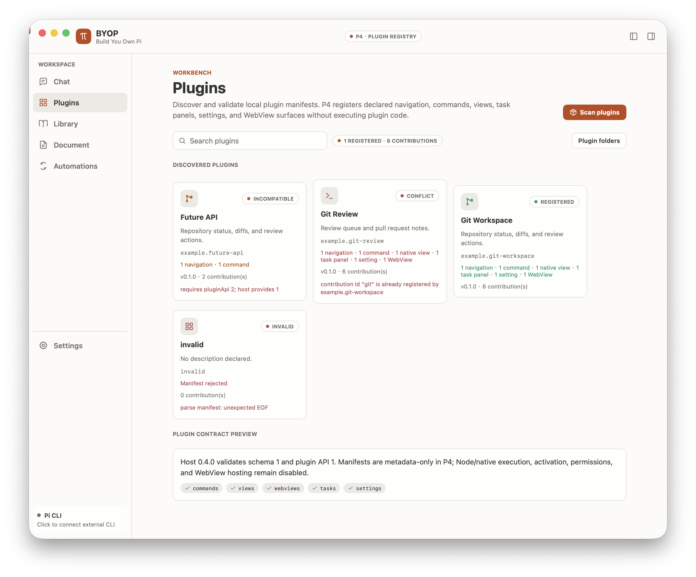

# BYOP P4 Validation

验证日期：2026-10-20

## 范围

P4 只实现插件清单和注册表。BYOP 可以发现、校验和展示本地 `plugin.json`，
记录贡献点以及插件 ID、贡献 ID 冲突；它不执行插件 entry，不安装插件，
不激活插件，不提供 plugin RPC，也不承载 WebView。

## 实现

- 默认扫描 `~/.byop/plugins` 与 `<cwd>/.byop/plugins`；
- 设置 `BYOP_PLUGINS_DIR` 后只扫描该变量列出的目录，支持平台路径列表；
- 默认目录不存在时忽略，显式目录不存在时显示扫描问题；
- 每个清单只接受一个 JSON 对象，拒绝未知字段、尾随 JSON 和超过 1 MiB 的文件；
- 校验 schema 1、语义化插件版本、Node/native runtime、安全相对 entry、图标、贡献点、激活事件和能力字段；
- 校验 Plugin API `1` 与宿主版本 `0.4.0`；
- 标记 invalid、incompatible、duplicate plugin ID 和 duplicate contribution ID；
- Plugins 页面支持注册数量、贡献数量、问题数量、搜索、空状态、重新扫描和问题详情；
- 任务栏显示注册表汇总，顶部阶段状态更新为 P4；
- entry 文件不存在时仍可完成元数据注册，证明 P4 没有执行或要求插件产物。

## 验证结果

| 检查 | 结果 |
|---|---|
| `gofmt` | 通过 |
| `go build` | 通过 |
| `go vet ./...` | 通过 |
| `go test ./...` | 31 项通过 |
| 设计 token JSON 解析 | 两项通过 |
| Light 主题 Plugins 页面 | 通过 |
| Dark 主题与展开任务栏 | 通过 |

自动测试覆盖有效清单、未知字段、尾随 JSON、非法 JSON、缺失清单、
`../`/规范化 `..`/绝对路径/反斜杠 entry、不兼容 Plugin API、不兼容宿主范围、
插件 ID 冲突、跨插件贡献冲突、同插件贡献冲突、目录显式性、搜索和统计。

## 界面走查

截图使用隔离目录中的虚构插件清单，不含真实凭据、客户内容或 Pi 会话 ID。
Light 模式确认右侧任务栏默认收起；Dark 模式另外展开任务栏，确认插件注册汇总、
问题数与本地任务卡映射正常。正文保持 14 px，导航和任务栏使用同一套主题 token。

## 未验证与边界

- 未执行任何插件 entry；
- 未实现插件安装、发现市场、激活、停用、生命周期或 JSON-RPC；
- 未实现新增导航、命令、原生视图或设置项在运行时动态注入；
- 未实现 WebView，meta 中的 `webviews` 仅登记声明；
- 未进行 Linux、Windows、窄窗口或辅助功能专项验证。
