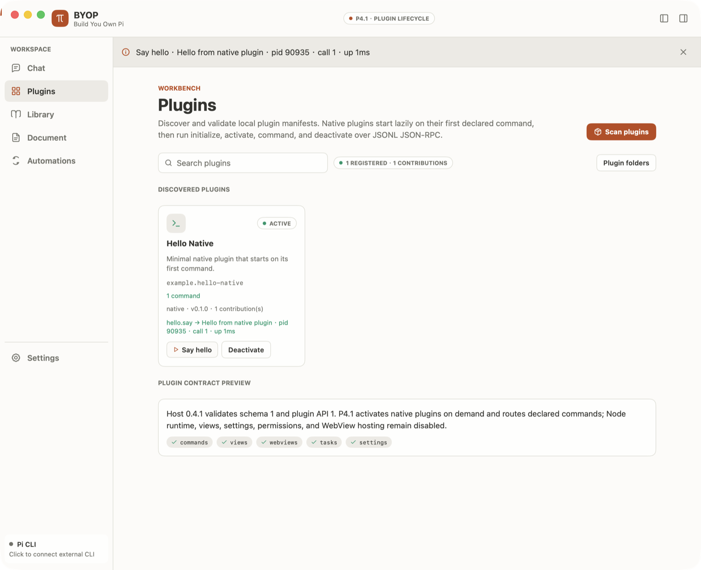
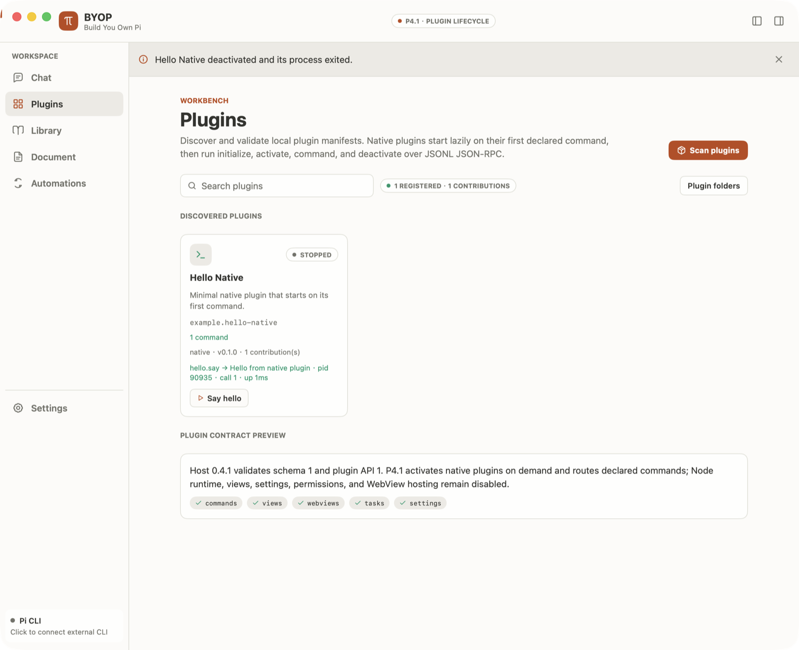

# BYOP P4.1 Validation

验证日期：2026-10-20

## 范围

P4.1 在 P4 清单注册表的基础上打通最小原生插件闭环：声明的命令首次执行时懒启动
native 插件，完成 `initialize`、`activate`、`invokeCommand`，停用时完成
`deactivate` 并结束进程。Node runtime、插件视图和设置注入、插件到宿主的调用、
权限执行和 WebView 不在本阶段范围内。

## 实现

- 新增 `plugin_runtime.go` Plugin Host，按插件 ID 管理进程和生命周期状态；
- 状态：inactive、starting、active、running、stopping、stopped、failed；
- 只在命令已声明，且 `activation.events` 含 `onCommand:<id>` 或 `lazy: true` 时启动；
- entry 解析符号链接后必须仍在插件目录内，且为可执行普通文件；直接执行，不经过 shell；
- JSONL JSON-RPC：每行一个对象，按 `id` 匹配响应，stderr 保留 4 KiB 尾部；
- 同一插件并发启动只启动一次；意外退出标记为 failed，并让挂起请求立即失败；
- Deactivate、重新扫描和关闭窗口都会停用插件进程；
- Plugins 卡片显示生命周期状态、命令按钮、最近结果或错误，以及 Deactivate；
- 宿主版本升至 `0.4.1`，新增 `examples/hello-native` 示例插件。

## 验证结果

| 检查 | 结果 |
|---|---|
| `gofmt` / `go vet ./...` / `go build` | 通过 |
| `go test ./...` | 36 项通过（P4 基线 31 项 + 新增 4 项生命周期测试 + 1 项 helper 入口） |
| `go test -race -run PluginHost` | 通过 |
| 设计 token JSON 解析 | 两项通过 |
| 真实窗口：点击 Say hello | 插件进程启动，卡片显示 ACTIVE 与命令结果 |
| 真实窗口：点击 Deactivate | 卡片显示 STOPPED，插件进程已退出 |
| 真实窗口：再次启动后关闭窗口 | 应用与插件进程均退出 |

自动测试覆盖：首次命令前不启动；完整调用顺序
`initialize → activate → invokeCommand → invokeCommand → deactivate → exit`；
第二次命令复用同一进程；未声明命令和非激活事件命令被拒绝且不启动进程；
Node runtime、不可执行 entry 和越出插件目录的符号链接被拒绝；`stopAll` 结束全部进程。

## 界面走查

Light 主题，右侧任务栏默认收起，正文保持 14 px。截图只包含示例插件。

## 未验证与边界

- 未实现 Node runtime、`renderView`、`cancel`、插件到宿主调用和能力权限执行；
- 插件进程没有沙箱，以当前用户身份运行；
- 未做 Dark 主题、窄窗口、Linux 和 Windows 专项走查；
- 命令参数固定为空对象，尚无参数表单。
