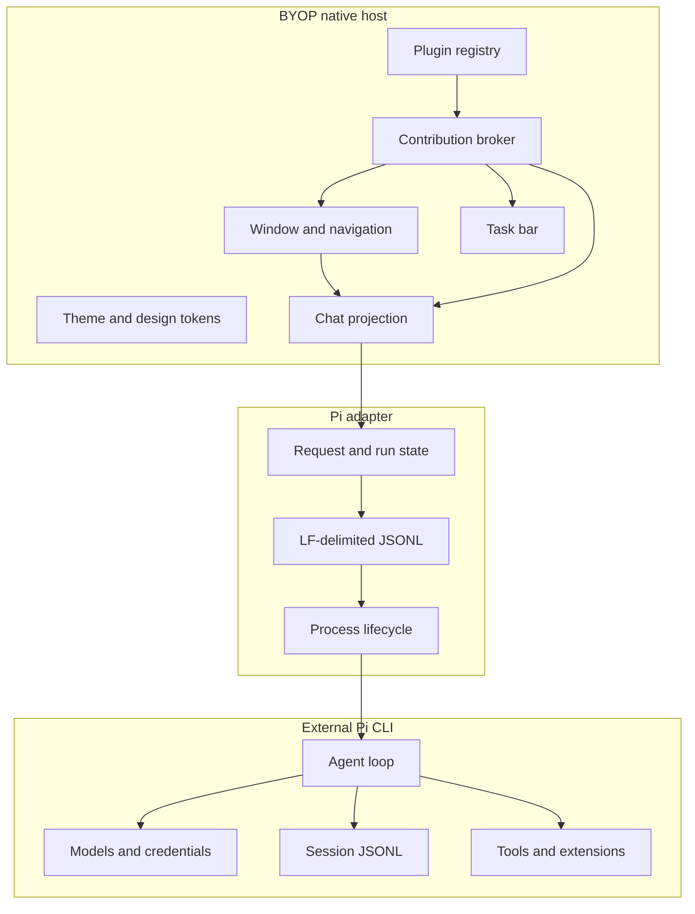

# BYOP Workbench Architecture

Status: P2 native shell and external Pi RPC loop are implemented. Plugin
registry, plugin runtime and WebView hosting are design targets for P4/P5 and
are not available in the current binary.

## Runtime Boundary



BYOP starts `pi --mode rpc --no-session` as a child process. Every outbound
command and inbound event uses one JSON object per LF-terminated line. Request
IDs correlate command responses. The UI treats `agent_settled` as the end of
a run because retries, compaction, steering, follow-ups and queued work may
continue after an earlier `agent_end` event.

## Ownership

| Capability | Owner | P2 behavior |
|---|---|---|
| Window, navigation, themes | BYOP | Implemented natively |
| Chat transcript projection | BYOP | Implemented for the active ephemeral run |
| Plugin metadata and contributions | BYOP | Planned |
| Model calls and provider auth | Pi | Delegated |
| Session persistence and credentials | Pi | Pi-owned; BYOP does not rewrite files |
| Tools, Skills and extensions | Pi | Delegated |
| Long-running task activity | BYOP plus adapters | Minimal current-run card only |
| Complex editor or visualizer UI | Plugin and WebView | Not implemented |

BYOP should persist references and rebuildable indexes rather than duplicate
Pi session bodies or secrets. A future session browser should discover
sessions read-only and use Pi RPC for switching and mutations.

## Planned Plugin Contract

Each plugin is an independent local package with a manifest, a runtime entry
point and declared contribution points. This is a design contract, not an SDK
shipped in P2.

```json
{
  "schemaVersion": 1,
  "id": "example.git-workspace",
  "name": "Git Workspace",
  "version": "0.1.0",
  "runtime": "node",
  "entry": "dist/plugin.js",
  "compatibility": {
    "host": ">=0.4.0 <1.0.0",
    "pluginApi": "1"
  },
  "contributes": {
    "navigation": [{ "id": "git", "title": "Git", "icon": "git" }],
    "commands": [{ "id": "git.refresh", "title": "Refresh repository" }],
    "views": [{ "id": "git.status", "location": "main", "view": "native" }],
    "taskPanels": [{ "id": "git.tasks", "title": "Git tasks" }],
    "settings": [{ "id": "git.settings", "title": "Git" }],
    "webviews": [{ "id": "git.diff", "location": "main" }]
  },
  "activation": {
    "events": ["onCommand:git.refresh", "onView:git.status"],
    "lazy": true
  },
  "capabilities": {
    "workspace": "read",
    "files": "read",
    "network": false,
    "process": "none"
  }
}
```

Host-to-plugin and plugin-to-host messages should use a versioned JSON-RPC
envelope over the plugin runtime's transport. Minimum methods:

| Direction | Method | Purpose |
|---|---|---|
| Host → Plugin | `initialize` | Validate API version and exchange host capabilities |
| Host → Plugin | `activate` | Activate a declared contribution |
| Host → Plugin | `invokeCommand` | Dispatch a command with typed arguments |
| Host → Plugin | `renderView` | Obtain a native view model or WebView URL |
| Host → Plugin | `cancel` | Cancel one long-running operation |
| Host → Plugin | `deactivate` | Release resources on unload |
| Plugin → Host | `host.getTheme` | Read semantic tokens without copying colors |
| Plugin → Host | `host.openWebView` | Open a declared WebView contribution |
| Plugin → Host | `host.updateTask` | Publish progress, logs and actions |
| Plugin → Host | `host.emit` | Notify the registry of an event |

The host validates manifests, owns lifecycle state, resolves icons from a
shared asset registry, and rejects undeclared contribution points. Native
views should receive a typed view model. Rich editors, diagrams, document
canvases and third-party dashboards can opt into WebView hosting, with a native
fallback for errors and unsupported platforms.

## WebView Boundary

WebView is reserved for complex surfaces and must remain inside the BYOP shell.
The planned host contract supplies:

- a unique view ID and plugin identity;
- shared light/dark semantic token values;
- lifecycle events for visibility, focus and disposal;
- a narrow message bridge for declared capabilities;
- crash and navigation recovery back to a native fallback;
- no direct access to Pi credentials or arbitrary local files.

The exact MyGo `ui.WebView` behavior still needs P5 platform validation.

## Migration Map

| Current Pi Agent Desktop area | BYOP direction |
|---|---|
| Tauri window and native webview shell | Rewrite with MyGo native host |
| React/Next chat interface | Rewrite as native Chat and typed view models |
| Embedded Pi SDK runtime | Remove; use external Pi CLI RPC |
| Sessions, models, credentials | Keep in Pi; access through RPC and read-only discovery |
| Skills and extensions | Keep in Pi; expose status and commands through adapters |
| Tool execution timelines | Expand native event projection |
| Mermaid, KaTeX, xterm, rich document editor | Consider declared WebView plugins |
| Themes, sidebar widths, drafts | Rebuild BYOP preferences and explicit import |
| Scheduled tasks and Loop semantics | Rebuild in BYOP with plugin-owned jobs |

## Next Phases

| Phase | Scope |
|---|---|
| P3 | Native tool cards, structured message events, run diagnostics and richer chat state |
| P4 | Manifest validation, registry, lazy activation, command and settings contributions |
| P5 | WebView proof, theme bridge, crash fallback and complex view sandbox |
| P6 | Read-only session discovery, model and thinking-level selectors |
| P7 | Automation and Loop contributions |
| P8 | Import old desktop preferences and migration verification |
