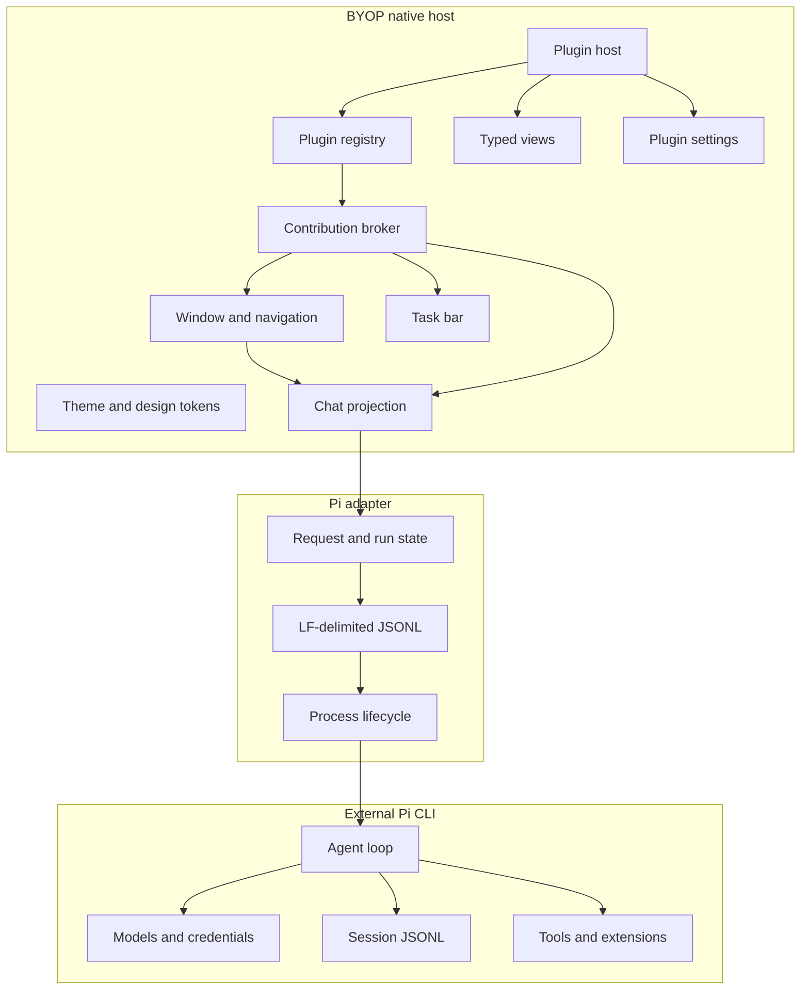
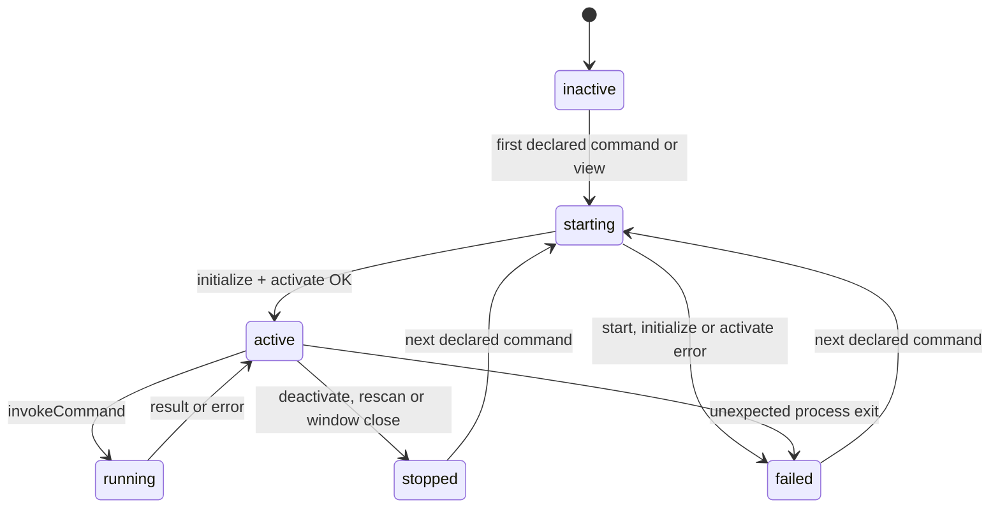

# BYOP Workbench Architecture

Status: P4.2 native shell, external Pi RPC loop, ordered timelines, transient
runtime diagnostics, a strict plugin manifest registry, native and Node plugin
lazy activation, typed native views, plugin settings, bidirectional host calls
and capability enforcement are implemented; Chat renders through Onevra
v0.2026.13 components. WebView hosting remains future work.

## Runtime Boundary



BYOP starts `pi --mode rpc --no-session` as a child process. Every outbound
command and inbound event uses one JSON object per LF-terminated line. Request
IDs correlate command responses. The UI treats `agent_settled` as the end of
a run because retries, compaction, steering, follow-ups and queued work may
continue after an earlier `agent_end` event.

P3.3a projects the following Pi session events into host-only transient state:
`queue_update`, `compaction_start`, `compaction_end`, `auto_retry_start`,
`auto_retry_end`, `agent_end` and `extension_error`. Queue details, retry
countdowns, compaction token estimates and extension failures appear in the
collapsed-by-default task panel. Provider errors from failed retry attempts do
not become assistant text blocks; only `agent_settled` decides whether a
permanent turn completed, stopped or failed.

## Ownership

| Capability | Owner | Current behavior |
|---|---|---|
| Window, navigation, themes | BYOP | Implemented natively |
| Chat transcript projection | BYOP plus Onevra components | Ordered text/tool timeline rendered as Onevra turns, activity groups and glass composer |
| Plugin metadata and contributions | BYOP | Validates manifests, scans local roots and records contribution conflicts |
| Plugin lifecycle, commands and views | BYOP Plugin Host | Starts native and Node plugins lazily, routes declared commands, renders typed views and stops processes on deactivate, rescan and window close |
| Plugin settings and host calls | BYOP Plugin Host | Persists typed values, injects settings, accepts JSON-RPC requests from plugins and enforces declared capabilities |
| Model calls and provider auth | Pi | Delegated |
| Session persistence and credentials | Pi | Pi-owned; BYOP does not rewrite files |
| Tools, Skills and extensions | Pi | Delegated |
| Long-running task activity | BYOP plus adapters | P3.3a projects the latest tool and transient runtime diagnostics into the task panel |
| Complex editor or visualizer UI | Plugin and WebView | Reserved for P5; typed native views are implemented |

BYOP should persist references and rebuildable indexes rather than duplicate
Pi session bodies or secrets. A future session browser should discover
sessions read-only and use Pi RPC for switching and mutations.

## Plugin Manifest Registry

P4 treats `plugin.json` as a versioned metadata contract. The host scans each
directory below `~/.byop/plugins` and `<cwd>/.byop/plugins`, or the explicit
path list in `BYOP_PLUGINS_DIR`. A missing implicit root is ignored; a missing
explicit root becomes a visible scan issue. A child directory without a
manifest is ignored.

The parser accepts one JSON object up to 1 MiB and rejects unknown fields,
trailing JSON values and unsafe entry paths. The host records registered,
invalid, incompatible, duplicate plugin ID and duplicate contribution ID
states. Scanning never opens or executes entry files. The current host version
is `0.4.2`; manifest schema and Plugin API version are both `1`.

Each plugin is an independent local package with a manifest, a runtime entry
point and declared contribution points.

```json
{
  "schemaVersion": 1,
  "id": "example.git-workspace",
  "name": "Git Workspace",
  "version": "0.1.0",
  "runtime": "node",
  "entry": "dist/plugin.js",
  "compatibility": {
    "host": ">=0.4.0 <1.0.0",
    "pluginApi": "1"
  },
  "contributes": {
    "navigation": [{ "id": "git", "title": "Git", "icon": "git", "view": "git.status" }],
    "commands": [{ "id": "git.refresh", "title": "Refresh repository" }],
    "views": [{ "id": "git.status", "location": "main", "view": "native" }],
    "taskPanels": [{ "id": "git.tasks", "title": "Git tasks" }],
    "settings": [{
      "id": "git.settings",
      "title": "Git",
      "description": "Repository view preferences.",
      "fields": [
        {
          "key": "showDetails",
          "label": "Show details",
          "type": "boolean",
          "default": true
        }
      ]
    }],
    "webviews": [{ "id": "git.diff", "location": "main" }]
  },
  "activation": {
    "events": ["onCommand:git.refresh", "onView:git.status"],
    "lazy": true
  },
  "capabilities": {
    "workspace": "read",
    "files": "read",
    "network": false,
    "process": "none"
  }
}
```

Navigation contributions may point to a view declared by the same manifest.
Setting field keys are unique across the plugin. The supported field types are
`string`, `boolean`, `number` and `select`; a plugin may declare at most 50
setting fields. Select fields require unique, non-empty options. Missing
defaults resolve to `""`, `false`, `0` or the first select option.

## Plugin Lifecycle (P4.2)

The host implements the lifecycle for `runtime: "native"` and
`runtime: "node"`. A plugin process starts only when the user opens a declared
view or runs a declared command and the manifest lists the matching
`onView:<view>` or `onCommand:<command>` event, or sets `activation.lazy:
true`. The host rejects undeclared contributions before starting anything.



The entry path must stay inside the plugin folder after symbolic links are
resolved and must be a regular file. Native entries must be executable. Node
entries must end in `.js`, `.mjs` or `.cjs`; they do not need execute
permission. The host starts either runtime without a shell, uses the plugin
folder as the working directory, and provides `BYOP_PLUGIN_ID`,
`BYOP_PLUGIN_API` and `BYOP_PLUGIN_RUNTIME`.

Transport is one JSON object per LF-terminated line over stdin/stdout. Host
requests are `{"jsonrpc":"2.0","id","method","params"}`; the plugin replies
with the same `id` and either `result` or `error`. A message containing
`method` is a plugin-to-host request when it has an `id`, or a notification
without one. Plugin requests run concurrently without blocking the host call
that is awaiting a command or view. Each process may have eight host requests
in flight; additional requests receive `host busy`. Stderr is kept as a 4 KiB
tail for failure messages.

| Method | Params | Timeout |
|---|---|---|
| `initialize` | `pluginApi`, `hostVersion`, `pluginId`, `settings`, `capabilities` | 10 s together with `activate` |
| `activate` | `reason`, for example `onCommand:hello.say` | 10 s together with `initialize` |
| `invokeCommand` | `command`, `args` | 30 s |
| `renderView` | `view`, `settings` | 10 s after activation |
| `deactivate` | empty object | 2 s, then stdin closes; kill after another 2 s |

Notifications from the host use the same JSONL channel without an `id`. P4.2
uses `settingsChanged` after a saved setting changes while the plugin process
is active.

`examples/hello-node` is the P4.2 contract fixture for the complete Node,
view, settings and host-call surface. `examples/hello-native` remains the
small native lifecycle example.

## Node Runtime

The host resolves `BYOP_NODE` or searches `PATH`, probes `node --version` once
per host, and requires major version 25 or newer. The command is:

```text
node --permission --allow-fs-read=<pluginRoot> [capability flags] <entryRealPath>
```

| Manifest capability | Additional Node permission flag |
|---|---|
| `files: read` or `files: write` | `--allow-fs-read=<workspaceRoot>` |
| `files: write` | `--allow-fs-write=<workspaceRoot>` |
| `network: true` | `--allow-net` |
| `process: execute` | `--allow-child-process` |

Plugin and workspace paths are absolute and symlink-resolved before flags are
built. The plugin root is always readable so Node can load its entry and local
modules. Workspace access is granted only by the `files` capability.

## Plugin-to-Host Calls

Plugin requests use the same JSONL transport. The host dispatches each request
in its own goroutine, preserves the request ID exactly and writes the response
under the shared write lock. Unknown methods return `-32601`; invalid params
return `-32602`; denied capabilities return `-32001` with a message beginning
`permission denied:`; other failures return `-32000`.

| Method | Params | Required capability or declaration |
|---|---|---|
| `host.getTheme` | none | none |
| `host.getSettings` | none | none |
| `host.showNotice` | `{text,tone?}` | none |
| `host.updateTask` | `{id,detail,status?,tone?}` | `id` must name one of the plugin's task panels |
| `host.refreshView` | `{view}` | `view` must be declared by the plugin |
| `host.getWorkspace` | none | `workspace: read` or `write` |
| `host.readFile` | `{path}` | `files: read` or `write` |
| `host.writeFile` | `{path,content}` | `files: write` |

File paths are relative to the workspace, must stay inside it after symlinks
are resolved, and must name a regular file. Reads are limited to 1 MiB and
valid UTF-8. Writes are limited to 1 MiB, require an existing parent directory,
write through a temporary file in that directory and atomically replace the
destination with mode `0644`. The runtime status records host-call and denied
call counts.

## Typed Native Views

`renderView` returns a JSON model. The outer object accepts only `title` and
`blocks`; known block objects reject unknown fields. An unknown block `type`
renders as a muted **Unsupported block** line rather than failing the entire
view.

```json
{
  "title": "Optional override",
  "blocks": [
    { "type": "heading", "text": "Heading" },
    { "type": "text", "text": "Body text" },
    { "type": "notice", "tone": "info", "text": "Notice" },
    { "type": "keyValue", "items": [{ "label": "Key", "value": "Value" }] },
    { "type": "list", "items": [{ "title": "Title", "detail": "Detail" }] },
    { "type": "code", "text": "monospace" },
    { "type": "button", "label": "Run", "command": "example.run", "args": {} }
  ]
}
```

A view may contain at most 200 blocks and a block may contain at most 100
items. Strings are truncated to 4000 runes. Button args must be a JSON object
no larger than 64 KiB. A button whose command is not declared by the same
plugin is disabled with an **Undeclared command** tooltip.

Main views can appear in the sidebar when a navigation contribution references
them. Secondary views are listed on the plugin card and are not rendered in
P4.2. Rendering runs off the UI goroutine, while the UI caches the last model
for each plugin and view.

## Plugin Settings

Settings are stored at
`<configDir>/plugin-settings/<pluginId>.json`, where `configDir` is
`BYOP_CONFIG_DIR` or `~/.byop`. The directory is mode `0700`; files are mode
`0600` and use atomic replacement. Loading merges declared defaults with valid
saved values and drops unknown keys. Invalid typed values fall back to their
default.

The Settings page renders one card per setting contribution. String and number
fields use text inputs, booleans use switches and selects use chip buttons.
Saving persists all declared values. When the plugin is active, the host then
sends a `settingsChanged` notification containing the merged setting object.

## Enforcement Boundary

| Runtime | OS enforcement | Host API enforcement |
|---|---|---|
| Node | Node permission model plus declared filesystem, network and process flags | Every host call is checked against the manifest |
| Native | None; the process runs with the current user's permissions | Every host call is checked against the manifest |

The `workspace`, `files`, `network` and `process` values on native plugins are
declarative. They appear in the plugin card but cannot sandbox an arbitrary
native executable.

## Planned Plugin Runtime Contract

The methods below remain future work.

| Direction | Method | Purpose |
|---|---|---|
| Host → Plugin | `cancel` | Cancel one long-running operation |
| Plugin → Host | `host.openWebView` | Open a declared WebView contribution |
| Plugin → Host | `host.emit` | Notify the registry of an event |

The host validates manifests, owns lifecycle state, resolves icons from a
shared asset registry, and rejects undeclared contribution points. Rich
editors, diagrams, document canvases and third-party dashboards can opt into
WebView hosting, with a native fallback for errors and unsupported platforms.

## Plugin Development Hold

After P4.2, the plugin platform is functionally ready for local native and Node
plugins. No feature plugin will be developed until Lex explicitly asks. The
earlier Library and Document designs must not be implemented as plugins.
`examples/` contains contract fixtures only. The existing Library and Document
pages remain untouched native visual skeletons.

## WebView Boundary

WebView is reserved for complex surfaces and must remain inside the BYOP shell.
The planned host contract supplies:

- a unique view ID and plugin identity;
- shared light/dark semantic token values;
- lifecycle events for visibility, focus and disposal;
- a narrow message bridge for declared capabilities;
- crash and navigation recovery back to a native fallback;
- no direct access to Pi credentials or arbitrary local files.

The exact MyGo `ui.WebView` behavior still needs P5 platform validation.

## Migration Map

| Current Pi Agent Desktop area | BYOP direction |
|---|---|
| Tauri window and native webview shell | Rewrite with MyGo native host |
| React/Next chat interface | Rewrite as native Chat and typed view models |
| Embedded Pi SDK runtime | Remove; use external Pi CLI RPC |
| Sessions, models, credentials | Keep in Pi; access through RPC and read-only discovery |
| Skills and extensions | Keep in Pi; expose status and commands through adapters |
| Tool execution timelines | Ordered native text/tool blocks implemented for the active run |
| Mermaid, KaTeX, xterm, rich document editor | Consider declared WebView plugins |
| Themes, sidebar widths, drafts | Rebuild BYOP preferences and explicit import |
| Scheduled tasks and Loop semantics | Rebuild in BYOP with plugin-owned jobs |

## Next Phases

| Phase | Scope |
|---|---|
| P3.1 | Structured tool lifecycle, native cards and active-tool task state |
| P3.2 | Ordered text/tool timeline, in-place lifecycle updates and automatic folding |
| P3.2a | Onevra Chat reading area, turn summaries, activity rows and glass composer; task panel collapsed by default |
| P3.3a | Queue, compaction, retry, extension-error and Stop-during-retry diagnostics |
| P4 | Strict manifest validation, local root discovery, registry search and duplicate/conflict reporting |
| P4.1 | Native lazy activation, lifecycle states, declared command routing, deactivate and shutdown cleanup |
| P4.2 | Node runtime, typed view/settings invocation, plugin-to-host calls and permission enforcement |
| P5 | WebView proof, theme bridge, crash fallback and complex view sandbox |
| P6 | Read-only session discovery, model and thinking-level selectors |
| P7 | Automation and Loop contributions |
| P8 | Import old desktop preferences and migration verification |
