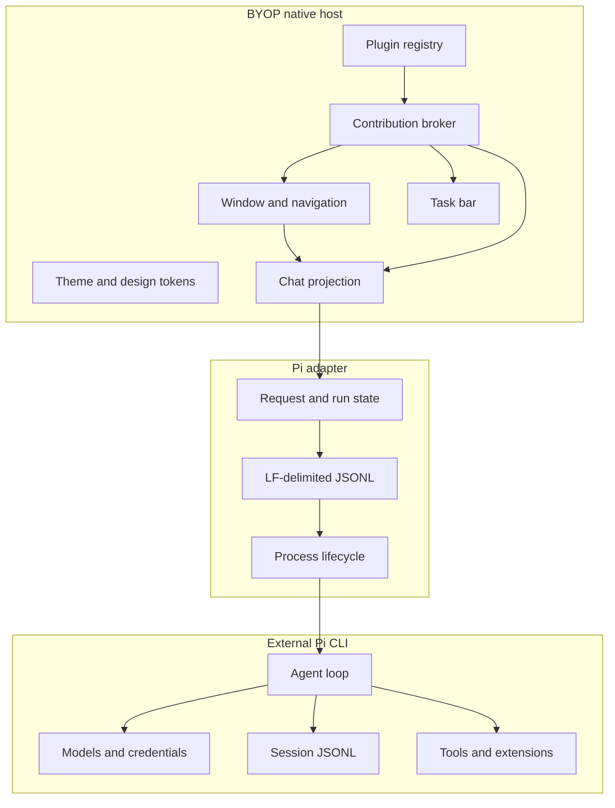
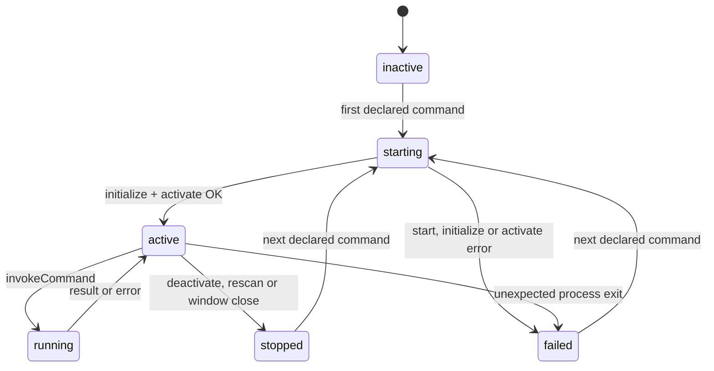

# BYOP Workbench Architecture

Status: P4.1 native shell, external Pi RPC loop, ordered timelines, transient
runtime diagnostics, a strict plugin manifest registry and native plugin lazy
activation with command routing are implemented; Chat renders through Onevra
v0.2026.13 components. Node plugins, plugin views, settings, permission
enforcement and WebView hosting remain future work.

## Runtime Boundary



BYOP starts `pi --mode rpc --no-session` as a child process. Every outbound
command and inbound event uses one JSON object per LF-terminated line. Request
IDs correlate command responses. The UI treats `agent_settled` as the end of
a run because retries, compaction, steering, follow-ups and queued work may
continue after an earlier `agent_end` event.

P3.3a projects the following Pi session events into host-only transient state:
`queue_update`, `compaction_start`, `compaction_end`, `auto_retry_start`,
`auto_retry_end`, `agent_end` and `extension_error`. Queue details, retry
countdowns, compaction token estimates and extension failures appear in the
collapsed-by-default task panel. Provider errors from failed retry attempts do
not become assistant text blocks; only `agent_settled` decides whether a
permanent turn completed, stopped or failed.

## Ownership

| Capability | Owner | Current behavior |
|---|---|---|
| Window, navigation, themes | BYOP | Implemented natively |
| Chat transcript projection | BYOP plus Onevra components | Ordered text/tool timeline rendered as Onevra turns, activity groups and glass composer |
| Plugin metadata and contributions | BYOP | P4 validates manifests, scans local roots and records contribution conflicts |
| Native plugin lifecycle and commands | BYOP Plugin Host | P4.1 starts native plugins lazily, routes declared commands and stops processes on deactivate, rescan and window close |
| Model calls and provider auth | Pi | Delegated |
| Session persistence and credentials | Pi | Pi-owned; BYOP does not rewrite files |
| Tools, Skills and extensions | Pi | Delegated |
| Long-running task activity | BYOP plus adapters | P3.3a projects the latest tool and transient runtime diagnostics into the task panel |
| Complex editor or visualizer UI | Plugin and WebView | Not implemented |

BYOP should persist references and rebuildable indexes rather than duplicate
Pi session bodies or secrets. A future session browser should discover
sessions read-only and use Pi RPC for switching and mutations.

## Plugin Manifest Registry

P4 treats `plugin.json` as a versioned metadata contract. The host scans each
directory below `~/.byop/plugins` and `<cwd>/.byop/plugins`, or the explicit
path list in `BYOP_PLUGINS_DIR`. A missing implicit root is ignored; a missing
explicit root becomes a visible scan issue. A child directory without a
manifest is ignored.

The parser accepts one JSON object up to 1 MiB and rejects unknown fields,
trailing JSON values and unsafe entry paths. The host records registered,
invalid, incompatible, duplicate plugin ID and duplicate contribution ID
states. Scanning never opens or executes entry files. The current host version
is `0.4.1`; manifest schema and Plugin API version are both `1`.

Each plugin is an independent local package with a manifest, a runtime entry
point and declared contribution points.

```json
{
  "schemaVersion": 1,
  "id": "example.git-workspace",
  "name": "Git Workspace",
  "version": "0.1.0",
  "runtime": "node",
  "entry": "dist/plugin.js",
  "compatibility": {
    "host": ">=0.4.0 <1.0.0",
    "pluginApi": "1"
  },
  "contributes": {
    "navigation": [{ "id": "git", "title": "Git", "icon": "git" }],
    "commands": [{ "id": "git.refresh", "title": "Refresh repository" }],
    "views": [{ "id": "git.status", "location": "main", "view": "native" }],
    "taskPanels": [{ "id": "git.tasks", "title": "Git tasks" }],
    "settings": [{ "id": "git.settings", "title": "Git" }],
    "webviews": [{ "id": "git.diff", "location": "main" }]
  },
  "activation": {
    "events": ["onCommand:git.refresh", "onView:git.status"],
    "lazy": true
  },
  "capabilities": {
    "workspace": "read",
    "files": "read",
    "network": false,
    "process": "none"
  }
}
```

## Native Plugin Lifecycle (P4.1)

P4.1 implements the host-to-plugin lifecycle for `runtime: "native"`. A
plugin process starts only when the user runs a declared command and the
manifest lists `onCommand:<command>` in `activation.events` or sets
`activation.lazy: true`. The host rejects undeclared commands before starting
anything.



The entry path must stay inside the plugin folder after symbolic links are
resolved, and it must be a regular executable file. The host runs it directly
without a shell, with the plugin folder as working directory and
`BYOP_PLUGIN_ID` and `BYOP_PLUGIN_API` in the environment.

Transport is one JSON object per LF-terminated line over stdin/stdout. Host
requests are `{"jsonrpc":"2.0","id","method","params"}`; the plugin replies
with the same `id` and either `result` or `error.message`. Lines without an
`id` are ignored and reserved for future plugin-to-host notifications. Stderr
is kept as a 4 KiB tail for failure messages.

| Method | Params | Timeout |
|---|---|---|
| `initialize` | `pluginApi`, `hostVersion`, `pluginId` | 10 s together with `activate` |
| `activate` | `reason`, for example `onCommand:hello.say` | 10 s together with `initialize` |
| `invokeCommand` | `command`, `args` | 30 s |
| `deactivate` | empty object | 2 s, then stdin closes; kill after another 2 s |

`examples/hello-native` is the reference plugin for this contract.

## Planned Plugin Runtime Contract

The remaining methods below are planned. P4.1 implements `initialize`,
`activate`, `invokeCommand` and `deactivate` for native plugins only.

| Direction | Method | Purpose |
|---|---|---|
| Host → Plugin | `initialize` | Validate API version and exchange host capabilities |
| Host → Plugin | `activate` | Activate a declared contribution |
| Host → Plugin | `invokeCommand` | Dispatch a command with typed arguments |
| Host → Plugin | `renderView` | Obtain a native view model or WebView URL |
| Host → Plugin | `cancel` | Cancel one long-running operation |
| Host → Plugin | `deactivate` | Release resources on unload |
| Plugin → Host | `host.getTheme` | Read semantic tokens without copying colors |
| Plugin → Host | `host.openWebView` | Open a declared WebView contribution |
| Plugin → Host | `host.updateTask` | Publish progress, logs and actions |
| Plugin → Host | `host.emit` | Notify the registry of an event |

The host validates manifests, owns lifecycle state, resolves icons from a
shared asset registry, and rejects undeclared contribution points. Native
views should receive a typed view model. Rich editors, diagrams, document
canvases and third-party dashboards can opt into WebView hosting, with a native
fallback for errors and unsupported platforms.

## WebView Boundary

WebView is reserved for complex surfaces and must remain inside the BYOP shell.
The planned host contract supplies:

- a unique view ID and plugin identity;
- shared light/dark semantic token values;
- lifecycle events for visibility, focus and disposal;
- a narrow message bridge for declared capabilities;
- crash and navigation recovery back to a native fallback;
- no direct access to Pi credentials or arbitrary local files.

The exact MyGo `ui.WebView` behavior still needs P5 platform validation.

## Migration Map

| Current Pi Agent Desktop area | BYOP direction |
|---|---|
| Tauri window and native webview shell | Rewrite with MyGo native host |
| React/Next chat interface | Rewrite as native Chat and typed view models |
| Embedded Pi SDK runtime | Remove; use external Pi CLI RPC |
| Sessions, models, credentials | Keep in Pi; access through RPC and read-only discovery |
| Skills and extensions | Keep in Pi; expose status and commands through adapters |
| Tool execution timelines | Ordered native text/tool blocks implemented for the active run |
| Mermaid, KaTeX, xterm, rich document editor | Consider declared WebView plugins |
| Themes, sidebar widths, drafts | Rebuild BYOP preferences and explicit import |
| Scheduled tasks and Loop semantics | Rebuild in BYOP with plugin-owned jobs |

## Next Phases

| Phase | Scope |
|---|---|
| P3.1 | Structured tool lifecycle, native cards and active-tool task state |
| P3.2 | Ordered text/tool timeline, in-place lifecycle updates and automatic folding |
| P3.2a | Onevra Chat reading area, turn summaries, activity rows and glass composer; task panel collapsed by default |
| P3.3a | Queue, compaction, retry, extension-error and Stop-during-retry diagnostics |
| P4 | Strict manifest validation, local root discovery, registry search and duplicate/conflict reporting |
| P4.1 | Native lazy activation, lifecycle states, declared command routing, deactivate and shutdown cleanup |
| P4.2 | Node runtime, typed view/settings invocation, plugin-to-host calls and permission enforcement |
| P5 | WebView proof, theme bridge, crash fallback and complex view sandbox |
| P6 | Read-only session discovery, model and thinking-level selectors |
| P7 | Automation and Loop contributions |
| P8 | Import old desktop preferences and migration verification |
