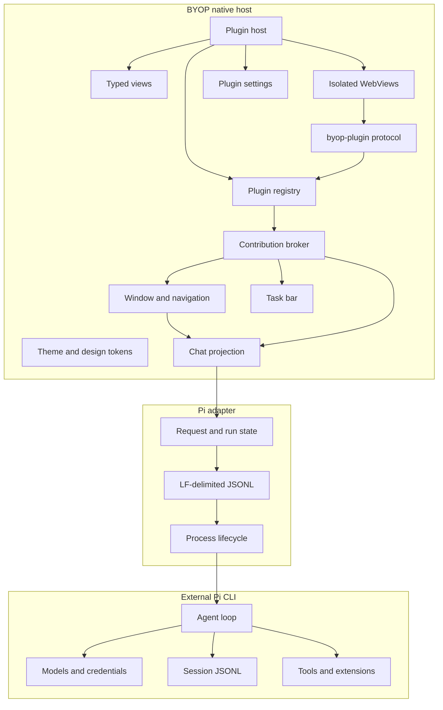
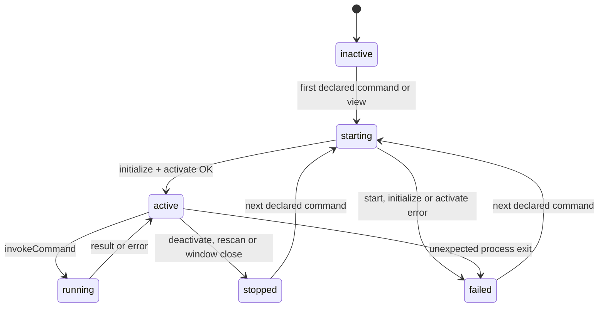

# BYOP Workbench Architecture

Status: P8 native shell, persisted external Pi sessions, read-only session
discovery and RPC-only session mutation, ordered timeline restoration, model
and thinking-level selection, transient runtime diagnostics, the P5 plugin
platform, plugin-registered automation run records, and explicit migration of
legacy Pi Agent Desktop preferences are implemented; Chat renders through
Onevra v0.2026.13 components.

## Runtime Boundary



BYOP starts `pi --mode rpc` as a child process, so Pi persists sessions in its
own store. `BYOP_PI_EPHEMERAL=1` adds `--no-session` for tests and isolated use.
Every outbound command and inbound event uses one JSON object per LF-terminated
line. Request IDs correlate command responses. The UI treats `agent_settled`
as the end of a run because retries, compaction, steering, follow-ups and
queued work may continue after an earlier `agent_end` event.

BYOP starts Pi and resolves the discovery directory from one common, absolute,
symlink-resolved workspace path (`BYOP_WORKSPACE` or the process working
directory). When `PI_CODING_AGENT_SESSION_DIR` is set, Pi stores session JSONL
files flat in that directory, so BYOP scans it non-recursively and keeps only
files whose header `cwd` matches the resolved workspace. A leading `~` is
expanded. When the variable is unset, the root is
`($PI_CODING_AGENT_DIR or ~/.pi/agent)/sessions`, and BYOP reads the resolved
workspace's `--<cwd>--` child. BYOP never changes session files or follows a
session symlink. Entries are sorted by modification time before the newest 50
are parsed; scans larger than 64 MiB and JSONL lines larger than 1 MiB are
bounded. Listing reads headers, message roles, the latest `session_info` name,
first user text and file modification time.

`new_session` and `switch_session` go through Pi RPC. Session mutations use a
generation-guarded busy state, so prompt, switch, create, model and thinking
changes cannot overlap; stale async callbacks are discarded. After a successful
create or switch, `get_messages` supplies the active branch for native
transcript reconstruction, while `get_state` supplies the active session file,
model and thinking level. Paths are compared after symlink resolution, with the
session ID as a fallback. A mismatch is reported without discarding the
reported transcript. `BYOP_PI_EPHEMERAL=1` skips discovery, hides the session
list and refuses switching. `get_available_models` and
`get_available_thinking_levels` populate the composer choices. The model picker
uses a lookup map keyed by `provider/id`, so model IDs containing `/` remain
intact. The thinking effort picker keeps its selection local while the user
clicks or drags, then commits once after the panel closes or 400 ms without
another change; stale timers are discarded. Both controls become read-only
during runs, compaction and Pi session operations. Session comparison uses the
canonical path stored after `get_state` is applied. These methods omit provider
URLs, headers and credential material from BYOP state.

P3.3a projects the following Pi session events into host-only transient state:
`queue_update`, `compaction_start`, `compaction_end`, `auto_retry_start`,
`auto_retry_end`, `agent_end` and `extension_error`. Queue details, retry
countdowns, compaction token estimates and extension failures appear in the
collapsed-by-default task panel. Provider errors from failed retry attempts do
not become assistant text blocks; only `agent_settled` decides whether a
permanent turn completed, stopped or failed.

## Ownership

| Capability | Owner | Current behavior |
|---|---|---|
| Window, navigation, themes | BYOP | Implemented natively |
| Chat transcript projection | BYOP plus Onevra components | Ordered text/tool timeline rendered as Onevra turns, activity groups and glass composer |
| Plugin metadata and contributions | BYOP | Validates manifests, scans local roots and records contribution conflicts |
| Plugin lifecycle, commands and views | BYOP Plugin Host | Starts native and Node plugins lazily, routes declared commands, renders typed views and stops processes on deactivate, rescan and window close |
| Plugin settings and host calls | BYOP Plugin Host | Persists typed values, injects settings, accepts JSON-RPC requests from plugins and enforces declared capabilities |
| Automation contributions and run state | BYOP | Validates plugin declarations, persists manual run records and enforces pause/resume and failure rules |
| Model calls and provider auth | Pi | Delegated |
| Session persistence and credentials | Pi | Pi owns JSONL and credentials; BYOP scans file metadata and conversation fields read-only for the sidebar, then mutates sessions only through RPC |
| Session list and active transcript | BYOP | Debounced discovery outside the UI goroutine; switch/create responses rebuild the native transcript through `get_messages` |
| Model and thinking state | Pi plus BYOP adapter | BYOP stores display fields and composer selection state; Pi owns the model directory, reasoning levels and credentials |
| Tools, Skills and extensions | Pi | Delegated |
| Long-running task activity | BYOP plus adapters | P3.3a projects the latest tool and transient runtime diagnostics into the task panel |
| Complex editor or visualizer UI | Plugin and BYOP WebView host | Declared WebViews are served from `byop-plugin://` and retain the plugin's existing capability boundary |

BYOP does not persist a second session index or duplicate Pi session bodies or
secrets. The in-memory sidebar cache is rebuilt by the read-only scanner;
switching, creation and transcript retrieval use Pi RPC.

## Plugin Manifest Registry

P4 treats `plugin.json` as a versioned metadata contract. The host scans each
directory below `~/.byop/plugins` and `<cwd>/.byop/plugins`, or the explicit
path list in `BYOP_PLUGINS_DIR`. A missing implicit root is ignored; a missing
explicit root becomes a visible scan issue. A child directory without a
manifest is ignored.

The parser accepts one JSON object up to 1 MiB and rejects unknown fields,
trailing JSON values and unsafe entry paths. The host records registered,
invalid, incompatible, duplicate plugin ID and duplicate contribution ID
states. Scanning never opens or executes entry files. The current host version
is `0.7.0`; manifest schema and Plugin API version are both `1`.

Each plugin is an independent local package with a manifest, a runtime entry
point and declared contribution points.

```json
{
  "schemaVersion": 1,
  "id": "example.git-workspace",
  "name": "Git Workspace",
  "version": "0.1.0",
  "runtime": "node",
  "entry": "dist/plugin.js",
  "compatibility": {
    "host": ">=0.4.0 <1.0.0",
    "pluginApi": "1"
  },
  "contributes": {
    "navigation": [{ "id": "git", "title": "Git", "icon": "git", "view": "git.status" }],
    "commands": [{ "id": "git.refresh", "title": "Refresh repository" }],
    "views": [{ "id": "git.status", "location": "main", "view": "native" }],
    "taskPanels": [{ "id": "git.tasks", "title": "Git tasks" }],
    "settings": [{
      "id": "git.settings",
      "title": "Git",
      "description": "Repository view preferences.",
      "fields": [
        {
          "key": "showDetails",
          "label": "Show details",
          "type": "boolean",
          "default": true
        }
      ]
    }],
    "webviews": [{
      "id": "git.diff",
      "title": "Git diff",
      "location": "main",
      "entry": "web/diff.html"
    }]
  },
  "activation": {
    "events": ["onCommand:git.refresh", "onView:git.status"],
    "lazy": true
  },
  "capabilities": {
    "workspace": "read",
    "files": "read",
    "network": false,
    "process": "none"
  }
}
```

Navigation contributions may point to a native view or WebView declared by the
same manifest. IDs are unique across both view types.
Setting field keys are unique across the plugin. The supported field types are
`string`, `boolean`, `number` and `select`; a plugin may declare at most 50
setting fields. Select fields require unique, non-empty options. Missing
defaults resolve to `""`, `false`, `0` or the first select option.

## Plugin Lifecycle (P4.2)

The host implements the lifecycle for `runtime: "native"` and
`runtime: "node"`. A plugin process starts only when the user opens a declared
view or runs a declared command and the manifest lists the matching
`onView:<view>` or `onCommand:<command>` event, or sets `activation.lazy:
true`. The host rejects undeclared contributions before starting anything.



The entry path must stay inside the plugin folder after symbolic links are
resolved and must be a regular file. Native entries must be executable. Node
entries must end in `.js`, `.mjs` or `.cjs`; they do not need execute
permission. The host starts either runtime without a shell, uses the plugin
folder as the working directory, and provides `BYOP_PLUGIN_ID`,
`BYOP_PLUGIN_API` and `BYOP_PLUGIN_RUNTIME`.

Transport is one JSON object per LF-terminated line over stdin/stdout. Host
requests are `{"jsonrpc":"2.0","id","method","params"}`; the plugin replies
with the same `id` and either `result` or `error`. A message containing
`method` is a plugin-to-host request when it has an `id`, or a notification
without one. Plugin requests run concurrently without blocking the host call
that is awaiting a command or view. Each process may have eight host requests
in flight; additional requests receive `host busy`. Stderr is kept as a 4 KiB
tail for failure messages.

| Method | Params | Timeout |
|---|---|---|
| `initialize` | `pluginApi`, `hostVersion`, `pluginId`, `settings`, `capabilities` | 10 s together with `activate` |
| `activate` | `reason`, for example `onCommand:hello.say` | 10 s together with `initialize` |
| `invokeCommand` | `command`, `args` | 30 s |
| `renderView` | `view`, `settings` | 10 s after activation |
| `deactivate` | empty object | 2 s, then stdin closes; kill after another 2 s |

Notifications from the host use the same JSONL channel without an `id`. P4.2
uses `settingsChanged` after a saved setting changes while the plugin process
is active.

`examples/hello-node` is the P4.2 contract fixture for the complete Node,
view, settings and host-call surface. `examples/hello-webview` is the P5
contract fixture for isolated static content, theme, bridge calls and plugin
message delivery. `examples/hello-native` remains the small native lifecycle
example.

## Node Runtime

The host resolves `BYOP_NODE` or searches `PATH`, probes `node --version` once
per host, and requires major version 25 or newer. The command is:

```text
node --permission --allow-fs-read=<pluginRoot> [capability flags] <entryRealPath>
```

| Manifest capability | Additional Node permission flag |
|---|---|
| `files: read` or `files: write` | `--allow-fs-read=<workspaceRoot>` |
| `files: write` | `--allow-fs-write=<workspaceRoot>` |
| `network: true` | `--allow-net` |
| `process: execute` | `--allow-child-process` |

Plugin and workspace paths are absolute and symlink-resolved before flags are
built. The plugin root is always readable so Node can load its entry and local
modules. Workspace access is granted only by the `files` capability.

## Plugin-to-Host Calls

Plugin requests use the same JSONL transport. The host dispatches each request
in its own goroutine, preserves the request ID exactly and writes the response
under the shared write lock. Unknown methods return `-32601`; invalid params
return `-32602`; denied capabilities return `-32001` with a message beginning
`permission denied:`; other failures return `-32000`.

| Method | Params | Required capability or declaration |
|---|---|---|
| `host.getTheme` | none | none |
| `host.getSettings` | none | none |
| `host.showNotice` | `{text,tone?}` | none |
| `host.updateTask` | `{id,detail,status?,tone?}` | `id` must name one of the plugin's task panels |
| `host.refreshView` | `{view}` | `view` must be declared by the plugin |
| `host.getWorkspace` | none | `workspace: read` or `write` |
| `host.readFile` | `{path}` | `files: read` or `write` |
| `host.writeFile` | `{path,content}` | `files: write` |

File paths are relative to the workspace, must stay inside it after symlinks
are resolved, and must name a regular file. Reads are limited to 1 MiB and
valid UTF-8. Writes are limited to 1 MiB, require an existing parent directory,
write through a temporary file in that directory and atomically replace the
destination with mode `0644`. The runtime status records host-call and denied
call counts.

## Typed Native Views

`renderView` returns a JSON model. The outer object accepts only `title` and
`blocks`; known block objects reject unknown fields. An unknown block `type`
renders as a muted **Unsupported block** line rather than failing the entire
view.

```json
{
  "title": "Optional override",
  "blocks": [
    { "type": "heading", "text": "Heading" },
    { "type": "text", "text": "Body text" },
    { "type": "notice", "tone": "info", "text": "Notice" },
    { "type": "keyValue", "items": [{ "label": "Key", "value": "Value" }] },
    { "type": "list", "items": [{ "title": "Title", "detail": "Detail" }] },
    { "type": "code", "text": "monospace" },
    { "type": "button", "label": "Run", "command": "example.run", "args": {} }
  ]
}
```

A view may contain at most 200 blocks and a block may contain at most 100
items. Strings are truncated to 4000 runes. Button args must be a JSON object
no larger than 64 KiB. A button whose command is not declared by the same
plugin is disabled with an **Undeclared command** tooltip.

Main views can appear in the sidebar when a navigation contribution references
them. Secondary views are listed on the plugin card and are not rendered in
P4.2. Rendering runs off the UI goroutine, while the UI caches the last model
for each plugin and view.

## Plugin Settings

Settings are stored at
`<configDir>/plugin-settings/<pluginId>.json`, where `configDir` is
`BYOP_CONFIG_DIR` or `~/.byop`. The directory is mode `0700`; files are mode
`0600` and use atomic replacement. Loading merges declared defaults with valid
saved values and drops unknown keys. Invalid typed values fall back to their
default.

The Settings page renders one card per setting contribution. String and number
fields use text inputs, booleans use switches and selects use chip buttons.
Saving persists all declared values. When the plugin is active, the host then
sends a `settingsChanged` notification containing the merged setting object.

## Enforcement Boundary

| Runtime | OS enforcement | Host API enforcement |
|---|---|---|
| Node | Node permission model plus declared filesystem, network and process flags | Every host call is checked against the manifest |
| Native | None; the process runs with the current user's permissions | Every host call is checked against the manifest |

The `workspace`, `files`, `network` and `process` values on native plugins are
declarative. They appear in the plugin card but cannot sandbox an arbitrary
native executable.

## P5 WebView Hosting

The host registers the `byop-plugin` scheme with MyGo before creating the
window. Each WebView is created lazily from a navigation click and reused for
the life of its registered contribution.

```text
byop-plugin://<pluginId>/<relative-path>
```

The handler looks up the plugin in the current, mutex-protected registry
snapshot. It serves only GET and HEAD requests for regular files inside the
resolved plugin root. Path traversal, encoded paths, directory targets,
symlink escapes, unknown plugins and files over 5 MiB return 404. Responses set
`Content-Type`, `X-Content-Type-Options: nosniff` and `Cache-Control: no-store`.

Every response uses this base policy:

```text
default-src 'none'; script-src 'self'; style-src 'self' 'unsafe-inline';
img-src 'self' data:; font-src 'self'; connect-src 'none';
media-src 'self'; frame-src 'none'; object-src 'none';
base-uri 'none'; form-action 'none'
```

Only a plugin with `capabilities.network: true` receives `connect-src https:`;
WebView declarations do not add capabilities. Inline scripts and inline event
handlers remain blocked.

Each page is locked to the same plugin host. `OnWillNavigate` rejects every
other scheme or plugin identity, `SetWindowOpenHandler` returns nil, and
`SetPermissionHandler` denies all requests. External links therefore cannot
navigate or open a child window.

The bridge is one MyGo service, `BYOPWebView`. Its `Call` method resolves the
calling page with `mygo.CallerPage(ctx)`, then finds the unique WebView state
whose `Page()` matches. It does not accept a plugin identity from the page. On
every call it also verifies:

- the current URL still uses the mapped plugin host and a safe path;
- the plugin remains registered;
- the mapped view and entry are still declared;
- the manifest/root fingerprint still matches the instance.

Plugin pages obtain host business capabilities only through the bridge.
`host.*` calls use the same `handleHostCall` dispatcher and capability checks as
native and Node plugins. `plugin.postMessage` accepts one JSON message up to
64 KiB, activates the plugin for `onWebView:<viewID>`, and invokes the
`webviewMessage` JSONL method. Each plugin has a shared bridge semaphore.

`Protocol.Handle` makes `byop-plugin` pages trusted to MyGo. MyGo v0.5.5
therefore exposes the built-in `mygo:window` service on every handled scheme,
and `window.mygo` is non-configurable. A plugin page can close, minimize or
toggle fullscreen on the host window and change its title without using the
bridge. Closing the window also triggers BYOP shutdown. Upstream follow-up:
request a per-page or per-scheme way to disable `mygo:window`, or a way to
expose only selected `BindAs` services on handled custom schemes.

The preload script exposes `window.byop.call`, `postMessage`, `onTheme` and
`theme`. It maps the host palette to `--byop-*` CSS variables, keeps
`--byop-font-body` at 14 px and updates `color-scheme`. Theme changes update
the WebView background and emit the `byop.theme` event to each live page. Each
completed page load also emits the current theme to that page so reloads and
same-plugin navigation do not retain the theme captured when the WebView was
created.

`NewWebView`, load and render-process failures switch the view to a native
warning card with Reload and Back to Plugins actions. Rescanning destroys
instances whose plugin, contribution, entry or manifest/root fingerprint no
longer matches. Deactivation, plugin stopping and window close also destroy
the affected WebViews. Leaving the view hides the instance and keeps it
available for reuse.

## Planned Plugin Runtime Contract

The methods below remain future work.

| Direction | Method | Purpose |
|---|---|---|
| Host → Plugin | `cancel` | Cancel one long-running operation |
| Plugin → Host | `host.emit` | Notify the registry of an event |

## P7 Automation and Loop Contract

Plugins register automations under `contributes.automations`. Each item has an
ID, title, optional description, a command declared by the same plugin, one of
the `manual`, `once`, `scheduledLoop` or `sessionLoop` kinds, an optional rule,
an optional missed policy and a maximum duration. The command must also appear
as the exact `onCommand:<command>` activation event, so lazy activation can
start the plugin when a run begins.

| Kind | Required rule | Accepted rule types |
|---|---|---|
| `manual` | None | — |
| `once` | Required | `at` with RFC3339 time |
| `scheduledLoop` | Required | `interval` (at least 5 minutes) or 5-field `cron` |
| `sessionLoop` | Required | `interval`, `cron` or `afterSettled` |

`missedPolicy` accepts an empty value (meaning `catchUpLatest`), `catchUpLatest`
or `skip`. `maxDurationMinutes` defaults to 30 when omitted and is bounded to
1–1440. Rules and activation are validated when the plugin registry is scanned.
P7 has no timed scheduler, ticker or live duration refresh: interval, cron and
`at` declarations are validated and displayed only, and the sole trigger is the
manual **Run now** action with `trigger: "manual"`.

Automation state lives under `<pluginConfigDir()>/automations/`. `state.json`
maps `<pluginID>/<automationID>` to enabled state, consecutive failures,
auto-pause reason, pause time, last run time and last state. Each automation has
a `runs/<pluginID>/<automationID>.jsonl` file containing `running` and final
records, plus an optional `archive/<pluginID>/<automationID>.jsonl` overflow
file. The active file keeps the newest 200 records. Starting a run appends one
receipt inside the store lock; finishing the run atomically replaces the active
file with its complete record set. Overflow records are appended to the archive.
`state.json` is also replaced atomically.

Recovery scans `runs/` only and parses each JSONL file line by line. Invalid
lines are skipped with a store warning while valid records remain available;
files whose names contain `.corrupt-` are ignored during this scan. If an
active run file exceeds the 200-record cap, startup moves the overflow records
to the archive and atomically rewrites the active file instead of quarantining
it. Recovery then converts any valid `running` record to `aborted` with error
code `interrupted`. If a run file has no parseable records, including after a
read failure, it is first renamed to
`<name>.corrupt-<UTC timestamp>.jsonl` in the archive directory. Valid records
that precede a read failure remain in the in-memory snapshot. Likewise, an
empty or corrupt `state.json` is renamed to
`state.corrupt-<UTC timestamp>.json` before a replacement is saved. Directories
use mode `0700` and files use `0600`.

At startup, an unfinished record becomes `aborted` with error code
`interrupted`, and enabled session Loops pause with reason `appRestarted`.
Failure and timeout increment the consecutive count. Success resets it only
when the automation is still enabled and has no paused marker. At five
consecutive failures the automation is disabled with reason
`consecutiveFailures`. Resume re-enables it and clears the count. A user pause
does not cancel an active run, so its final result is still recorded, but a
successful finish preserves the pause and failure count; only Resume clears
both the pause and count.

Run invocation uses the existing plugin command path with a timeout derived
from `maxDurationMinutes`. Timeout records use `errorCode: "timeLimit"`; other
command errors use `errorCode: "pluginError"`. Timeout detection uses
`errors.Is(err, context.DeadlineExceeded)`. A pending command interrupted by an
intentional plugin stop returns an `errPluginStopped` sentinel; the run becomes
`aborted` with error code `stopped` and does not increment consecutive failures.
The stop sentinel covers deactivation, rescan and window close.

The store maintains in-memory state and capped recent-run snapshots. Load,
begin, finish, pause, resume and startup recovery update those maps under the
store mutex. The Automations page copies its state, running flag and newest five
runs through one short lock and performs no file I/O on the draw path. Plugin
rescans rebuild the registry and contribution cards without reopening the
automation store, so startup recovery runs once and state remains keyed by
plugin and automation IDs. Stored state for a no-longer-registered plugin is
not shown.

## Plugin Development Hold

After P5, the plugin platform is functionally ready for local native, Node and
declared WebView surfaces. No feature plugin will be developed until Lex
explicitly asks. The earlier Library and Document placeholder pages and
navigation entries were removed in P5 and must not be implemented as feature
plugins. `examples/` contains contract fixtures only.

## Migration Map

| Current Pi Agent Desktop area | BYOP direction |
|---|---|
| Tauri window and native webview shell | Rewrite with MyGo native host |
| React/Next chat interface | Rewrite as native Chat and typed view models |
| Embedded Pi SDK runtime | Remove; use external Pi CLI RPC |
| Sessions, models, credentials | Keep in Pi; sessions are discovered read-only and all mutations use RPC |
| Skills and extensions | Keep in Pi; expose status and commands through adapters |
| Tool execution timelines | Ordered native text/tool blocks implemented for the active run |
| Mermaid, KaTeX, xterm, rich document editor | Consider declared WebView plugins |
| Themes, sidebar widths, drafts | Themes and drafts have BYOP preferences with explicit, idempotent import; legacy width and scale values are preserved without changing BYOP layout |
| Scheduled tasks and Loop semantics | Rebuild in BYOP with plugin-owned jobs |

## Next Phases

| Phase | Scope |
|---|---|
| P3.1 | Structured tool lifecycle, native cards and active-tool task state |
| P3.2 | Ordered text/tool timeline, in-place lifecycle updates and automatic folding |
| P3.2a | Onevra Chat reading area, turn summaries, activity rows and glass composer; task panel collapsed by default |
| P3.3a | Queue, compaction, retry, extension-error and Stop-during-retry diagnostics |
| P4 | Strict manifest validation, local root discovery, registry search and duplicate/conflict reporting |
| P4.1 | Native lazy activation, lifecycle states, declared command routing, deactivate and shutdown cleanup |
| P4.2 | Node runtime, typed view/settings invocation, plugin-to-host calls and permission enforcement |
| P5 | Isolated WebView scheme, bridge identity and capability reuse, theme bridge, navigation lock, lifecycle and native fallback (implemented) |
| P6a | New BYOP logo, persisted Pi sessions, read-only session list, RPC session switching/restore and model/thinking RPC state (implemented) |
| P6b | Model and thinking-level picker UI (implemented) |
| P7 | Automation and Loop contributions, manual run records, failure auto-pause and pause/resume (implemented) |
| P8 | Import old desktop preferences and migration verification (implemented) |
